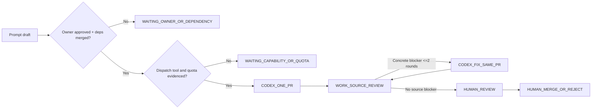
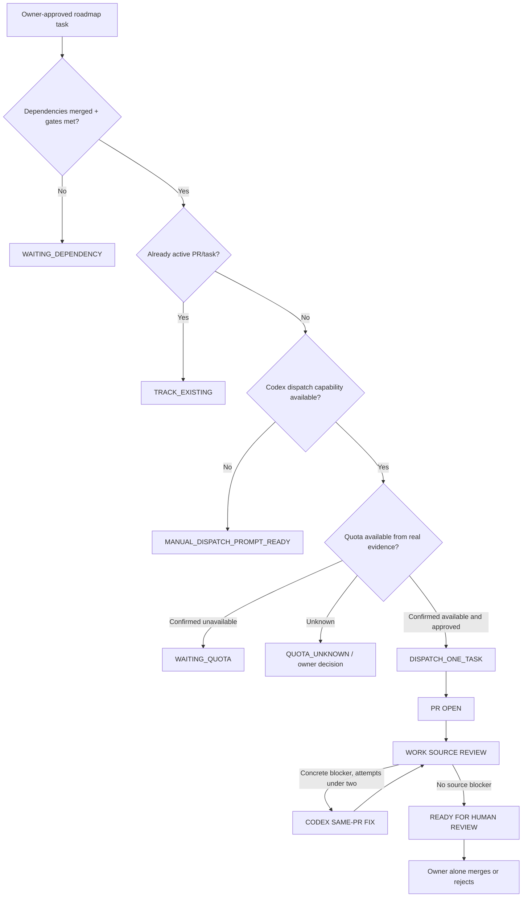

# GASILKO — V2 DEPENDENCIES & EXECUTION GATES

Date 2026-10-28. All milestones in `automation/queue.json` have `approved_by_owner=false`. No automatic dispatch permitted merely because a prompt exists.

## Recommended operator sequence

1. Recheck latest PR #82 head; if SQL delimiters remain wrong, use prompt **00** on the **same branch**.
2. Owner performs PR review/merge; applies SQL; performs Android Room v15 human build/schema export; configures TRAINING with Web commander and two real accounts/devices. Do not assume those actions happened.
3. If actual pilot defects exist, authorize **01** with evidence; otherwise skip.
4. On human approval and merged dependencies, authorize **02 M14.7B1** snapshot/change feed, then **03 M14.7B2** private Realtime.
5. Proceed with approved Android unit leadership/map/offline reliability and M14.10 closure/reporting; optional SIM/hydrants/platform streams based on owner priorities.
6. External CAD/112, real GPS, UAS and AR cannot be queued as authorized work until separate explicit agreement/privacy/scope approvals.

## State flow

**A PR marked 'source-ready' is NOT compiled, tested, installed, nor production certified.**

# GASILKO — DEPENDENCY AND DISPATCH GATES

## Hard rules

- Owner alone merges, applies SQL, deploys, approves external access/changes and release.
- PR review finding does not automatically equal a new milestone.
- Source correctness ≠ production readiness. Human SQL/Room/field validation required.
- A new milestone can be dispatched only when its dependencies are actually merged and owner approved its implementation. Human SQL rollout and field findings may be blocking gates even after code merge.
- Independent feature work may start before unrelated PR merge, but only with explicit owner approval and merged-main base; no unapproved stacking on PR branches.
- Review Work and coding Codex share or may share usage quotas; do not infer the exact balance. If quota cannot be checked, mark UNKNOWN and ask owner to authorize any single attempted dispatch rather than asserting sufficient tokens.
- Max 2 automated correction requests per open PR head lineage. Never auto-release another new PR simply because one PR is READY_FOR_HUMAN_REVIEW if the next feature depends on pending owner merge.

## Work state machine

## Evidence before dispatch

Store at minimum: `code`, `source_branches`, `base_SHA`, `required_merged_PRs`, `owner_approval`, `task_id`, `attempts`, `latest_reviewed_SHA`, `quota_state`, `last_error`, `manual_gate`, `last_update`. Re-fetch current GitHub status on every action and verify latest SHA.

**Quota and reset**: use only supported live usage fields or actual `rate_limit`/`insufficient_quota` dispatch failure. If no signal: UNKNOWN. No invented reset intervals, background retry loops, credit purchases or model entitlement claims. A scheduled follow-up is useful only if supported and user authorized it; does not guarantee quota availability.

## Definition of ready for owner

`READY_FOR_HUMAN_SOURCE_REVIEW`: no confirmed blocker from current-source review; does not imply compiled/tested/runtime/security verified.

`READY_FOR_MERGE`: decision only after human review. Work never emits this as an action or performs it.

`HUMAN_VERIFIED`: human logs actual SQL result, Android Room migration, offline/permission/manual scenarios, test results if applicable, and release approval. Codex cannot claim it.

## Source priority

1. Actual current repository schema, source code, current GitHub PR head.
2. Current approved `docs/SPEC.md`, `docs/SPEC-M14-INCIDENT-OPERATIONS.md`, `AGENTS.md` (report instruction conflict).
3. Owner-confirmed architecture decisions.
4. This prompt packet and prior handoff snapshot.
5. Historical Codex prompt bodies and PR summaries, as context only (not runtime proof).

## Unmerged PR #82

As-of 2026-10-28, #82 is OPEN. Use prompt `00` only if the latest actual head still contains the defect. Do NOT dispatch #02 or later based on unmerged #82. Human must complete field-pilot setup and approval independently.
