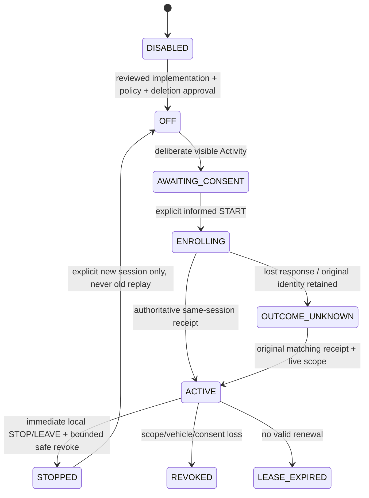

# M14.8C2 / M15 — consented vehicle-phone REAL GPS: disabled capability foundation

**2026-11-02 — SOURCE CODE ONLY. PARTIAL IMPLEMENTATION UNDER §12 OF THE ROOT ASSIGNMENT.**
**NOT POLICY-APPROVED / NOT DEPLOYED / NOT TESTED, BUILT OR RUN / NO GPS COLLECTED.**
This PR does **not** implement operational vehicle tracking, phone enrollment,
START/STOP, latest-position ingestion, foreground sharing or REAL markers.
It implements a real authenticated, read-only, permanently-disabled capability
check end to end. No pretend producer, consent acceptance or coordinate is supplied.

## Baseline and dependency evidence

- GitHub main before edits: `5295070e9e0b54ebc6eae1319b91e3eeb57dbd1d`.
- PR #91 is MERGED; head `07f51406a0a3898f6dcac35f63a68ce493b79aea`;
  merge `8087e206d178faaf5b43a5a50a466ad00ce2d639`.
- GitHub compare #91 head → baseline: ahead2 / behind0. No overlapping open PRs
  at inspection. This new branch starts from merged main, not #91's old base.
- Root `M14.8C2.txt` is the current assignment. Archived SPECS C2 is an older
  design, not evidence of current implementation, approval or deployment.
- Read AGENTS, primary SPEC and M14 §7/13, B1/B2/B/C1/C3/D1/D2 source/docs,
  canonical inventory/crew/command/NAV/SIM/receipt contracts, Android
  manifest/location/security/cache and Web COP/API/live boundaries.
- Owner no-test/no-execution instruction overrides AGENTS' normal validation
  requirements for this task. Release validation remains outstanding; AGENTS unchanged.

## Decision and actual blockers

The root assignment §6 explicitly forbids retention based only on future traffic
and a new unsanctioned scheduler; §12 permits only safe source-backed parts
when retention, device/consent or other mandatory requirements cannot safely
be achieved. The earlier SPECS C2 packet also gates implementation on privacy approval.

1. **OWNER POLICY APPROVAL REQUIRED:** no approved precise-reader audience,
   driver notice/policy version, cross-agency scope, maximum session lease,
   offline withdrawal risk or named activation sign-off is supplied.
   The assignment explicitly says it is not policy approval.
2. **RETENTION BLOCKER:** inspected source/config contains no approved GPS
   physical-deletion mechanism that runs without incoming traffic. M10's
   on-claim cleanup and B1's read-triggered pruning are not that guarantee.
   Existence of external Cron is unverified; none is configured or assumed here.
   Adding a new job without approval is expressly prohibited.
3. **DEVICE BINDING BLOCKER:** existing M10 installation UUID/FCM registration
   is not proof of possession of a vehicle-phone sharing session. Registration
   accepts caller-supplied installation UUID/token and can rebind a row's
   user_id on conflict. Keystore encrypts local auth/lease state but provides no
   registered server-verifiable sharing device key/credential. This is a
   source-contract gap, **not** a claim that M10 notifications are broken.
   Do not convert that UUID or FCM token into a GPS credential.
4. **DEPENDENCY ROLLOUT UNKNOWN:** owner reports #86 attachment SQL failed;
   #87–90 SQL and evidence Edge/Storage/Realtime/client rollout are not confirmed.
   No remote DB inspection, remediation or deployment is authorized.

Canonical vehicle and driver identities **do exist**. They are not an excuse
to invent a missing device/security/retention contract. The feature stays OFF
in both clients and server; completing these gates requires a reviewed follow-up.
This is a deliberate bounded subset, **not completion of the full C2/M15 goal**.

## As found / new / owner decisions

| Contract | VERIFIED AS FOUND | NEW implementation here | OWNER POLICY APPROVAL REQUIRED |
|---|---|---|---|
| Vehicle | public.operational_vehicles(id UUID PK, organization_id), UNIQUE(id,organization_id); callsign/name, active, availability | none; no parallel vehicle registry | eligible owner/cross-agency vehicle context |
| Unit/deployment | operational_units.vehicle_id + organization FK → vehicles; incident_units(unit_id,organization_id) FK → units; (id,incident_id,organization_id) unique, participant same-incident/org FK | none | which eligible VEHICLE_CREW can be paired |
| Crew/driver | incident_crew_members.unit_assignment_id + incident_id + membership_organization_id FK; crew_role DRIVER/LEADER/RESPONDER/SPECIALIST, ACTIVE/LEFT | none | designated driver vs effective leader priority/takeover |
| Effective command | incident_role_assignments UNIT_LEADER + private.incident_assignment_effective; private.field_unit_leader and field_unit_visible | no new role or grant | precise-reader audience; hierarchy/unit-name visibility is not GPS authority |
| Lifecycle/mode | incidents ACTIVE/STABILIZED/CLOSED/CANCELLED; simulation_scenarios membership is authoritative TRAINING even when SIM disabled | capability returns REAL/TRAINING label, always OFF | only ACTIVE REAL enrollment in future; STABILIZED sharing policy unresolved |
| Org/account | auth.uid, private.is_active_user / incident_acting_member / can_read_incident; selected org and participation | same incident_sync_head authorization, current caller echo | no widening of memberships or precise location access |
| Device | private.notification_devices(installation PK,user_id,token,active,revision); register_notification_device(uuid,text,boolean); caller-chosen installation, account rebind; no GPS proof-of-possession | none; no token copied or device registration created | vetted sharing-device possession and revocation protocol |
| Android security | KeystoreSessionManager AES/GCM for SDK session/PKCE, authorization and incident lease; secure clear on signout | no sensitive material stored | vetted minimal sharing credential and local revocation-intent protection |
| Android GPS | feature/map/ForegroundLocation.kt uses LocationManager callbackFlow; coarse/fine, elapsed freshness, STARTED screen; no network/store | **no reuse for uploading**, no acquisition call | explicit permission+consent+visible-Activity FGS lifecycle |
| SDK/manifest | min26 / compile36 / target36; COARSE/FINE, notification permission; FCM service only, no location FGS | unchanged | FGS/LOCATION permission/service only after actual approved producer contract |
| Local cache/sync | RegistryDatabase version16; incident_field_cache + incident_sync_cursor; original queue, HydrantSyncWorker; 24h field lease /2h warning, registry30d separate | optional nonpersistent read through same repository; no cursor write | no GPS cache without reviewed privacy/expiry model |
| B1/C1/C3 | pinned atomic cursor/projection; field_map schema1, independent NAV source; C3 null-only unavailable model | reused notice + explicit capability card | future independent authorized REAL source scope/watermark |
| Web | same-origin authenticated incidents Next route, X-Gasilko-Account, existing COP/mapStatus/live fingerprint | one allowlisted manual read, identity-keyed transient result | no socket/polling/coordinate viewer authority added |
| Receipts | private.incident_operation_receipts immutable operation_id + actor/org/incident/command/request/result; canonical locks/version checks | none: capability read has no operation/side effects | freeze START/STOP exact identity; do not store samples in receipts/audit |
| SIM/NAV | simulation_unit_positions CHECK SIMULATED; NAV ACTUAL_POSITION → NAV_POSITION_UNAVAILABLE; manual/SIM planning origins | unchanged | no implicit NAV enrollment or conversion to observations |
| Retention | B1 pruning and M10 delivery cleanup are traffic-driven; SIM runner scheduling is separate optional infrastructure | no Cron/job/table/storage | approved deletion SLA including no traffic, backup/restore and legal policy |

Concrete source evidence: migrations `20261007100000_operational_inventory_schema.sql`,
`20261007101000_operational_inventory_api.sql`,
`20261007103000_incident_resource_commands.sql`,
`20261007104000_incident_resource_reads.sql`,
`20261005140000_notifications.sql`,
`20261027100000_incident_android_field_pilot.sql`,
`20261030100000_incident_snapshot_protocol.sql`,
`20261030180000_android_unit_leadership.sql`,
`20261030200000_incident_field_map.sql`, `supabase/config.toml`,
`core/auth/KeystoreSessionManager.kt`, `core/notifications/Notifications.kt`,
`feature/map/ForegroundLocation.kt` and current C3 adapters.

## MoSCoW / scope actually delivered

**MUST delivered:** server+client OFF, authenticated capability check, exact caller/
org/incident binding, safe missing-server result, no implicit enrollment, no GPS
in any store/queue/log/transport, no unrelated incident revocation, localization.
**MUST BLOCKED:** sharing M1–M15 and positive M11 marker presentation, opt-in FGS,
leases/takeover/STOP receipts, latest-point validation/retention and precise-reader
scope. These are not marked complete.
**Preserved:** M16 Room16/B1/D1/D2; M17 no new worker/poller/Cron;
M18 OFF; M19 forward-only unexecuted SQL; M20 no operational-release claim.
**SHOULD/COULD blocked:** accepted-fix UI, real overlap, accuracy ring, heartbeat.
**WILL NOT:** covert/remote/boot start, BACKGROUND_LOCATION, trails, driver
scoring, predictions, task/status/NAV changes, new vehicle registry/dependencies.

## Actual SQL / grants / response

New forward-only file:
`supabase/migrations/20261102140000_incident_vehicle_location_capability.sql`.

Only new function:
```sql
public.incident_vehicle_location_capabilities(
  p_acting_organization_id uuid,
  p_incident_id uuid
) RETURNS jsonb
```
No new tables/columns/FKs/indexes/RLS policies, receipt store or mutation RPC.
No START/SAMPLE/STOP illustrative names in the assignment are implemented.

Function is SECURITY DEFINER, owner postgres, search_path='', lock_timeout1500ms.
PUBLIC/anon/authenticated/service_role defaults explicitly revoked; only
authenticated EXECUTE granted. No direct table privilege is added.
It rejects null IDs (P0001 VALIDATION_FAILED), then calls existing
incident_sync_head(uuid,uuid): current authenticated ACTIVE user, exact acting-org
membership and current incident access/participation, same org→actor→incident
locks, generic42501 denial. It does not materialize commander context,
field/map geometry, unit roster or GPS. Scenario existence labels TRAINING.
Response is a constant-sized14-field document, independent of unit count:

```text
schema_version=1; account=auth.uid(); organization=requested org;
incident_id=requested incident; scope_fingerprint=existing Web head scope;
mode=REAL|TRAINING; state=DISABLED;
enabled=false; producer_available=false; reader_available=false;
policy_approved=false; retention_ready=false; device_binding_ready=false.
```

OFF is structural: no GUC, environment variable, client request, admin action or
database flag can turn this function ON. Clients also have literal false producer
gates, accept only the exact disabled schema, and do not contain a publisher.
A future ON response is unsupported, **not** permission to track.
A reviewed forward implementation is needed to add that capability.

The head fingerprint is Web authorization scope, **not** Android's B1 field
fingerprint and not a precise GPS permission. Web compares it to its existing
live head. Android independently rechecks its secure Room incident lease/current
projection around the RPC; it does not compare unlike fingerprint types.
Read transactions do not mutate canonical revision/sequence, receipts or cursors.
Repeated reads are side-effect-free; idempotent write/replay/anti-sample-replay
semantics do not exist yet because there is no command or sample endpoint.

## Actual client flow, identity and cancellation

```mermaid
sequenceDiagram
  actor U as Current user
  participant UI as Existing C3 notice / Units dialog
  participant VM as Android ViewModel
  participant R as Existing repository / Web authenticated API
  participant DB as Capability RPC → existing sync head
  U->>UI: Explicit Check availability
  UI->>VM: Android only, current model/scope
  VM->>R: Verify selected identity and valid field lease
  UI->>R: Web only, current account header + acting org
  R->>DB: One bounded read; no GPS or consent payload
  DB->>DB: Existing current authorization + locks
  DB-->>R: DISABLED, false flags, authorized binding
  R-->>UI: Exact supported OFF result or unavailable
  Note over UI,DB: No session, capture, sample, receipt, marker or command
```

Android: existing C1 Units dialog includes the new card; Compose → ViewModel →
IncidentRepository. Same remote mutex and credential-change mutex, secure lease
and selected-account/org guards are reused before/after suspension.
The read has a5s cancellation budget including mutex wait, no background retry.
The result is not saved in Room or used to renew its lease.
Compose result/request state is keyed to model/incident/B1 fingerprint and
disposed when dialog closes or protected screen locks; old jobs are cancelled.
Failure/unknown schema/identity mismatch shows unverified, always OFF.
No failure invokes revokeIncident, removes field data or touches pending evidence.

Web: expanded existing C3 mapStatus notice contains the check. Component key
contains account/org/incident/live authorization fingerprint/locked state.
Unmount aborts and rejects late results. A ref prevents simultaneous clicks;
Strict Mode performs no fetch on mount. One read per opened component,5s abort
budget, no poll/retry loop. Exact response shape/binding/Web fingerprint checked.
No protected filenames, device identity, coordinate, frozen command or persistent
browser storage. Read error is local to this card, not RTS revocation.

UI state: OFF/IDLE → manual READING → confirmed OFF or UNVERIFIED/OFF;
scope loss/disposal cancels and discards result. A remount or scope change permits
another manual check (Android: close/reopen Units); merely collapsing Web details
does not remount the card. Never ACTIVE/ENROLLING or a fake successful STOP.
Default/sl and German explain blockers, no capture and OS permission≠consent.
C3 still accepts no observations and retains immutable null coordinate/time/
accuracy fields. Its120/900s legend stays conditional, not an active timer.
No REAL map layer, retained coordinate or freshness calculation is introduced.

## Future source design — NOT IMPLEMENTED OR APPROVED

After gates, source design must use existing vehicle/deployment/crew UUIDs and
owner org FK chain; prove current driver/effective-leader eligibility at commit.
It needs a vetted device holder/generation, one active vehicle/deployment lease,
server-owned version/sequence/timestamps, actor-bound immutable START/STOP
receipts without GPS, and a latest-only private ephemeral observation store.
Do not reuse canonical request receipts for coordinate samples or add a GPS trail.

Required transaction order (future): authorize exact actor/org/current REAL ACTIVE
deployment → scoped lock → exact immutable receipt replay/CAS generation →
session metadata → bounded metadata-only audit → response. Sample independently
rechecks policy/consent/holder/device/generation/lease/sequence, valid finite WGS84,
accuracy and trusted age; latest-only replace under same stop/sample lock.
STOP owner proof must work even after loss of controller authority, delete latest
point/revoke generation atomically. Lost-response START must not resurrect STOP.
No such mutation/DDL is shipped in this partial milestone.

Future state machine, blocked until contracts are approved:

Only DISABLED and its capability-check UI are reachable in this PR.
No durable stop intent can be lost here because no session/capture can start.
Do not interpret that as implementation of offline withdrawal.

## Privacy / threats / retention gate

| Threat | Implemented boundary | Missing future guarantee |
|---|---|---|
| Silent tracking / admin activation | no producer, capture call, enrollment API, service or ON switch | reviewed opt-in consent/FGS |
| Forged/rebound device ID | no notification UUID accepted as GPS authority | holder proof/secure credential lifecycle |
| GPS in receipts/logs/push | endpoint accepts only org/incident; returns no coordinates; no telemetry writer | enforce redaction end to end on future ingestion |
| Replay / old-device takeover | no start/sample endpoint or source generation | immutable replay/CAS/lease design |
| Driver scope/cross-org visibility | same current incident read authority; no precise data ever returned | narrower separately approved precise-reader audience |
| Stale async result | account/org/incident/fingerprint keys, cancellation and lease checks | true source revocation watermark under active producer |
| Expired point retained forever | no coordinate is stored at all | approved no-traffic physical cleanup and backup/restore handling |
| Lost phone/offline stop | cannot pair or collect | bounded lease + durable non-coordinate revoke + no backlog |
| Misread green/SIM marker | C3 stays null-only; SIM/NAV unchanged | genuine accepted REAL renderer and timing anchor |

Unresolved policy checklist: purpose/lawful basis, participating orgs, driver
notice Sl/De, precise audience, cross-agency policy, eligible vehicle/driver,
session length/renewal, disconnected withdrawal risk, current120s/expiry900s,
physical deletion SLA/job owner, backup restoration, named acceptance/activation.
No legal compliance or deletion guarantee is inferred. No new Cron/worker is
added. A SQL WHERE expiry filter alone must never be sold as physical deletion.

## Android FGS / maps: exact limitation

No manifest edit, location FGS, notification channel/action, locked-screen share,
permission request or Leave vehicle implementation. Existing own-phone blue dot
and foreground map/navigation location remain their original local-only paths.
No on-boot/FCM/login/WorkManager start or persistent sample backlog.
Source min26/target36 requires a later real implementation to satisfy current
Android foreground-start/while-in-use rules, service type=location and required
FOREGROUND_SERVICE + FOREGROUND_SERVICE_LOCATION declarations; no
ACCESS_BACKGROUND_LOCATION. Starting from background is not a safe workaround.
Official sources reviewed2026-11-02:
[service types](https://developer.android.com/develop/background-work/services/fgs/service-types),
[foreground-start restrictions](https://developer.android.com/develop/background-work/services/fgs/restrictions-bg-start).
These are future implementation requirements, not runtime verification.

Web/Android maps continue C1/C3 unavailable behavior. No new per-unit reads,
poller, map instance, collision stack, feature/layer, timer-based GPS ageing or
camera update. Targets, hydrants, route geometry, selected/priority objects and
original UUID command selection are unchanged; REAL/SIM remain separate.
No NAV ACTUAL_POSITION support is enabled.

## Owner-only forward rollout / backout

Do not deploy or enable tracking. This feature has no deployable tracking path.
Owner later records actual project/object/signature/applied-output state:
1. Review/merge pinned source only if accepted. Preserve developer edits/local
   settings and existing Room pending evidence. No forced reset.
2. Reconcile #82 `20261027100000_incident_android_field_pilot.sql`,
   #83 `20261030100000_incident_snapshot_protocol.sql`,
   #84 `20261030120000_incident_private_realtime.sql`,
   #85 `20261030140000_incident_scoped_messages.sql`.
   Owner reports applied; this run did not verify. Do **not** blindly rerun.
3. Resolve reported #86 `20261030160000_incident_private_attachments.sql`
   syntax/partial-install blocker using actual DB evidence and a separately
   reviewed correction. This PR does not fix or assume it succeeded.
4. Only after dependencies, apply unapplied corrected #87
   `20261030180000_android_unit_leadership.sql`, #88
   `20261030200000_incident_field_map.sql`, #89
   `20261102100000_incident_field_receipt_recovery.sql`, #90
   `20261102120000_incident_field_reliability.sql`; #91 has no SQL.
5. Review this new `20261102140000_incident_vehicle_location_capability.sql`
   and apply only when compatible prerequisites are installed. No activation.
6. Owner verifies incident-evidence Edge/private Storage/JPEG/WebP/PDF20MiB,
   B2 private Realtime/RLS/fallback, matching Web and Android Room16 builds.
   No Edge/Storage/Realtime/Cron/secrets change belongs to this PR.
7. Record manual results separately; approve privacy and reliable physical
   deletion and vetted device binding before commissioning a real producer.
   No amount of toggling client UI makes this partial branch ready for GPS.

Old clients do not call the additive read; new clients + old server show
unverified/OFF. Room16 and field_map schema1 remain; no generated schemas.
Disable the optional card/API allowlist for backout; no coordinate table/rows to
delete or historical migration to rewrite. If future rollout ever stores GPS,
backout must first stop producers/revoke sessions/delete current points under an
approved process; hiding UI alone will be insufficient.

## Manual acceptance — exactly100 cases, all UNEXECUTED

No automated test, harness, runtime probe or manual case was executed.
Cases requiring a real source/policy are BLOCKED; they are requirements for a
future complete implementation, not claims about this subset.

| ID | Owner scenario | Expected evidence / limitation | Status |
|---|---|---|---|
| C2-001 | Initial server capability | Authorized read returns DISABLED and all six booleans false; no GPS rows or receipts are written. | UNEXECUTED |
| C2-002 | Android initial view | Units dialog shows sharing OFF before any network call; opening never requests location permission. | UNEXECUTED |
| C2-003 | Web initial view | C3 notice remains no-position; opening the page never starts capability or GPS polling. | UNEXECUTED |
| C2-004 | Explicit Android check | One user action reaches ViewModel → existing repository → capability RPC, then confirmed OFF. | UNEXECUTED |
| C2-005 | Explicit Web check | One same-origin account-scoped API call; matching live-head fingerprint required; confirmed OFF. | UNEXECUTED |
| C2-006 | Anonymous RPC | EXECUTE unavailable to anon/PUBLIC; no incident existence or source data disclosed. | UNEXECUTED |
| C2-007 | Suspended account | Existing current incident authorization denies; capability stays OFF and no capture starts. | UNEXECUTED |
| C2-008 | Inactive organization | Existing acting-membership check denies without a new authorization model. | UNEXECUTED |
| C2-009 | Cross-org incident read | Unauthorized selected-org/incident pair denied; no roster or coordinate returned. | UNEXECUTED |
| C2-010 | Null RPC arguments | P0001 VALIDATION_FAILED; no canonical state or receipt side effect. | UNEXECUTED |
| C2-011 | TRAINING with SIM enabled | Capability labels TRAINING but every flag remains false; no enrollment or SIM conversion. | UNEXECUTED |
| C2-012 | TRAINING with SIM disabled | Scenario membership still labels TRAINING; no simulation-enabled flag grants REAL capability. | UNEXECUTED |
| C2-013 | Old server missing RPC | Android/Web show unverified/OFF; no alternate writer or fallback GPS. | UNEXECUTED |
| C2-014 | Unsupported future ON response | Exact decoder refuses it; no client producer or implicit permission activated. | UNEXECUTED |
| C2-015 | Malformed disabled response | Wrong schema/type/keys/UUID/binding/fingerprint stays unverified/OFF. | UNEXECUTED |
| C2-016 | Repeated/rapid check taps | One in-flight manual read per card; read has no durable operation or side effects. | UNEXECUTED |
| C2-017 | Slow capability response | 5s client budget ends optional request; field sync/cached tasks remain available. | UNEXECUTED |
| C2-018 | Network loss during check | Local card reports unverified/OFF; does not purge B1 cursor/projection or pending work. | UNEXECUTED |
| C2-019 | Android account/org switch in flight | Existing repository selection/cancellation + new keyed UI prevents old result installation. | UNEXECUTED |
| C2-020 | Web account/org/incident switch in flight | Key disposal aborts old request; late promise cannot restore previous result. | UNEXECUTED |
| C2-021 | Web head fingerprint changes | Capability component remounts; previous confirmed OFF is not a fresh authorization proof. | UNEXECUTED |
| C2-022 | Android field fingerprint changes | Capability card state resets; result is nonpersistent and not a lease renewal. | UNEXECUTED |
| C2-023 | Android lease expiry | Existing locked screen hides card/protected data; pending immutable operations remain. | UNEXECUTED |
| C2-024 | Close dialog / leave map | UI read is cancelled; no service, retry or coordinate callbacks survive. | UNEXECUTED |
| C2-025 | Web Strict Mode remount | Mount does not fetch; cleanup aborts pending request without duplicate enrollment. | UNEXECUTED |
| C2-026 | Capability-only authorization denial | Only card becomes unverified; no new revokeIncident or RTS revoke invoked by this feature. | UNEXECUTED |
| C2-027 | Default and Slovenian copy | OFF, blockers, no capture and permission-not-consent text readable; no untranslated UI key. | UNEXECUTED |
| C2-028 | German copy / narrow landscape / screen reader | Text labels and existing controls remain usable; not color-only or clipped. | UNEXECUTED |
| C2-029 | Room16/old clients/canonical cursor | No migration/schema/DAO/cursor write; existing app data and receipt identities unchanged. | UNEXECUTED |
| C2-030 | No implicit source or command | No GPS endpoint/service/worker/job; blue dot, SIM, NAV origin, targets and routes remain separate. | UNEXECUTED |
| C2-031 | Owner privacy purpose/lawful basis | BLOCKED: obtain named policy approval; do not enable source merely because code merged. | UNEXECUTED — BLOCKED |
| C2-032 | Precise-reader audience approval | BLOCKED: approve exact current role/unit/org scope, distinct from unit-name visibility. | UNEXECUTED — BLOCKED |
| C2-033 | Cross-agency vehicle policy | BLOCKED: owner defines access/ownership; hierarchy/admin cannot silently track. | UNEXECUTED — BLOCKED |
| C2-034 | Consent policy version and language | BLOCKED: approved Sl/De/default notice with actual audience, purpose, lease and retention. | UNEXECUTED — BLOCKED |
| C2-035 | Maximum producer lease | BLOCKED: approve duration/renewal and risk bound before adding session fields. | UNEXECUTED — BLOCKED |
| C2-036 | Physical deletion without traffic | BLOCKED: approved maintenance removes expired coordinates even in idle database. | UNEXECUTED — BLOCKED |
| C2-037 | Backup/restore deletion policy | BLOCKED: owner defines expired-coordinate handling after restore/backup retention. | UNEXECUTED — BLOCKED |
| C2-038 | Vetted device possession | BLOCKED: registered sharing credential proves holder; FCM installation UUID alone insufficient. | UNEXECUTED — BLOCKED |
| C2-039 | Vehicle/deployment FK binding | BLOCKED: future session must match real operational_vehicles via exact org/unit/deployment chain. | UNEXECUTED — BLOCKED |
| C2-040 | Vehicle absent / nonvehicle deployment | BLOCKED: future enrollment denies no-vehicle or wrong kind, never fake vehicle identity. | UNEXECUTED — BLOCKED |
| C2-041 | Current DRIVER eligibility | BLOCKED: current ACTIVE exact-org crew DRIVER proof at commit required, not a name match. | UNEXECUTED — BLOCKED |
| C2-042 | Effective UNIT_LEADER eligibility | BLOCKED: owner-approved leader/driver policy and current effective role required. | UNEXECUTED — BLOCKED |
| C2-043 | Ordinary responder cannot enroll | BLOCKED: read/incident membership alone cannot start sharing. | UNEXECUTED — BLOCKED |
| C2-044 | Manager/admin remote-start attempt | BLOCKED: future server must deny remote phone activation absent holder action. | UNEXECUTED — BLOCKED |
| C2-045 | Wrong account/device/org pairing | BLOCKED: session binding and proof validation reject hostile mismatches. | UNEXECUTED — BLOCKED |
| C2-046 | Vehicle released / unavailable | BLOCKED: live predicate makes uploads and coordinate reads immediately invalid. | UNEXECUTED — BLOCKED |
| C2-047 | Membership/role/participant removed | BLOCKED: invalidate precise scope without removing independent pending field evidence. | UNEXECUTED — BLOCKED |
| C2-048 | Incident STABILIZED policy | BLOCKED: future enrollment/continuation must use explicitly approved lifecycle policy. | UNEXECUTED — BLOCKED |
| C2-049 | Incident closed/cancelled | BLOCKED: stop future source, deny sample and hide coordinate; no historical GPS by default. | UNEXECUTED — BLOCKED |
| C2-050 | TRAINING enrollment rejected | BLOCKED: future writer must reject TRAINING even if same real vehicle is referenced. | UNEXECUTED — BLOCKED |
| C2-051 | Explicit START notice | BLOCKED: user affirmatively accepts approved context; no first coordinate before permission/session. | UNEXECUTED — BLOCKED |
| C2-052 | Immutable START identity | BLOCKED: actor/org/incident/vehicle/device/consent request frozen with original operation UUID. | UNEXECUTED — BLOCKED |
| C2-053 | Lost START response | BLOCKED: receipt-first exact recovery, no duplicate lease or new operation. | UNEXECUTED — BLOCKED |
| C2-054 | START replay after STOP | BLOCKED: original request cannot resurrect a cancelled session. | UNEXECUTED — BLOCKED |
| C2-055 | Duplicate concurrent START | BLOCKED: server locks/CAS establish exactly one active producer per approved vehicle/deployment scope. | UNEXECUTED — BLOCKED |
| C2-056 | Second phone takeover | BLOCKED: deliberate authorized replacement invalidates previous holder/generation; no automatic takeover. | UNEXECUTED — BLOCKED |
| C2-057 | Old phone returns online | BLOCKED: stale generation/lease and samples rejected; no dual green source. | UNEXECUTED — BLOCKED |
| C2-058 | Visible Activity service start | BLOCKED: user starts approved FGS only while visible after OS permission and explicit consent. | UNEXECUTED — BLOCKED |
| C2-059 | Android26–28 capture lifecycle | BLOCKED: owner device acceptance after real service implementation; no automatic relaunch. | UNEXECUTED — BLOCKED |
| C2-060 | Android29–33 typed location FGS | BLOCKED: correct location service type, foreground permission and OS behavior reviewed. | UNEXECUTED — BLOCKED |
| C2-061 | Android34–36 restrictions | BLOCKED: required foreground-location manifest permission/runtime checks; no background-start workaround. | UNEXECUTED — BLOCKED |
| C2-062 | Approximate-only permission | BLOCKED: honest coarse fix/accuracy handling; no fabricated high precision. | UNEXECUTED — BLOCKED |
| C2-063 | Permission denied/permanently denied | BLOCKED: no capture; map/tasks usable; user-facing settings flow respects denial. | UNEXECUTED — BLOCKED |
| C2-064 | Location provider disabled | BLOCKED: approved service stops capture safely and explains state. | UNEXECUTED — BLOCKED |
| C2-065 | Permission revoked mid-session | BLOCKED: immediate local stop, bounded server lease/revoke; no exception logging of fixes. | UNEXECUTED — BLOCKED |
| C2-066 | Locked-screen sharing | BLOCKED: explicitly started user-visible location FGS only; owner verifies actual OS/device behavior. | UNEXECUTED — BLOCKED |
| C2-067 | Foreground notification | BLOCKED: persistent vehicle/share label, no GPS/phone/person detail; real STOP action. | UNEXECUTED — BLOCKED |
| C2-068 | One-tap Leave vehicle | BLOCKED: stop local capture immediately, unbind safely, initiate authenticated server revoke. | UNEXECUTED — BLOCKED |
| C2-069 | Offline Leave vehicle | BLOCKED: durable bounded non-coordinate revoke intent; no buffered coordinate sent later. | UNEXECUTED — BLOCKED |
| C2-070 | STOP authority after controller loss | BLOCKED: proven holder can revoke own session despite lost command role. | UNEXECUTED — BLOCKED |
| C2-071 | STOP response loss / exact replay | BLOCKED: immutable original STOP identity recovered without new source or duplicate history. | UNEXECUTED — BLOCKED |
| C2-072 | STOP races with sample | BLOCKED: shared lock/generation makes stop win; late old-session sample rejected. | UNEXECUTED — BLOCKED |
| C2-073 | Org/account/incident switch while sharing | BLOCKED: local capture stops; no credential or queued fix crosses identity. | UNEXECUTED — BLOCKED |
| C2-074 | Service killed / process death | BLOCKED: no covert restart; source becomes uncertain/expires under approved policy. | UNEXECUTED — BLOCKED |
| C2-075 | Reboot / force-stop / boot broadcast | BLOCKED: never auto-start; deliberate new user action required. | UNEXECUTED — BLOCKED |
| C2-076 | Battery saver / notification restrictions | BLOCKED: controlled device checks; no claim of guaranteed collection. | UNEXECUTED — BLOCKED |
| C2-077 | Offline session lease expires | BLOCKED: stop local transmission attempts; no implicit lease renewal or green state. | UNEXECUTED — BLOCKED |
| C2-078 | Reconnect with many device fixes | BLOCKED: only newest valid approved observation, never a history backlog. | UNEXECUTED — BLOCKED |
| C2-079 | Minimum10s interval and10m movement | BLOCKED: bounded rate/movement policy; stationary heartbeat separately approved. | UNEXECUTED — BLOCKED |
| C2-080 | Out-of-order/duplicate sequence | BLOCKED: monotonic server enforcement; no older point overwrites newer. | UNEXECUTED — BLOCKED |
| C2-081 | Future observed_at >2minutes | BLOCKED: reject future fix without precise values in exception/log. | UNEXECUTED — BLOCKED |
| C2-082 | Out-of-order observed_at / clock jump | BLOCKED: trusted timestamp correction/anchor prevents false current state. | UNEXECUTED — BLOCKED |
| C2-083 | Finite longitude/latitude limits | BLOCKED: validate WGS84 [lon,lat], NaN/Infinity and bounds; no silent swap/fallback. | UNEXECUTED — BLOCKED |
| C2-084 | Genuine0,0 vs placeholder | BLOCKED: provenance must distinguish a real accepted observation from invented default. | UNEXECUTED — BLOCKED |
| C2-085 | Measured accuracy / unavailable accuracy | BLOCKED: genuine measured value only; no fake0m or inferred movement certainty. | UNEXECUTED — BLOCKED |
| C2-086 | Server ACK / latest-only row | BLOCKED: authoritative received_at/revision/expiry; no coordinate trail or sample receipts. | UNEXECUTED — BLOCKED |
| C2-087 | 119s accepted REAL point | BLOCKED: current green only with live authorization and server-confirmed genuine source. | UNEXECUTED — BLOCKED |
| C2-088 | Exactly120s accepted REAL point | BLOCKED: amber/hatch last-known with actual observation age, never read-time age. | UNEXECUTED — BLOCKED |
| C2-089 | 899s accepted REAL point | BLOCKED: last-known only while consent/lease/retention still permits. | UNEXECUTED — BLOCKED |
| C2-090 | Exactly900s / earlier revoke | BLOCKED: no point; unknown grey list; deletion guarantee separately enforced. | UNEXECUTED — BLOCKED |
| C2-091 | Offline cached REAL display | BLOCKED: never green solely from Room read; trusted time/lease and absolute expiry required. | UNEXECUTED — BLOCKED |
| C2-092 | Source opt-out while Web/Android reads | BLOCKED: hide precise point immediately; old response cannot resurrect it. | UNEXECUTED — BLOCKED |
| C2-093 | Authorized Web IC versus responder | BLOCKED: approved precise-reader policy, no unit-label/incident-wide GPS inheritance. | UNEXECUTED — BLOCKED |
| C2-094 | Scope denial preserves field tasks | BLOCKED for actual GPS: invalidate private source only, preserve unrelated B1 data/ACK evidence. | UNEXECUTED — BLOCKED |
| C2-095 | REAL/SIM markers overlap | BLOCKED: separate source/layers/count groups; accessible selected/priority fallback. | UNEXECUTED — BLOCKED |
| C2-096 | Map camera/RTS selection under updates | BLOCKED: accepted REAL point updates do not recenter or retask implicitly. | UNEXECUTED — BLOCKED |
| C2-097 | No GPS in audit/FCM/Broadcast/logs | BLOCKED for future source: inspect every new path including request/exception/analytics traces. | UNEXECUTED — BLOCKED |
| C2-098 | Latest source bounded bulk-read performance | BLOCKED: future authorized read must have explicit caps/watermark, no per-unit poll. | UNEXECUTED — BLOCKED |
| C2-099 | Lease/sequence/START/STOP concurrency acceptance | BLOCKED: owner verifies exact receipts, CAS, rollback and replay with real approved implementation. | UNEXECUTED — BLOCKED |
| C2-100 | Activation/release sign-off | BLOCKED: policy+physical cleanup+device binding+source code+owner builds/human cases required; this PR cannot be enabled. | UNEXECUTED — BLOCKED |

## Remaining work and exclusions

Full vehicle-phone pairing, informed opt-in, driver/device/session receipt model,
local STOP/LEAVE/revoke durability, FGS/notification, latest-point writes, precise
bulk read, expiry clock, REAL markers and physical retention are **not implemented**.
They must not be accepted as passed by applying the disabled-capability migration.
No unrelated incident command, evidence, message, D1 recovery, routing or SIM
correctness change was made. No new issue was silently folded into this milestone.

Source-only restrictions honored: no tests created/modified/run; no build,
lint, typecheck, CI/monitoring, Gradle sync, emulator/browser/runtime verification,
SQL execution/application, deployment, real notifications/GPS, secrets/Cron/
Storage changes, merge, dependencies, generated schemas or developer-file edits.
Owner alone records CODE_MERGED, SQL_APPLIED, WEB_DEPLOYED, ANDROID_INSTALLED,
HUMAN_VERIFIED and policy/operational approval as separate states.
