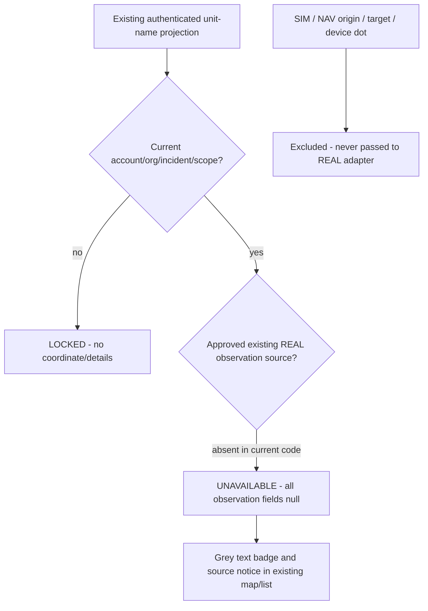

# M14.8C3 — REAL unit location availability and freshness

**SOURCE REVIEW ≠ RUNTIME VERIFIED ≠ OPERATIONAL RELEASE.**
**NOT TESTED / NOT APPLIED / NOT DEPLOYED.**

## Decision gate and verified baseline

Base main: `7602663f4689663a817e86cf4f4cb98e964f74dc`.
PR90 was confirmed MERGED, corrected head
`434a70cdfcf299a1aa2279deae1e4847d16bcf52`; GitHub comparison to base
ahead2/behind0. Open PR inventory was empty. Latest prior migration is
`20261102120000_incident_field_reliability.sql`.

**Decision B — no usable existing authorized OBSERVED_REAL source in the
inspected current repository schema and read contracts.**
This is a source finding, not a query of deployed production. Existing NAV
explicitly raises NAV_POSITION_UNAVAILABLE for ACTUAL_POSITION. SIM storage
CHECK permits only SIMULATED. Unit/COP/field DTOs provide no authenticated
REAL observation, consent/retention grant or trusted fix clock.

Therefore current C3 deliberately renders **POSITION UNAVAILABLE**, never a
REAL pin, observation age, accuracy or fake server time. This is the permitted
source-backed partial implementation, not an operational GPS feature.

Read AGENTS, SPEC/M14 location policy, NAV/SIM root prompts, root milestone
inventory and SPECS C1/C2/D1/D2 references, current B1/B2/B/C1/D1/D2 docs,
SIM map/recovery notes and actual schema/Web/Android sources. The archived C2
prompt is an unimplemented design, not consent/approval to start ingestion.
Historical reference/queue state is not live deployment evidence.
Owner's explicit no-test/no-execution task rule overrides AGENTS' normal
test/build/CI expectation; no policy/test file was changed.

## Requirements (MoSCoW)

**MUST:** truthful unavailable source, canonical actor/org/incident/unit binding,
no fallback coordinate, no SIM reinterpretation, current read scope/lease,
same C1/Room16/map instances and existing selection/command behavior,
SI/DE accessible text, documented positive-case blockers.

**SHOULD:** compact map source card, reused unit list/inspector badge,
conditional green/current, amber/last-known, grey/unavailable policy legend,
bounded display and no extra network/timer.

**COULD:** future approved REAL point renderer and source-specific time/retention
adapter. Not enabled in this branch.

**WILL NOT:** telemetry/consent UI, writer/store, GPS acquisition, phone pairing,
foreground/background service or permission, source watermark/transport, trails,
new worker, map/clustering redesign, NAV/SIM command changes or deployment.

## As-found contract matrix before edits

| Existing owner / contract | Authority / identity / time | Provenance decision |
|---|---|---|
| public.incident_units, operational_units/vehicles (20261007100000) | deployment incident/participation/org FKs; unit UUID; assigned_at/status_changed_at | UNKNOWN/deployment state, no observed position/consent fields |
| public.simulation_unit_positions (20261009140000) | scenario/incident/unit FKs, source CHECK SIMULATED, observed_at/version | SIMULATED only, excluded from REAL |
| incident_navigation_sessions/routes, private.navigation_visible(uuid,uuid,uuid) | original NAV read scope, immutable route/session/assignment, origin_snapshot/calculated_at | MANUAL_PLANNING_POINT / ROUTE_ORIGIN / SIMULATED_POSITION; ACTUAL_POSITION explicitly raises NAV_POSITION_UNAVAILABLE |
| incident task target_geometry_snapshot / incident COP objects/sectors/hydrants | existing task/COP/registry permission and frozen target | TASK_TARGET / MAP_OBJECT / planning point; not a unit observation |
| incident_resources(p_incident_id uuid,p_acting_organization_id uuid,p_history_page integer=0) RETURNS jsonb | current incident_context exact actor/acting-org; unit names from this incident; normal live deployment cap500 plus50 terminal rows/page | existing Web list only; unit visibility does NOT grant position visibility |
| private.field_unit_visible(person,org,unit), field_unit_leader(person,org,unit) | current active actor/org/participation, own active crew/effective leader; existing terminal policy | retain original narrower Android scope; no location grant |
| private.field_projection(uuid,uuid), field_map_projection(uuid,uuid) | B1 scoped revision; C1 field_map schema1, max100 field units /200 features /25 routes | no REAL source in current projection; no new SQL or watermark for absent source |
| incident_field_directory(uuid), snapshot_manifest(uuid,uuid), snapshot_page(uuid,uuid,uuid,text,bigint,integer), field_entities(uuid,uuid,text,bigint) | current per-page scope, same incident/account/org, atomic Room cursor+projection | unchanged, no independent location generation |
| IncidentRepository.observe(org), IncidentMapData.fieldMapData(i), IncidentMapScreen | secure24h lease/2h warning, B1 scope/revision; Room16 | reuse same authorized units; locked scope hides whole view, pending evidence untouched |
| IncidentMapLayers / MapScreen | one existing MapLibre view, selection/camera/overlap lifecycle; local foreground device GPS component | existing features remain command/reference geometry; blue local dot is not shared |
| IncidentCop/CopMap/SimulationMapLayer/MapOverlapStacks/RtsMapInteraction | scoped COP and SIM origin/scenario checks, existing selected-unit UUID semantics | no SIM/target/route conversion, no REAL layer with fabricated coordinates |
| IncidentResources / IncidentLiveProvider / CommandMapProvider / workspace | existing authenticated read, current account/org/incident keys, hint/poll/cancel lifecycle | read-only availability in existing map/list, no new RPC, timer or polling |
| SPEC future incident_current_positions and SPECS/prompts/08_m14-8c2... | design-only consent/ingestion, no current source/read/privacy grant | not implemented; no authorized OBSERVED_REAL observation can currently be rendered |

### Positive/negative source evidence

- `20261007100000_operational_inventory_schema.sql`: incident_units stores a
  deployment episode/status/sector and times; operational inventory has no
  observed REAL position or approved sharing grant.
- `20261009140000_incident_simulation_foundation.sql`:
  simulation_unit_positions source CHECK='SIMULATED', scenario+incident+unit FKs.
- `20261012100000_incident_navigation_execution.sql`: immutable route
  origin/destination and calculated time are planning; ACTUAL_POSITION explicitly
  raises NAV_POSITION_UNAVAILABLE. MANUAL_PLANNING_POINT and SIMULATED_POSITION
  remain their original sources. NAV visibility is not a GPS grant.
- `20261007104000_incident_resource_reads.sql`: incident_resources returns
  permitted unit identity/status under current incident_context, no GPS DTO.
- `20261027100000_incident_android_field_pilot.sql`:
  field_unit_visible restricts exact org/current crew/effective unit leader;
  field projection max100 units. B/C1 extensions preserve this boundary.
- `20261030200000_incident_field_map.sql`: C1 schema1 exposes reference/task
  geometry and permitted manual-origin NAV routes, no shared positions.
- Incident SPEC §7 and its future incident_current_positions dictionary describe
  intended opt-in120s/900s defaults, explicitly not a delivered telemetry source.
- Android MapScreen foreground device location is only local map/camera input,
  not an incident-unit observation. No C3 path consumes it.

No existence/approval of an external deployed REAL source is inferred. Ambiguous
or hypothetical fields are excluded; future JSON cannot silently activate pins.

## Implemented contract / algorithm

New pure view adapters:
- Web `realUnitPositionView(binding: RealUnitBinding,scopeAuthorized: boolean): RealUnitPositionView`.
- Android `realUnitPositionView(binding: RealUnitBinding,scopeAuthorized: Boolean): RealUnitPositionView`.

Binding contains the existing authenticated account, acting organization,
incident and deployment-assignment UUID. Android additionally binds the current
C1/B1 scope fingerprint. Invalid/missing binding or invalid scope -> LOCKED.
Valid existing name-read scope + absent approved REAL source -> UNAVAILABLE /
SOURCE_NOT_IMPLEMENTED. Name visibility is NOT asserted to authorize position.

The current view accepts **no observation object or coordinate JSON**. Coordinate,
position origin, observed time, age, accuracy, source revision and server-as-of
are immutable null outputs; no time source is manufactured.
Web object/binding are frozen. Kotlin fields are not constructor/copy inputs.
This is ephemeral UI, not null position rows in a database.

The source-independent absence is stable. There is no read/refetch timestamp
watermark, per-unit RPC, synthetic revision or change-feed event.

### Freshness policy: implemented legend, NOT active observation rendering

Existing SPEC defaults are central constants120s /900s in each client.
The conditional legend states:
- Green **CURRENT**: only a verified, currently authorized REAL observation with
  trusted0<=age<120s, valid sharing/retention and a currently confirmed read.
- Amber **LAST KNOWN**:120<=age<900s, or an explicitly permitted stale/offline
  read; no live/movement/readiness implication. Web legend uses a dashed accent
  plus hatch symbol/text; no actual marker is claimed.
- Grey **UNAVAILABLE**: absent/invalid/expired/denied source or time; no map pin.
  At900s, or an earlier consent/source/lease deadline, coordinate must be hidden.

**Current C3 never emits CURRENT/LAST_KNOWN and installs no REAL marker layer.**
Clock anchoring, observed-point validation, source-revision refresh, real marker
styling/overlap selection and actual offline retention require a real approved
source and remain blocked, not a simulated demonstration.

No Date.now()/wall-time/refetch time becomes observation authority. There is no
new clock or timer because there is no observation to age. Future integration
must first provide a server-filtered source, trustworthy UTC observed time,
source/consent expiry and matching scope/revision. Then a reviewed adapter must
validate exact finite Point[longitude,latitude], no coercion/swapping/fallback,
and future/ambiguous time. Android needs a same-boot elapsedRealtime anchor;
Web needs validated server time/bounded offset and reauthorization. Untrusted
clock/reboot/future time cannot turn an old fix green. No accuracy is inferred.

This future hook is an explicit source milestone, not a new permission scheme,
silent optional-field decoder, client consent boolean or invented location API.

## Web implementation / lifecycle

- New shared RealUnitPosition badge/notice and SI/DE dictionary.
- IncidentCop reuses MapOverlaySlot(mapStatus) for a compact native details card.
  It stays pointer/keyboard accessible; map canvas/source/selection/camera code
  is untouched. Locked/denied COP shows only access unavailable.
- IncidentResources adds grey noninteractive REAL-position badges to existing
  permitted unit rows and selected-unit inspector. Existing SIM statement stays.
- New badge scope is installed only with the successful existing resource read;
  current account/org/incident ref and abort fence reject late old-scope results.
  Access-lost/blocked state locks new badges. No parent remount assumption is
  required for this new read binding.
- No additional request, effect timer, polling lane, localStorage/sessionStorage,
  coordinate URL, GeoJSON source/layer, simulation recipient layer or export.
- Existing RPC may expose unit names from other permitted incident participants;
  this existing unit-name right is not broadened into cross-org GPS authority.
  Terminal/released name rows also stay position-unavailable, no history grant.
- Existing RTS picks/eligibility, current unit UUID selection, task drawing,
  overlapping target/SIM selection and route/camera behavior remain unchanged.
- Web resource read already has canonical live-unit deployment limit500 and50
  terminal history rows/page. C3 adds no independent collection or fan-out;
  broader legacy resource-list rendering/performance remains inherited.

## Android implementation / lifecycle

- Same IncidentMapScreen / MapScreen / IncidentMapLayers, same MapLibre instance.
- Compact source notice and expandable conditional legend in C1 map and Units
  dialog. Existing source-backed unit names/status are separate from position.
- Units remain the already atomically installed B1 list. Validate canonical unit
  IDs, deterministic order, at most100 entries and30 per UI page; malformed,
  duplicate or extra rows show explicit INCOMPLETE notice rather than pretending
  a complete list. No C1 feature/route/schema1 decoder change.
- Existing state.locked/incident/field_map support guards hide the whole view on
  lease/scope loss. Binding includes account/org/incident/unit/_scope. No old
  position generation is combined with a newer task/assignment.
- Existing max24h incident lease and2h warning unchanged. Offline source absence
  remains grey/unknown; no retained coordinate exists and no new lease is issued.
  Own device blue dot is unrelated and never passed to this model.
- No manifest/location permission, foreground service, Room model/DAO/migration,
  worker, queue, source watermark or synchronization mutation.
- Source/lease disappearance never deletes tasks, cursor, receipts, pending
  operations, hydrant/inspection/photo data or private evidence.

## Effective permissions and threat model

| Actor/data state | Existing unit-name scope reused | C3 REAL position |
|---|---|---|
| IC/current authorized Web incident reader | original incident_context/resource projection only | unavailable, no GPS right inferred |
| Effective UNIT_LEADER | original exact-org supervised B1 units | unavailable |
| Active crew/responder | original own eligible field units | unavailable |
| Org ADMIN/MANAGER or hierarchy only | no additional incident/name right | no new right |
| Wrong account/org/incident, denied/revoked scope | no new protected detail; new binding locked | none |
| Terminal/released historical name row | original historical visibility only | none; no historic GPS permission |
| TRAINING/SIM | existing approved SIM source/layers only | no conversion to REAL |
| Offline under original valid field lease | original cached unit names only | no observed point/time, never green |

Threats addressed: route/SIM/target spoofing as GPS, invented0,0/center fallback,
timestamp-reset freshness, stale-scope callback, implicit sharing permission,
historic-coordinate leakage and false tactical/readiness inference. Absence is not
idle/missing/in-danger/arrived/complete. Server remains authoritative; UI binding
does not replace RLS or future stricter position grants.

No new data may enter audit/timeline/FCM/Broadcast/diagnostics/URLs/logs because
C3 accepts no observation. No new writer or persistent source/retention exists.
No personnel/device identifiers or consent metadata are projected by C3.

## SQL / Room / compatibility

**No SQL migration or RPC added.** An empty polling endpoint or synthetic null
position table would provide no authoritative source and is deliberately avoided.
Current authenticated reads already supply permitted unit names. No historical
migration, grant, global RLS or command signature changes.

**Room remains16.** No generated schema, KAPT/KSP/Gradle/dependency edit.
Old C1 server/schema1 and clients remain compatible; C3 fields are local derived
views, not required response fields. Pre-C1 server retains existing unsupported-
backend behavior; task detail remains outside this new source capability.
D1/D2, receipt/UUID/request/parent identity, B1 cursor atomicity, M10 and worker
remain untouched. No Android WebSocket claim.

## Localization and accessibility

Default/sl and de Android resources; Web sl/de dictionary. Grey unavailable
status and locked text, unknown observation time, absent accuracy and REAL/SIM/
route/device-dot distinction. Conditional green/amber/grey legend uses full state
text and square/hatch glyphs as well as semantic colors, not color alone.
Native details/text buttons and semantic heading/badge components retained.
There are no new icon-only critical actions.

## Owner-only deferred rollout and forward fix

No rollout authorized; still deferred until owner says "greva na lokal".
Owner later:
1. Review pinned PR source, preserve local developer edits and actual DB state
   through#81 including manual hotfixes.
2. Apply only corrected UNAPPLIED#82..#87 in order, then:
   #88 20261030200000_incident_field_map.sql;
   #89 20261102100000_incident_field_receipt_recovery.sql;
   #90 20261102120000_incident_field_reliability.sql.
   C3 has **no migration**. SQL Editor ledger may be incomplete; inspect unknown
   outcomes and do not blindly rerun.
3. Independently review#86 incident-evidence Edge/private Storage20MiB/MIME/policy,
   #84 private Realtime/RLS/fallback, matching Web/API and Android Room16 install.
   C3 adds no Edge/Storage/Realtime/Cron/configuration.
4. Human controlled TRAINING IC + leader + responder acceptance, preserving SIM
   labels and radio/voice fallback. REAL observation cases remain BLOCKED until
   separate approved C2/M15 source, privacy/consent and retention lifecycle.
5. Record CODE_MERGED / SQL_APPLIED / EDGE_DEPLOYED / WEB_DEPLOYED /
   ANDROID_INSTALLED / HUMAN_VERIFIED / OPERATIONAL_RELEASED separately.
   Source review alone approves none of these operational stages.

Forward fix/disable new notice if needed; no coordinate store or canonical history
to roll back. Preserve original Room pending evidence/receipts and existing sources.
No merged/deployed/verified claim is inferred from migration filenames or this doc.

## Remaining limitations / C2-M15 boundary

No actual REAL position, source timestamp, age, accuracy, trusted clock anchor,
last-known coordinate, retention cleanup or positive marker/overlap path exists
without the missing genuine source. Green/amber are conditional policy legend
only. Tests below requiring a genuine observation are explicitly BLOCKED.
No GPS acquisition/transmission, consent enrollment, vehicle-phone binding,
"Leave vehicle", foreground/background tracking, trails, ingest Edge/API,
new permission/service/dependency or source lifecycle is implemented or started.

Existing MapLibre/SIM behavior, SQL/RLS, real data privacy, build/type correctness,
screen reader behavior, narrow/landscape layout and runtime performance are
UNVERIFIED. No source-only claim substitutes for controlled owner acceptance.

## Owner acceptance table — all80 UNEXECUTED

BLOCKED means no genuine REAL source exists; it does not mean PASS. Expected
behavior below describes source guarantees or future gates, not observed results.

| ID | Setup / owner scenario | Expected view / authoritative evidence | Status |
|---|---|---|---|
| 01 | Authorized REAL unit with genuine fresh position shows green. | BLOCKED pending a genuine authorized OBSERVED_REAL source. Current adapter returns UNAVAILABLE, coordinate=null; no green REAL marker can be produced. | UNEXECUTED — BLOCKED: genuine REAL source not implemented; C2/M15 required |
| 02 | Fresh observation shows call sign, timestamp, provenance. | BLOCKED for actual REAL observation. Current scoped unit row retains permitted call sign but timestamp/provenance remain absent; read time is never substituted. | UNEXECUTED — BLOCKED: genuine REAL source not implemented; C2/M15 required |
| 03 | Fresh observation shows accuracy only when genuine and valid. | BLOCKED for actual accuracy. Current view accuracyM=null and UI says not supplied, never0m precision. | UNEXECUTED — BLOCKED: genuine REAL source not implemented; C2/M15 required |
| 04 | At exactly 120s marker becomes amber, not green. | BLOCKED for live aging. Existing SPEC policy is120s boundary; legend says last-known at120s, but no current observation clock/marker is enabled. | UNEXECUTED — BLOCKED: genuine REAL source not implemented; C2/M15 required |
| 05 | At 119s marker remains current when source is live. | BLOCKED for current observation. Future source must prove age<120s, live authorization and trusted clock; current implementation never emits CURRENT. | UNEXECUTED — BLOCKED: genuine REAL source not implemented; C2/M15 required |
| 06 | At 14m59s permitted last-known marker is amber. | BLOCKED for last-known coordinate. Future approved source must prove age<900s and earlier source/consent expiry; C3 retains no coordinate. | UNEXECUTED — BLOCKED: genuine REAL source not implemented; C2/M15 required |
| 07 | At >=15m coordinate disappears and status becomes grey unavailable. | BLOCKED for actual expiry. At900s future coordinate must disappear; current C3 always has no coordinate and creates no retention store. | UNEXECUTED — BLOCKED: genuine REAL source not implemented; C2/M15 required |
| 08 | No position source: unavailable list entry, no map pin. | Open authorized Web unit list/map notice or C1 Units dialog. Expect grey POSITION UNAVAILABLE and no new map source/pin. Evidence: null-only model and unchanged scene/renderers. | UNEXECUTED |
| 09 | Unknown time: unavailable, no invented relative age. | Current view observedAt/ageSeconds/serverAsOf are null; UI says time unknown. No cache verifiedAt, NAV calculated_at or deployment time is used. | UNEXECUTED |
| 10 | Unknown accuracy: "not supplied", never fake precision. | BLOCKED for genuine unknown accuracy versus a real point; current no-source view always says not supplied. | UNEXECUTED — BLOCKED: genuine REAL source not implemented; C2/M15 required |
| 11 | Device clock jumps forward: does not revalidate data. | BLOCKED for observed-point freshness. Current model never reads wall clock, so clock-forward cannot activate a marker; future source anchor policy must be reviewed separately. | UNEXECUTED — BLOCKED: genuine REAL source not implemented; C2/M15 required |
| 12 | Device clock jumps backward: does not make stale data fresh. | BLOCKED for observed-point freshness. Current model never reads wall clock, so clock-backward cannot create green; future source must use trusted time/elapsed anchor. | UNEXECUTED — BLOCKED: genuine REAL source not implemented; C2/M15 required |
| 13 | Android reboot: no false green due to missing uptime anchor. | BLOCKED for a persisted observation anchor. C3 adds no anchor/cache; existing B1 boot/lease guard remains authoritative and no REAL marker exists. | UNEXECUTED — BLOCKED: genuine REAL source not implemented; C2/M15 required |
| 14 | Future observed_at: rejected/hidden. | BLOCKED for genuine future-dated source input. Current adapters accept no observation/timestamp JSON at all. | UNEXECUTED — BLOCKED: genuine REAL source not implemented; C2/M15 required |
| 15 | ISO timestamps include UTC offset and parse consistently. | BLOCKED for observation timestamp parsing; C3 does not parse any fix time. Future source must supply timezone-aware server-verified timestamps. | UNEXECUTED — BLOCKED: genuine REAL source not implemented; C2/M15 required |
| 16 | Valid [lon,lat] maps at correct point. | BLOCKED for a REAL coordinate renderer. Current model coordinate is immutable null; old task/reference WGS84 rendering remains unchanged. | UNEXECUTED — BLOCKED: genuine REAL source not implemented; C2/M15 required |
| 17 | Swapped [lat,lon] is never silently corrected. | BLOCKED for a REAL source coordinate. No swapping/coercion/fallback exists in C3; future source must validate exact WGS84 order. | UNEXECUTED — BLOCKED: genuine REAL source not implemented; C2/M15 required |
| 18 | NaN/Infinity/not-numeric coordinate rejected. | BLOCKED for REAL coordinate validation. C3 accepts no coordinate input, including NaN/Infinity/text; no new map feature can be constructed by its view. | UNEXECUTED — BLOCKED: genuine REAL source not implemented; C2/M15 required |
| 19 | Missing coordinates: no incident-center fallback. | Inspect list and scene without source. Expect no incident-center/hydrant/target/route-origin fallback. Existing map center remains incident context, not a unit pin. | UNEXECUTED |
| 20 | 0,0 placeholder is not invented; genuine verified 0,0 permitted. | BLOCKED for genuine verified0,0. Current model cannot emit any0,0 or other coordinate; future approval must distinguish observation from placeholder. | UNEXECUTED — BLOCKED: genuine REAL source not implemented; C2/M15 required |
| 21 | Invalid provenance is rejected. | BLOCKED for a genuine source/provenance adapter. Current adapters accept no source/provenance flag from DTO JSON; all observations remain excluded. | UNEXECUTED — BLOCKED: genuine REAL source not implemented; C2/M15 required |
| 22 | `SIMULATED` row cannot enter REAL layer. | Existing simulation_unit_positions source CHECK SIMULATED and C3's no-input adapter keep SIM out of REAL. No shared GeoJSON collection or cast. | UNEXECUTED |
| 23 | TRAINING SIM markers keep explicit SIM label. | Run approved TRAINING later: existing SimulationMapLayer/source labels and SIM interaction remain unchanged. C3 notice explicitly says SIM is separate, never REAL GPS. | UNEXECUTED |
| 24 | REAL unit/route task selection remains unchanged. | Existing unit UUID/RTS list selection and task/NAV controls remain. C3 badges are noninteractive and cannot alter eligibility or create actions. | UNEXECUTED |
| 25 | Stale position does not imply unit stopped/arrived. | BLOCKED for actual stale marker. Conditional legend explicitly disclaims stopped/arrived/readiness inference; current unit operational status remains separate. | UNEXECUTED — BLOCKED: genuine REAL source not implemented; C2/M15 required |
| 26 | Stale position does not confirm task completion. | BLOCKED for actual stale point. No C3 action sends ACK/START/COMPLETE; source absence is not task completion. | UNEXECUTED — BLOCKED: genuine REAL source not implemented; C2/M15 required |
| 27 | User location blue dot never becomes shared unit dot. | Use existing local-location action later if approved. Device blue dot/camera path is untouched and never accepted by the C3 unit adapter. | UNEXECUTED |
| 28 | No source GPS permission prompt is shown in read-only viewer. | Open C3 notice/Units dialog: no location permission API, service or acquisition call. Existing user-invoked own-location controls remain separate. | UNEXECUTED |
| 29 | Web IC authorized list shows only allowed units. | Web reuses only rows returned by authenticated incident_resources under existing incident_context. No extra unit search/position read or broader grant. | UNEXECUTED |
| 30 | Android responder sees only authorized own/eligible units. | C1 reuses the current B1 permitted units, same account/org/incident and field_map scope. No new unit enumeration or RPC. | UNEXECUTED |
| 31 | Effective unit leader loses role: protected positions hide. | BLOCKED for actual coordinate removal. Existing field scope/leader validity still hides map when lost; C3 contains no protected coordinate to retain. | UNEXECUTED — BLOCKED: genuine REAL source not implemented; C2/M15 required |
| 32 | Removed crew member loses scope and old positions hide. | BLOCKED for actual coordinate removal. Existing active crew/field_unit_visible/page/lease checks remain, original queue stays. | UNEXECUTED — BLOCKED: genuine REAL source not implemented; C2/M15 required |
| 33 | Incident role transfer does not retain forbidden coordinates. | BLOCKED for actual GPS scope transfer. Existing Web access/RTS and B1 fingerprints remain authoritative; no location authority is inherited. | UNEXECUTED — BLOCKED: genuine REAL source not implemented; C2/M15 required |
| 34 | Organization switch hides prior position immediately. | Change org with a pending read: new C3 resource badge remains locked until matching account/org/incident read scope; old response guarded/aborted. | UNEXECUTED |
| 35 | Account logout/relogin never leaks prior account. | Existing auth/session/account keying hides prior protected rows; C3 binding includes original account UUID and stores no browser position data. | UNEXECUTED |
| 36 | Incident switch does not carry old marker into new map. | Incident key and C3 binding include exact UUID; no coordinate/camera state is introduced or moved between incidents. | UNEXECUTED |
| 37 | Revoked B1 fingerprint invalidates derived positions. | BLOCKED for a real coordinate. Existing B1 scope guard still invalidates field map; C3 reads only its current atomic projection. | UNEXECUTED — BLOCKED: genuine REAL source not implemented; C2/M15 required |
| 38 | Expired Android incident lease hides protected positions. | BLOCKED for a real cached point. Existing24h secure lease/2h warning guards the whole C1 screen and dialog; no coordinate stored by C3. | UNEXECUTED — BLOCKED: genuine REAL source not implemented; C2/M15 required |
| 39 | Terminal incident does not automatically disclose old GPS. | BLOCKED for historical observed positions. Terminal unit-name rows never imply a right to GPS history; C3 remains UNAVAILABLE. | UNEXECUTED — BLOCKED: genuine REAL source not implemented; C2/M15 required |
| 40 | Unapproved sharing/source denies precise position. | BLOCKED for a genuine sharing-source grant. Name read permission is explicitly not GPS permission; no consent flags or position API are trusted/created. | UNEXECUTED — BLOCKED: genuine REAL source not implemented; C2/M15 required |
| 41 | No hierarchy-only org permission leaks coordinates. | Existing incident_context/field_unit_visible applies; organization hierarchy/ADMIN role alone adds no position permission. No SQL/RLS change. | UNEXECUTED |
| 42 | Unauthorized backend read returns indistinguishable safe error. | No new backend location read endpoint exists; existing RPC errors/grants remain. Current C3 view cannot disclose hidden source existence or coordinates. | UNEXECUTED |
| 43 | No private location data in FCM. | No new FCM category/producer/payload; immutable null-only C3 view is not transmitted. Existing metadata hint transport unchanged. | UNEXECUTED |
| 44 | No raw coordinates in general timeline/audit/diagnostics. | No writer/log/audit/diagnostic change. C3 neither accepts nor serializes coordinates; existing route/target data is not reclassified as telemetry. | UNEXECUTED |
| 45 | No location query parameters leak through external links. | C3 adds no coordinate URL/external navigation link. Existing explicit task/reference navigation is unchanged and never labeled shared unit position. | UNEXECUTED |
| 46 | No location persisted in sessionStorage/localStorage/Web cache. | No C3 sessionStorage/localStorage/cache API write. Only UI expansion booleans and ephemeral null-only bindings exist. | UNEXECUTED |
| 47 | No wide public table grants or service-role client fetch. | No SQL migration, table grant, service client or credential added. Existing authenticated API/Room reads remain the only sources. | UNEXECUTED |
| 48 | Read of one incident cannot see another incident's unit. | Existing read parameters/SQL incident predicates plus scoped C3 binding prevent cross-incident location. No observation or extra read is introduced. | UNEXECUTED |
| 49 | Read of one org cannot see another org's units without authority. | Web unit names may already span permitted incident participants under existing RPC; C3 adds no position rights for them. Android remains exact-org field scope. | UNEXECUTED |
| 50 | Changing server source revision refreshes permitted position only. | BLOCKED: no REAL source revision/watermark exists. C3 creates no changing timestamp/watermark and consumes no hypothetical future field. | UNEXECUTED — BLOCKED: genuine REAL source not implemented; C2/M15 required |
| 51 | A stale previous async read cannot overwrite current scope. | BLOCKED for actual location data. New Web badge binding uses current account/org/incident read scope and late-read guard; Android uses same atomic parent snapshot. | UNEXECUTED — BLOCKED: genuine REAL source not implemented; C2/M15 required |
| 52 | Simultaneous C1 tasks/maps remain coherent at same B1 revision. | BLOCKED for actual position generation. C3 leaves field_map schema/revision, B1 cursor transaction and source watermark unchanged. | UNEXECUTED — BLOCKED: genuine REAL source not implemented; C2/M15 required |
| 53 | Snapshot gap/reset preserves durable pending operations. | B1 gap/reset behavior and D1/D2 pending queue unchanged. No new location invalidation/purge touches tasks, receipts, registry or attachments. | UNEXECUTED |
| 54 | Offline cached position becomes LAST_KNOWN/uncertain, never live. | BLOCKED for actual cached REAL coordinate. Current offline C1 shows source unavailable, never green; no new offline clock/lease is manufactured. | UNEXECUTED — BLOCKED: genuine REAL source not implemented; C2/M15 required |
| 55 | Offline coordinate disappears on retention expiry. | BLOCKED for actual retained point. C3 stores none; future source TTL must hide at900s or earlier consent/lease expiry. | UNEXECUTED — BLOCKED: genuine REAL source not implemented; C2/M15 required |
| 56 | Offline cache and lease expiry do not destroy D1 evidence. | Existing source/lease expiry hides protected C1 view; no C3 queue/database/file deletion method exists. | UNEXECUTED |
| 57 | Offline stale position remains visibly labeled. | BLOCKED for a stale REAL marker. Current source-unavailable status remains explicit offline; relative age is unknown rather than frozen. | UNEXECUTED — BLOCKED: genuine REAL source not implemented; C2/M15 required |
| 58 | Unsupported server capability shows honest no-location state. | Absence of any REAL capability always stays source-unavailable; no optional JSON position field is auto-trusted. C1 compatibility guard remains unchanged. | UNEXECUTED |
| 59 | Old Android Room16 client continues existing tasks. | No SQL/RPC/Room/schema changes; old Room16 clients keep original C1/B1/task APIs and renderer. | UNEXECUTED |
| 60 | New Android Room16 client handles old server safely. | New client with existing C1 schema1 server uses existing units and source-unavailable contract. Pre-C1 retains existing unsupported-backend path; no new missing RPC. | UNEXECUTED |
| 61 | Web map still shows tasks/hydrants/sectors without position data. | No changes to CopMap geometry/layers or task/hydrant/sector selection; a compact source notice does not add fake points. | UNEXECUTED |
| 62 | Android map still shows C1 targets without position data. | Existing fieldMapData/scene/routes/registry logic untouched; no REAL point is appended. C1 target selection still uses original features. | UNEXECUTED |
| 63 | Routes do not become source of position. | NAV origin_snapshot MANUAL_PLANNING_POINT/SIMULATED_POSITION and route geometry are excluded; ACTUAL_POSITION remains NAV_POSITION_UNAVAILABLE. | UNEXECUTED |
| 64 | Routing metadata never becomes implied GPS heading/speed. | No heading/speed fields or derivation in C3. Existing route/SIM metadata retains its own provenance. | UNEXECUTED |
| 65 | Compact marker selection works when points overlap. | BLOCKED for overlapping REAL points. No REAL source/layer is installed; existing genuine rendered target/SIM overlap handling is untouched. | UNEXECUTED — BLOCKED: genuine REAL source not implemented; C2/M15 required |
| 66 | Selected/priority task target remains accessible under grouping. | BLOCKED for a REAL marker overlap. Existing priority/selected target accessibility and C1 browser remain unchanged because no new map features compete. | UNEXECUTED — BLOCKED: genuine REAL source not implemented; C2/M15 required |
| 67 | Overlapping SIM and REAL layers are distinguishable, not conflated. | BLOCKED for simultaneous REAL+SIM points. SIM layers remain separate and labeled; C3 cannot contribute a REAL point or recipient layer. | UNEXECUTED — BLOCKED: genuine REAL source not implemented; C2/M15 required |
| 68 | Camera remains stable after position refresh. | BLOCKED for a position refresh. Existing map instances/camera/focus keys unchanged; source notice and null-only view cannot recenter the map. | UNEXECUTED — BLOCKED: genuine REAL source not implemented; C2/M15 required |
| 69 | Background hidden map does not start a new independent poller. | No new effect with interval/timer/socket/RPC; existing Live/F4 and map lifecycle remain sole refresh owners. | UNEXECUTED |
| 70 | Large authorized unit list respects bounded read/partial status. | Android uses existing max100 field-unit contract with30-row UI pages and explicit incomplete warning for malformed/extra/duplicate rows. Web badges stay within existing resource collection/history page. | UNEXECUTED |
| 71 | Missing data reports source-unavailable not "all units idle". | Source notice says real shared positions unavailable, not idle/safe/ready. Operational unit status is shown separately and unchanged. | UNEXECUTED |
| 72 | One denied unit does not cause unrelated cached tasks deletion. | No C3 revocation/delete/queue operation exists; denied badge does not revoke unrelated B1/C1/task data. | UNEXECUTED |
| 73 | No new location/telemetry worker, DB write path or foreground service. | No new location writer, table, observation endpoint, worker, foreground service, device binding or acquisition code. | UNEXECUTED |
| 74 | No new Android runtime location permission request. | No manifest/permission settings or location permission request added; read-only notice does not invoke own-location action. | UNEXECUTED |
| 75 | SI messages for three freshness states and denial are correct. | Default/sl text explicitly distinguishes unavailable, locked and conditional current/last-known/expiry; observed time/accuracy remain unknown. | UNEXECUTED |
| 76 | DE messages for three freshness states and denial are correct. | German text preserves separate REAL/SIM, grey unavailable, conditional green/amber policy and no implied readiness. | UNEXECUTED |
| 77 | Screen reader distinguishes states without relying on color. | Visible state text and distinct square/hatch glyphs accompany colors. Native details/buttons and semantic headings are reused. | UNEXECUTED |
| 78 | Source revocation cancels/blocks in-flight UI updates. | BLOCKED for actual source revocation. Existing access-loss checks hide C3 badge detail; no asynchronous coordinate path or old observation storage exists. | UNEXECUTED — BLOCKED: genuine REAL source not implemented; C2/M15 required |
| 79 | No REAL GPS trail or history retention added. | No REAL observations or GPS history stored. All coordinate/time/provenance fields remain null and immutable in current adapters. | UNEXECUTED |
| 80 | Existing hydrant/inspection/photos/pending queue unaffected. | No Room/server/queue/photo/inspection/hydrant mutation changed. Existing original operation UUIDs/requests/dependencies/receipts remain. | UNEXECUTED |
