# M14.8D1 — Field offline reliability, recovery and conflict UX

**SOURCE REVIEW != RUNTIME VERIFICATION. SOURCE ONLY.**
No operational readiness certification, SQL application, deployment or manual acceptance.
Owner alone merges, applies SQL, installs Android and authorizes release.

## Dependency / source baseline

Main at start: `4f8214152679319844cb5fc616c34fddf14ecc48`.
PR88 was freshly confirmed MERGED with corrected head
`3865bc39fbc99dd5d167f1f731164548f6ed1a0a`.
GitHub comparison: main ahead2, behind0 relative to that head. No open PR existed.
Current latest prior migration: `20261030200000_incident_field_map.sql`.
Owner explicitly defers #82–88 rollout. Merged source is not SQL_APPLIED,
EDGE_DEPLOYED, WEB_DEPLOYED, ANDROID_INSTALLED or HUMAN_VERIFIED.

Read AGENTS, SPEC, current incident SPEC, A/B1/B2/C/D/B/C1 contracts and both
V2 D1/D2 prompts. D2 is context only; no metrics stream/readiness dashboard.
AGENTS normally requires tests; owner's explicit prohibition wins for this task.
No AGENTS/test modification or execution was performed.

## As-found contract matrix

Kotlin paths below are under android/app/src/main/java/si/gasilko/app/.

| Entry / actual signature | Owner / identity / permission | Persistence / version / receipt | As-found recovery and exact D1 extension |
|---|---|---|---|
| feature/incidents/IncidentRepository(account,remainingAuthorization) | captures authenticated account; exact selected org; field scope from B1 and canonical RPC | Room16 incident_field_cache, incident_sync_cursor, INCIDENT_TASK rows and dispatch | remote mutex + identity mutex reused; post-suspension/final transaction fencing and recovery methods added |
| IncidentViewModel.foreground()/action() / IncidentScreen / UnitLeadershipScreen | existing scoped lifecycle, actor model, canonical can_execute/effective leader flags | state from Room; busy/stale/errors ephemeral only | existing sync entry extended with shared recovery screen; no new top-level module |
| RegistryDatabase version16 / IncidentFieldDao.operations(account,org), observeOperations(account,org) | account+org partition; discriminator INCIDENT_TASK; deterministic sequence | PendingHydrantChange operationId/entityId/payload/baseVersion/createdAt/state; IncidentDispatch parent/request/result/error | no new table/column/state enum, no migration/generated export; UI derives phases and50-row pages |
| IncidentFieldDao.prepare(sequence,request) | existing request IS NULL conditional update | first materialization only, original JSON thereafter immutable | original parent checked BEFORE frozen-request shortcut; no silent rebase |
| IncidentRepository.transition(org,incident,assignment,status,reason) | exact visible assignment episode + can_execute + valid read lease | durable intent + parent relation atomically stored before scheduling | optional explicit reviewedRejection/reviewedVersion for NEW corrective intent only; original row untouched |
| HydrantSyncScheduler.select/enqueue(account,org) | selected identity, network CONNECTED, unique work hydrant-sync | APPEND_OR_REPLACE, existing WorkManager defaults/backoff | unchanged; no new work name, worker, retry timer or jitter service |
| HydrantSyncWorker.doWork / SupabaseAuthGateway.synchronizeHydrants(context,account,organization) | SDK session initialization, online active profile/org verification, selected scope | existing incident drain then HydrantSyncEngine | unchanged; incident transient/compatibility failure returns retry flag so unrelated registry engine still runs |
| HydrantSyncEngine.sync(org) / RegistryDao.nextChange | original registry roles/auth; explicitly excludes INCIDENT_TASK | original hydrant/inspection/photo/skip queues and version acknowledgement | untouched, no data purge or new ordering |
| incident_field_directory(p_acting_organization_id uuid) | auth.uid + exact current org/profile/field participation | incident id/revision/timeline_sequence, authorization fingerprint and independent NAV map_source | unchanged public signature/authority; read before dispatch; genuine denial hides protected projection |
| incident_snapshot_manifest(uuid,uuid) / incident_snapshot_page(uuid,uuid,uuid,text,bigint,integer) | current actor/org/incident, per-page scope | pinned5min manifest, page25,3MiB field budget,24h read lease | existing atomic projection/cursor replacement; corruption cannot wipe pending queue |
| incident_change_feed(uuid,uuid,text,bigint,integer,integer) / incident_field_entities(uuid,uuid,text,bigint) / incident_field_timeline(uuid,uuid,bigint) | current field scope, revision/ordinal separate from timeline | original B1 cursor and immutable timeline semantics | unchanged; no D1 map/telemetry or new poll |
| incident_transition_task_assignment(uuid,uuid,uuid,bigint,jsonb) | current recipient/leader execution and exact episode; actor server-derived | expected ASSIGNMENT.version; TASK_TRANSITION receipt stores incident counters, NOT assignment version | existing worker action; D1 receipt-first UNKNOWN, exact replay only explicit, child version remains authoritative before freezing |
| incident_issue_task / incident_update_unit_status / incident_add_crew_member / incident_remove_crew_member / incident_transition_resource_allocation | common envelope below; current canonical effective own-unit command gates | incident.version + entity versions where required; TASK_ISSUE / RESOURCE_* receipts | ONLINE_REQUIRED remains; existing leader review gains receipt-first ambiguous recovery, never background issue |
| incident_message_send(uuid,uuid,uuid,bigint,jsonb) | private.message_authority current audience and sender; original C normalization | MESSAGE_SEND request deliberately excludes expected version in server receipt identity; original normalized body/parent frozen | existing offline send; D1 current write targets checked, narrow denial masks message page, not whole field cache |
| incident_attachment_prepare(p_operation uuid,p_acting_organization_id uuid,p_incident_id uuid,p_attachment_id uuid,p_target_kind text,p_target_id uuid,p_metadata jsonb) | original D live scope/target/audience | original prepare/upload/verify/finalize IDs, bytes, parent and service-verifier receipt | unchanged pipeline; own prepare is already recovery; D1 does not dispatch it through generic receipt command retry |
| KeystoreSessionManager / IncidentRepository.lease | existing AES/GCM Android Keystore lease/session; account/org | wall+elapsed+BOOT_COUNT,24h max and2h warning; registry30d separate | unchanged clock policy; unavailable key/clock/reboot hides data, neutral original queue remains |
| M10/FCM / B2 hint seam | hints only, current read/RLS authoritative | existing notification workers/preferences | unchanged; Android WebSocket still unsupported |

All common canonical field write RPCs retain:
`(p_operation uuid,p_acting_organization_id uuid,p_incident_id uuid,
p_expected_version bigint,p_payload jsonb) RETURNS jsonb`.
D1 does not change canonical mutations, optimistic checks, audit or receipt table.

## Proven source gaps / chosen correction

1. private.incident_operation_receipts is immutable, private, no client table read.
   Canonical commands return it on exact replay, but inspected field contracts
   offered no standalone original-receipt read. B1 projection/timeline does not
   expose enough operation proof to infer ACK from a current assignment state.
   A small forward-only read RPC is therefore required for receipt-FIRST recovery.
2. Existing send() treated most4xx as rejection even after SENDING/UNKNOWN,
   replacing ambiguity with NEEDS_ATTENTION/RECOVERY_REJECTED. D1 preserves
   UNKNOWN after an ambiguous earlier attempt; recognized first rejections
   have explicit REJECTED:<safe-code> proof classification.
3. Timeout57014/lock/busy/schema failures could be conflated with denial/rejection.
   D1 classifies cancellation/lock/serialization/rate-limit as uncertain/busy,
   never proof of authorization loss. Known401/403 are distinguished.
4. Frozen-request shortcut ran before parent validation. Dependency existence
   and confirmed matching receipt are now checked first; dispatched requests
   still NEVER change. A parent receipt alone is not assignment.version.
5. Result persistence lacked a final identity fence after the network suspension.
   Current account/org/cancellation is rechecked under existing identity mutex
   and before transaction return. Cancelled/lost commits remain SENDING/UNKNOWN.
6. Existing locked projection removed all operation visibility. A neutral copy
   now exposes only correlation/status/local-created metadata; request/result/
   private payload are masked, physical durable evidence is unchanged.
7. Current worker did not pre-refresh field authority before independent sends.
   D1 refreshes current B1 online before dispatch. Unknowns are read, not
   blindly background-replayed; independent valid assignments remain independent.

## New read-only RPC / migration

`supabase/migrations/20261102100000_incident_field_receipt_recovery.sql`
— **NOT APPLIED**, after corrected C1 `20261030200000_incident_field_map.sql`.

```sql
public.incident_field_operation_receipts(
 p_acting_organization_id uuid,
 p_incident_id uuid,
 p_requests jsonb
) RETURNS jsonb
```

Input array of `{rpc,request:<ORIGINAL frozen p_* envelope>}`.
Allowlist: TASK_TRANSITION, TASK_ISSUE, RESOURCE_STATUS, RESOURCE_CREW_JOIN,
RESOURCE_CREW_LEAVE, RESOURCE_RESOURCE_TRANSITION and MESSAGE_SEND.
No attachment prepare/finalize or generic arbitrary RPC dispatch.

Limits25 requests and256KiB/request batch; Android uses groups of4 and at most25
candidate operations per explicit pass/drain. Group by actual incident first.
Receipt PK operation_id makes lookup keyed, not a broad receipt scan.
No new indexes/tables/worker/notification/configuration.

Current private.incident_sync_lock + incident_field_scope authenticate
auth.uid, exact active organization and permitted field incident. Each row also
checks the affected assignment/own effective leader unit or current message
read audience. Same-incident/unit joins prevent guessing a foreign target.
Single-crew issue is the existing Android issue shape. No organizational
ADMIN/MANAGER command bypass. Lost original crew episode is not a new episode.

Exact server canonical request is reconstructed from the existing command code,
org/incident/expected/payload; MESSAGE_SEND uses its existing body normalization
and excludes expected exactly as canonical C does. Compare actor, org, incident,
command_code and full normalized request before returning a result.
Another actor's UUID produces no receipt disclosure.

Response:
`{account,organization,incident_id,scope_fingerprint,rows:[
 {operation_id,status:FOUND|ABSENT|SCOPE_UNAVAILABLE|IDENTITY_MISMATCH,
  result?:<minimal original canonical proof>,confirmed_at?:<server receipt created_at>}
]}`.

FOUND includes matching immutable receipt and real server created_at. MESSAGE_SEND
projection removes its private message DTO/body; ID/counter proof remains.
No body, old request, bytes, hidden audience history, storage path or actor details
are returned as diagnostics. SQL receipt/audit immutability is untouched.
ABSENT does NOT prove no transaction ever committed or will commit; it is NEVER
converted to rejection or fabricated success. No operation receipt is written by
this read, and no read performs ACK/start/complete/task or incident mutation.
Receipt visibility is a read grant, not fresh command authority.

SECURITY DEFINER postgres owner, empty search_path, fully qualified relations,
no p_actor, PUBLIC/anon/service_role EXECUTE revoked, authenticated only.
Original private tables/RLS and all write RPC signatures remain unchanged.

If backend is not yet compatible, receipt recovery shows compatibility and
keeps UNKNOWN; no write fallback is substituted for a failed receipt read.
Successful ordinary writes still use their existing canonical contract.
Distribute D1 with the compatible read migration; code merge alone is not rollout.

## Durable state mapping and invariants

| Concept | Existing durable/derived facts | Human meaning |
|---|---|---|
| LOCAL_INTENT | DRAFT | review/editor only, not sent; manual leader proposal not worker-approved |
| READY_TO_SEND | LOCAL_PENDING and no unconfirmed parent | original local intent awaits current online authorization |
| SENDING | persisted SENDING with existing activeDispatches owner | network attempt running; not success |
| OUTCOME_UNKNOWN | persisted SENDING recovered after process loss or OUTCOME_UNKNOWN | original bytes/UUID/expected still need proof |
| SERVER_CONFIRMED | matching canonical result stored atomically with state | receipt proves only that action, not future task/version state |
| DEFINITIVELY_REJECTED | NEEDS_ATTENTION + REJECTED:<recognized first canonical4xx code> | first unambiguous rejection, original operation untouched |
| STALE/NEEDS_ATTENTION | local stale/corruption/identity/protocol conflict | no silent rebase or automatic corrected UUID |
| BLOCKED_DEPENDENCY | original parent missing, unknown or not confirmed | child does not send; parent receipt resolved first |
| SCOPE_UNAVAILABLE | absent visible authorized incident/episode/audience or expired/uncertain lease | neutral row only; private content/retry hidden |

Legacy SERVER_REJECTED/RECOVERY_REJECTED lacks D1's proof distinction; it is
conservatively NEEDS_ATTENTION, NOT a known first rejection. Human receipt
inspection can confirm it, but absent proof never fabricates a corrected success.
OPERATION_REUSED/IDENTITY_MISMATCH remains abnormal, with original unknown
evidence retained and no retry-UUID workaround.

```mermaid
stateDiagram-v2
    [*] --> LOCAL_INTENT
    LOCAL_INTENT --> READY_TO_SEND: durable confirmed local intent
    READY_TO_SEND --> BLOCKED_DEPENDENCY: original parent not confirmed
    BLOCKED_DEPENDENCY --> READY_TO_SEND: matching parent receipt + authoritative version
    READY_TO_SEND --> SENDING: current online scope + frozen request persisted
    SENDING --> SERVER_CONFIRMED: matching canonical receipt
    SENDING --> OUTCOME_UNKNOWN: lost/malformed reply or process death
    SENDING --> DEFINITIVELY_REJECTED: recognized first unambiguous rejection
    OUTCOME_UNKNOWN --> SERVER_CONFIRMED: read original matching receipt
    OUTCOME_UNKNOWN --> OUTCOME_UNKNOWN: absent receipt or later rejection
    OUTCOME_UNKNOWN --> SENDING: explicit exact replay after receipt check and live guards
    DEFINITIVELY_REJECTED --> NEEDS_ATTENTION: explicit comparison
    NEEDS_ATTENTION --> LOCAL_INTENT: human creates NEW operation; old one retained
    READY_TO_SEND --> SCOPE_UNAVAILABLE: authorization/lease unavailable
    OUTCOME_UNKNOWN --> SCOPE_UNAVAILABLE: hide private details, retain original
    SCOPE_UNAVAILABLE --> OUTCOME_UNKNOWN: same actor/scope reauthorized for read
```



Diagram is presentation, not a new persisted enum. Original pending_hydrant_changes
states and discriminator remain. The arrow for corrective action creates a NEW
row; it never moves/relabels/deletes the rejected row or changes its request.

## Operation / permission matrix

| Action | Original canonical path | D1 classification |
|---|---|---|
| ACKNOWLEDGED | incident_transition_task_assignment, existing can_execute_task for exact crew/unit episode | existing offline-safe local queue; online dispatch authorization |
| IN_PROGRESS (start/resume) | same RPC; original ACK/configuration requirements | same queue, original parent; no inferred ACK |
| BLOCKED | same RPC, configured nonempty reason | same queue, explicit human status |
| COMPLETED | same RPC | same queue; no map/GPS/SIM/hint inference |
| UNABLE | same RPC and allowed current state, nonempty reason | same queue; no new transitions |
| CANCELLED | existing issuer/cancel authority, not offered by Android transitions() | NOT newly offline-enabled |
| issue/status/crew/resource | existing leader DRAFT + canonical TASK/RESOURCE RPCs | ONLINE_REQUIRED, existing review; new receipt read before ambiguous replay |
| message append/correction | existing C audience/normalized payload/UUID | original offline queue; current write targets and narrow message denial |
| evidence prepare/upload/finalize | original D pipeline and parent IDs, private storage/service verification | unchanged; generic D1 receipt retry does not upload or re-own bytes |
| hydrant/inspection/photo/plan skip | existing registry engine excludes INCIDENT_TASK | unchanged, not rewritten as incident commands |

TRAINING is a label, not a new permission. Existing SIM stock guard remains.
No new offline issue/status/resource/crew or simulator action is admitted.

## Deterministic drain / receipt-first recovery

1. Persist normalized intent, account/org/incident/assignment UUID and parent
   sequence in one existing Room transaction, with identity checks, BEFORE scheduling.
   Disk failure means no network send of unpersisted new action.
2. Existing unique worker verifies SDK/current online profile/org and selection;
   incident drain refreshes B1 field authority before any command.
3. At most25 uncertain eligible candidates are bulk read, four per incident batch.
   Confirmed receipts update original operation only. Missing receipts become
   RECEIPT_ABSENT/UNKNOWN and wait for explicit human replay, not blind background
   resubmission. Scoped-denied/identity/sticky unknown-rejection entries are not
   repeatedly auto-read by every later worker.
4. A denied incident is immediately removed from protected cache, evidence stays.
   Revalidate directory to distinguish global membership loss from one incident;
   skip further denied-incident batches. Global401/confirmed directory denial
   locks field cache; unrelated permitted incidents/registry data are not purged.
5. First unambiguous pending operations retain deterministic sequence ordering.
   Independent assignment failure does not become success or stall unrelated work.
   Process at most25 task/message commands per drain; remaining work uses the
   existing WorkManager retry mechanism. Evidence keeps original dispatch path.
6. Parent must exist and have a matching original receipt. For unprepared child,
   original parent task/entity/incident/status/revision must match authoritative
   current assignment; then take exact assignment.version. Never receipt.version+1.
   If parent unknown, block; if rejected/missing, attention. Already frozen child
   must retain its ORIGINAL request even after server version changes.
7. Persist first p_* request only where dispatch.request IS NULL. Check it is the
   durable exact string before SENDING/network. SENDING is recorded before RPC.
8. Recheck current account/org/cancellation after every RPC and before Room commit
   under existing identity mutex. Complete matching result plus state atomically.
   Cancellation/storage failure leaves recoverable SENDING/UNKNOWN.
9. A timeout/57014/55P03/40P01/40001/408/429/malformed response is NOT proof of
   failure/revocation. Later rejection after ambiguity stays UNKNOWN_REJECTED.
   Only recognized first unambiguous canonical4xx gets REJECTED:<code>.
10. Explicit Retry refreshes current scope, reads original receipt FIRST, and
    sends only the same durable request if ABSENT and current actor/episode/
    version/dependency/allowed transition support it. No new UUID on timeout.
    Online leader review uses the same receipt-first principle and original role
    stamp/versions after absence; FOUND can confirm older pre-submit versions.
11. Canonical refresh is a separate step from receipt proof. A failed refresh
    never revokes a valid confirmed result merely because projection is stale.

No custom retry timer, new jitter service or queue is added. Existing WorkManager
network constraint and defaults govern backoff. Statement timeout is not raised.
No receipt RPC per recomposition/frame/row; explicit bounded batches and existing
worker triggers only. Parent chains still need necessary authoritative B1 reads
after preceding writes; no performance/latency claim is made for long chains.

## Conflict/review behavior

Existing task detail retains canonical server status and separately lists local
actions. Recovery detail compares original local target status and frozen expected
version with the last authorized server assignment status/version.
Check state reads/refetches; it never resends. Retry exact is explicit and only
available after absent receipt with current guards. Unknown or identity-mismatch
requests have NO discard/delete or implicit replacement action.

A NEW corrective operation requires explicit choice/reason, current can_execute,
fresh online B1 version equal to the one reviewed, and either:
- a known first REJECTED proof, or
- a known local pre-send stale/dependency blockage (not an attempted unknown).
No ambiguous/active chain for that assignment may remain. A new row/UUID records
corrects_operation locally, without retargeting/deleting any old child/parent.
Old frozen request, payload, dependency and receipt stay intact. There is no
automatic conflict resolution, server rollback or server rejection rewriting.

## Privacy, lease and cold start

24h field lease/2h warning remains the existing Keystore AES/GCM contract.
Wall AND elapsed clock, boot count and exact secure marker must match Room.
Reboot, rollback, expiry or unavailable key locks incident/private recovery content.
Registry30d authorization remains separate and is never a fresh command grant.

Neutral queue copies expose operation UUID/status/local created time/opaque parent
correlation only. Payload/request/result and private label/coordinates are removed
from this UI projection. Physical queue/dispatch/files are NOT removed.
Account/org switch empties the old identity projection; same-actor authorized
return recovers original durable entries, not a new episode/UUID.

Message-only rejection masks C page; it does not prove whole field access loss.
Actual B1 directory/scope denial retains existing revocation semantics.
C/D message/evidence scope generations, acquisition checks, bytes, pending uploads,
M10/FCM hints and Android no-WebSocket limitation remain unchanged.

Corrupt cached JSON is not rendered as valid; a complete new snapshot may replace
it atomically. Until then the old physical cache and original queue remain.
No fallback destructive Room migration or private-file cleanup is introduced.

## UI / metadata honesty

Paths: Field incidents -> Sinhronizacija / Synchronisierung; also task header
and own-unit dashboard. Same screen, no redundant top-level navigation module.
Open offline; page at most50 rows, filter derived phase, key each row by UUID.
Open existing task/unit details through existing callbacks; map remains unchanged.

Local createdAt is labeled LOCAL. B1 verifiedAt is last authorized READ, NOT a
write receipt timestamp. Canonical task/resource direct acknowledgements do not
contain a timestamp. D1 receipt read exposes actual receipt.created_at; a local
_d1_confirmed_at JSON member preserves that server provenance separately from
canonical proof fields. No guessed last-attempt/retry count/reconciled-at is stored.
Existing canonical server receipts are immutable; no receipt table field changes.
MESSAGE_SEND read proof omits the private message DTO/body, keeping identifiers/
counters; original intent/body and authoritative C page remain their own sources.

Last known server receipt time is shown only when this trusted metadata exists;
otherwise unavailable. A later read time is never relabeled as successful upload.
No new telemetry/metrics/history table (D2) is implemented.

## Compatibility / owner-only rollout

Room remains16. NO schema bump, generated JSON, Gradle/KAPT/KSP/dependency change.
No new persistent state column or DAO signature is required.
Source gap was receipt read, not local persistence.

Owner alone:
1. Review/merge source (not done by agent); resolve any code review findings.
2. Inspect actual database state through #81, then apply deferred migrations:
   20261027100000 field pilot (#82), 20261030100000 B1 (#83),
   20261030120000 B2 (#84), 20261030140000 messages (#85),
   20261030160000 evidence (#86), 20261030180000 leadership (#87),
   20261030200000 field map (#88), THEN
   20261102100000_incident_field_receipt_recovery.sql (D1).
   SQL Editor may not reflect schema_migrations; inspect unknown outcomes before
   re-executing, never blind repeat.
3. Coordinate previously deferred D evidence Edge/private Storage and compatible
   Web/API as separately approved. D1 requires no new Edge/Web/Storage deployment.
4. Human Android build/install and Room16 upgrade-path review, in controlled
   authenticated TRAINING; separately approve any REAL-mode check.
5. Run the following manual matrix, record all failures and independent
   CODE_MERGED / SQL_APPLIED / EDGE_DEPLOYED / WEB_DEPLOYED /
   ANDROID_INSTALLED / HUMAN_VERIFIED states. Keep radio/voice procedures.
6. Do not call source-only PR an operational release.

## Human-only acceptance — ALL UNEXECUTED

Every case below is UNEXECUTED. UI evidence = existing field/task/unit and recovery
screen; durable evidence = original scoped queue/dispatch/request/parent/result,
B1 Room cursor/cache and human-authorized server receipts. No Codex execution.
- [ ] **01 — UNEXECUTED:** On an approved TRAINING incident, available supported offline ACK in airplane mode -> local pending only, no server confirmed badge.
  Expected UI / durable-server evidence: Room shows LOCAL_PENDING/ready, original assignment and UUID; no canonical receipt or confirmed badge until authenticated server proof.

- [ ] **02 — UNEXECUTED:** Offline START then COMPLETE with a valid dependency chain -> correct ordered dispatch after parent confirmation, no guessed versions.
  Expected UI / durable-server evidence: Original ACK/START/COMPLETE parent sequence remains; child freezes only after matching parent receipt and current authoritative assignment.version, never +1.

- [ ] **03 — UNEXECUTED:** Airplane mode before freezing: no lost action if persistent storage succeeds.
  Expected UI / durable-server evidence: Intent and dispatch rows commit atomically before scheduling; absent durable commit means no network command.

- [ ] **04 — UNEXECUTED:** No available storage: show failure; no network dispatch of unpersisted action.
  Expected UI / durable-server evidence: Storage failure shows localized storage warning; queue transaction rolls back and no unpersisted new action is sent.

- [ ] **05 — UNEXECUTED:** App process killed after local queue persists -> operation survives restart.
  Expected UI / durable-server evidence: Same operationId/payload/parent/request survive process death; inactive SENDING is rendered UNKNOWN, not ready/success.

- [ ] **06 — UNEXECUTED:** Device reboot -> pending identity survives, lease uncertainty handled safely.
  Expected UI / durable-server evidence: Original pending row survives; boot/elapsed mismatch locks private cache until fresh successful authorization.

- [ ] **07 — UNEXECUTED:** Local clock moved backwards -> prevent false extension of cache authorization.
  Expected UI / durable-server evidence: Negative wall elapsed invalidates lease; no protected cache extension; operations retained.

- [ ] **08 — UNEXECUTED:** Local clock moved forwards -> display conservative expiry, preserve evidence.
  Expected UI / durable-server evidence: Conservative max(wall,elapsed) expiry; original rows/files remain with neutral recovery view.

- [ ] **09 — UNEXECUTED:** Lose network during send (unknown commit) -> original UUID and payload survive.
  Expected UI / durable-server evidence: Persisted SENDING/UNKNOWN retains exact original normalized request and UUID after transport ambiguity.

- [ ] **10 — UNEXECUTED:** Recover matching receipt -> confirmation and read reconciliation, no duplicate.
  Expected UI / durable-server evidence: FOUND must match actor/org/incident/original request and receipt IDs/counters; same row becomes confirmed, no new command.

- [ ] **11 — UNEXECUTED:** No matching receipt -> UNKNOWN, not rejected, no invented success.
  Expected UI / durable-server evidence: ABSENT remains UNKNOWN/RECEIPT_ABSENT; never treated as failed or successful.

- [ ] **12 — UNEXECUTED:** Exact same UUID retry with same request -> one server mutation, same receipt.
  Expected UI / durable-server evidence: Explicit Retry reads receipt first and uses exact durable p_* request if live guards hold; canonical receipt deduplicates.

- [ ] **13 — UNEXECUTED:** Retry original UUID with altered payload -> must be blocked/rejected.
  Expected UI / durable-server evidence: Local frozen tuple mismatch or canonical receipt mismatch blocks send, flags identity; original bytes/UUID not auto-replaced.

- [ ] **14 — UNEXECUTED:** Confirmed first rejection -> human may create corrected NEW operation.
  Expected UI / durable-server evidence: Recognized first unambiguous4xx has REJECTED proof; explicit comparison/current version allows NEW UUID and corrects_operation, old row stays.

- [ ] **15 — UNEXECUTED:** Earlier unknown request + later rejection -> don't forget original unknown.
  Expected UI / durable-server evidence: Earlier SENDING/UNKNOWN followed by a rejection stays UNKNOWN_REJECTED; no new corrected operation is offered.

- [ ] **16 — UNEXECUTED:** Parent ACK unknown -> child START is blocked until receipt resolution.
  Expected UI / durable-server evidence: Unconfirmed/unknown parent blocks child; receipt query runs before any exact replay, no version guessing.

- [ ] **17 — UNEXECUTED:** Parent ACK rejected -> child remains blocked for explicit human review.
  Expected UI / durable-server evidence: Known parent rejection blocks child with dependency attention; no blind child resend or parent UUID replacement.

- [ ] **18 — UNEXECUTED:** Parent ACK confirmed but changed version -> derive authoritative child only if not dispatched/frozen; otherwise conflict review, never silent mutation.
  Expected UI / durable-server evidence: Unprepared child derives current exact version only with original parent identity/status/revision proof; frozen child never rebases.

- [ ] **19 — UNEXECUTED:** Duplicate WorkManager dispatch -> no duplicate task transitions.
  Expected UI / durable-server evidence: Existing unique work and shared process mutex serialize sends; canonical UUID receipt prevents duplicate effects.

- [ ] **20 — UNEXECUTED:** Rapid app foreground/background cycles -> no overlapping command storms.
  Expected UI / durable-server evidence: Existing lifecycle/coordinator/mutex remain; no per-row polling or extra worker/subscription.

- [ ] **21 — UNEXECUTED:** Concurrent UI inspect and worker dispatch -> deterministic safe display.
  Expected UI / durable-server evidence: UI inspect and worker both use the same remote/identity mutexes; no mixed request/state or premature confirmation.

- [ ] **22 — UNEXECUTED:** Realtime/FCM duplicate hints -> no duplicated operations.
  Expected UI / durable-server evidence: Existing M10/B2 hints only trigger authoritative existing flow; no new operation from a hint.

- [ ] **23 — UNEXECUTED:** Hint lost -> existing polling/reconciliation remains functional.
  Expected UI / durable-server evidence: Original foreground polling/worker/manual read paths remain; no Android WebSocket claim.

- [ ] **24 — UNEXECUTED:** One account switches to another mid-request -> old response cannot write into new account's UI/cache or change selected action.
  Expected UI / durable-server evidence: Post-suspension/final transaction checks cancel old account work; old queue stays partitioned, new UI empty/neutral.

- [ ] **25 — UNEXECUTED:** Same account switches organization mid-request -> no wrong-org replay.
  Expected UI / durable-server evidence: Selected organization rechecked before network and commit; no wrong-org replay or receipt write.

- [ ] **26 — UNEXECUTED:** Switch incident mid-request -> returned details remain properly scoped.
  Expected UI / durable-server evidence: UUID/incident filtering and keyed recovery screen prevent old details being attached to new incident.

- [ ] **27 — UNEXECUTED:** Switch back to original permitted scope -> original queue is recoverable.
  Expected UI / durable-server evidence: Fresh same-account/org/field scope reopens original row, exact request and dependency; no new UUID.

- [ ] **28 — UNEXECUTED:** Access revoked while offline -> visible private cached content disappears at authorized lease limit; no new command is sent.
  Expected UI / durable-server evidence: No new dispatch without successful online B1 scope; offline cache hides at lease expiry, original pending evidence retained.

- [ ] **29 — UNEXECUTED:** Access revoked while online -> immediate scope denial and masked details.
  Expected UI / durable-server evidence: Confirmed denial masks affected field data; directory revalidation distinguishes global loss; neutral rows remain.

- [ ] **30 — UNEXECUTED:** Unit-leader role lost -> supervised actions hidden; evidence preserved.
  Expected UI / durable-server evidence: Current role/stamp/crew controls disappear; original leader proposals/requests stay, no background issue.

- [ ] **31 — UNEXECUTED:** Crew episode replaced -> old target episode is not reused as new target.
  Expected UI / durable-server evidence: Old assignment/crew episode is not replaced by a new same-person episode; absent old scope remains unavailable.

- [ ] **32 — UNEXECUTED:** Incident CANCELLED/CLOSED while disconnected -> attention, not auto retry.
  Expected UI / durable-server evidence: Fresh dispatch guard/ canonical error gives local attention or known first rejection; earlier unknown remains unknown; no fake completion.

- [ ] **33 — UNEXECUTED:** Schema mismatch after app update -> safe compatibility warning.
  Expected UI / durable-server evidence: Missing receipt RPC/unsupported staging shows compatibility; original requests retained; no write-as-read fallback.

- [ ] **34 — UNEXECUTED:** B1 scope fingerprint changed -> old protected projection not displayed.
  Expected UI / durable-server evidence: B1 genuine scope change revokes protected projection; recovery UI masks labels and camera scope behavior from C1 stays intact.

- [ ] **35 — UNEXECUTED:** B1 NAV data-only watermark changed -> no false role revocation.
  Expected UI / durable-server evidence: NAV DATA watermark does not become an authorization token; original task queue/cursor/receipt retained.

- [ ] **36 — UNEXECUTED:** Change feed gap / expired horizon -> full bounded snapshot, no partial success.
  Expected UI / durable-server evidence: Existing bounded B1 snapshot replaces coherently; no queue reset or partial current claim.

- [ ] **37 — UNEXECUTED:** Interrupted manifest paging -> last complete valid cache retained.
  Expected UI / durable-server evidence: Last complete authorized projection remains until compatible commit; paging failure cannot confirm actions.

- [ ] **38 — UNEXECUTED:** Cursor update never precedes authoritative projection transaction.
  Expected UI / durable-server evidence: Original projection and cursor are saved in one Room transaction; no D1 schema or cursor reinterpretation.

- [ ] **39 — UNEXECUTED:** Reconciliation with bad result -> original evidence and previous authorized data persist; no false caught-up indicator.
  Expected UI / durable-server evidence: Malformed/identity-incompatible result remains UNKNOWN or attention; original request/history and valid leased cache preserved.

- [ ] **40 — UNEXECUTED:** Incident read lease warning around 22h -> accurate and localized.
  Expected UI / durable-server evidence: Existing leaseRemaining warning shows2h boundary; local created time not used as server verification.

- [ ] **41 — UNEXECUTED:** Incident read lease exceeded 24h -> no protected stale incident read.
  Expected UI / durable-server evidence: At most24h, boot and elapsed/wall safeguards lock protected incident content; neutral correlation queue visible.

- [ ] **42 — UNEXECUTED:** Hydrant registry separate lease continues per existing policy.
  Expected UI / durable-server evidence: Registry30d policy remains separate; no D1 role/token or new registry engine behavior.

- [ ] **43 — UNEXECUTED:** Offline hydrant edit survives incident cache reset.
  Expected UI / durable-server evidence: Cache reset does not delete pending_hydrant_changes or rewrite registry operations excluded from INCIDENT_TASK.

- [ ] **44 — UNEXECUTED:** Offline inspection survives app restart while incident pending.
  Expected UI / durable-server evidence: Original inspection completion UUID/photo staging and existing engine persist; D1 never updates those rows.

- [ ] **45 — UNEXECUTED:** Pending hydrant photo upload is not evicted by incident queue changes.
  Expected UI / durable-server evidence: Existing photo files/UPLOAD_PHOTO queue untouched; incident recovery failure does not delete or relabel them.

- [ ] **46 — UNEXECUTED:** Pending evidence attachment remains intact after loss of incident visibility.
  Expected UI / durable-server evidence: Existing D files/prepare/finalize UUIDs and original parent remain; no premature upload under revoked scope.

- [ ] **47 — UNEXECUTED:** Web IC issues a task; Android responder receives authorized assignment.
  Expected UI / durable-server evidence: Canonical issue and existing B1/FCM projection deliver only the authorized assignment; no notification ACK inference.

- [ ] **48 — UNEXECUTED:** Crew user cannot perform an effective leader's command.
  Expected UI / durable-server evidence: Offline transition controls remain exact can_execute; manual leader commands require existing current authority and online review.

- [ ] **49 — UNEXECUTED:** Organization admin without incident capability cannot bypass authority.
  Expected UI / durable-server evidence: Organization role alone gives no field unit/leader capability; server checks remain authoritative.

- [ ] **50 — UNEXECUTED:** REAL vs TRAINING separation survives all error and retry states.
  Expected UI / durable-server evidence: Exact incident UUID/grouping and current server mode are preserved; no SIM positions/stock or fake REAL behavior.

- [ ] **51 — UNEXECUTED:** SIM FINISH does not become incident CLOSE.
  Expected UI / durable-server evidence: SIM and incident lifecycles remain separate; no new close/finish RPC is invoked.

- [ ] **52 — UNEXECUTED:** UI displays original action title/recipient/version when permitted.
  Expected UI / durable-server evidence: Authorized task title/recipient/issued target/episode/base version shown; masked on scope loss; pending local status separate.

- [ ] **53 — UNEXECUTED:** Same-title actions still separated by original operation UUIDs.
  Expected UI / durable-server evidence: List keys are operation UUIDs, not title text; parent links identify original operation.

- [ ] **54 — UNEXECUTED:** SI text for pending/unknown/rejected/confirmed/status/retry/permission.
  Expected UI / durable-server evidence: Default/sl labels distinguish local/unknown/rejected/receipt-confirmed, safe errors and manual actions.

- [ ] **55 — UNEXECUTED:** DE text for same states and accessibility labeling.
  Expected UI / durable-server evidence: German has equivalent status/permission/storage/retry/review text; narrow/landscape header remains scrollable.

- [ ] **56 — UNEXECUTED:** Screen reader can understand status without relying solely on colors.
  Expected UI / durable-server evidence: Visible text labels/status and accessible Material controls, not color-only or gesture-only actions.

- [ ] **57 — UNEXECUTED:** Sync inbox can be opened without network using existing Room.
  Expected UI / durable-server evidence: Room-derived screen opens without network; checks/retries require actual current scope and original protocol.

- [ ] **58 — UNEXECUTED:** Unknown operation cannot be silently dismissed/deleted.
  Expected UI / durable-server evidence: No delete/discard button; original unknown request/ID/parent remains durable.

- [ ] **59 — UNEXECUTED:** Definitively rejected action can be reviewed without resending.
  Expected UI / durable-server evidence: Review/Check does not send; explicit NEW action requires known safe corrective condition and reviewed current version.

- [ ] **60 — UNEXECUTED:** User opens task/map then returns, retains state; no accidental action.
  Expected UI / durable-server evidence: Existing task/map callbacks and saved parent state remain; opening recovery or returning never dispatches.

- [ ] **61 — UNEXECUTED:** Conflicting newer task version shows details rather than auto-rebase.
  Expected UI / durable-server evidence: Frozen expected vs authorized assignment version displayed; changing version requires review/new safe action, not same-UUID rebase.

- [ ] **62 — UNEXECUTED:** Offline banner offers radio/voice operational fallback guidance.
  Expected UI / durable-server evidence: Localized radio/voice fallback guidance explicitly says local intent is not operational/server confirmation.

- [ ] **63 — UNEXECUTED:** Background battery saver constraints do not mark pending as confirmed.
  Expected UI / durable-server evidence: WorkManager constraints/delay do not alter pending into confirmed; only matching receipt does.

- [ ] **64 — UNEXECUTED:** Session refresh or auth token expiry shows appropriate scopes.
  Expected UI / durable-server evidence: SDK/current account and exact org verified by existing auth flow; uncertain/expired lease masks data.

- [ ] **65 — UNEXECUTED:** Correlation display never exposes raw sensitive request/SQL.
  Expected UI / durable-server evidence: No raw SQL/request/body/storage-path diagnostics; only safe codes, IDs and authorized task labels.

- [ ] **66 — UNEXECUTED:** Long queue shows bounded list without per-row network reads.
  Expected UI / durable-server evidence: 50-row paged rendering and explicit bounded receipt batches; no per-frame/per-row network fetch.

- [ ] **67 — UNEXECUTED:** Repeated retry/manual refresh respects existing concurrency controls.
  Expected UI / durable-server evidence: Same process-wide remote mutex, ViewModel busy guard and WorkManager backoff; absent/denied unknowns need manual action.

- [ ] **68 — UNEXECUTED:** Multiple incidents in same org remain isolated.
  Expected UI / durable-server evidence: Receipt batches grouped by actual incident, original immutable envelope retained; no cross-incident success.

- [ ] **69 — UNEXECUTED:** Two organizations with same incident title remain isolated by UUID.
  Expected UI / durable-server evidence: Account/org/incident/operation UUID partition, not same display title; no wrong-org row shown or sent.

- [ ] **70 — UNEXECUTED:** PR applied only in code; after human rollout, result logged distinctly as MERGED, SQL_APPLIED, EDGE_DEPLOYED, WEB_DEPLOYED, ANDROID_INSTALLED, VERIFIED.
  Expected UI / durable-server evidence: Owner records merge/SQL/Edge/Web/install/verification independently; this source-only PR claims none of those runtime outcomes.

## Remaining risks / unavailable facts

- No full retry/attempt log, retry_count, last_attempt_at or automatic aging policy
  exists in Room16; D1 does not invent them. UI shows local created time and only
  genuinely known server receipt time. D2 metrics remains separate.
- Receipt read needs CURRENT original field/audience permission. Lost historical
  crew episode may remain SCOPE_UNAVAILABLE even for the original sender; no new
  archive/commander access is invented to force recovery. Evidence stays durable.
- Legacy generic rejection flags cannot prove a first unambiguous rejection;
  corrected-new-operation controls stay conservative until canonical proof.
- The UI pages rendering, but existing DAO still observes the original scoped
  operation history. Large-history memory/read cost and long dependency-chain
  B1 refresh cost require human measurement; no new index/schema or performance
  claim is made. No autonomous tuning of57014/server limits.
- Server statement cancellation, exact replay races, Room/storage exceptions,
  SDK authentication, SQL syntax/planner/security and Compose/real-device behavior
  are SOURCE-REVIEWED ONLY and require owner verification.
- No technical Room version blocker: original queue/dispatch JSON fields suffice.
  A narrow new receipt READ migration was necessary; rollout remains owner-only.
- No GPS/REAL current or last-known unit position markers, location freshness,
  phone/vehicle association, SIM physics, NAV3 capacity, map UX expansion or
  production-readiness dashboard is included.

## Execution record

No tests added/modified/run; no build/lint/typecheck/CI, Gradle sync,
SQL execution, migration application, deployment, emulator/browser/runtime
or manual verification. No new secrets/Cron/Storage/Realtime settings,
Gradle/KAPT/KSP/dependency/generated schema/lockfile/local configuration changes.
No historical migration edited. No pending-file cleanup or queue deletion.
Commit uses [skip ci]. One new PR only; owner alone merges and rolls out.
