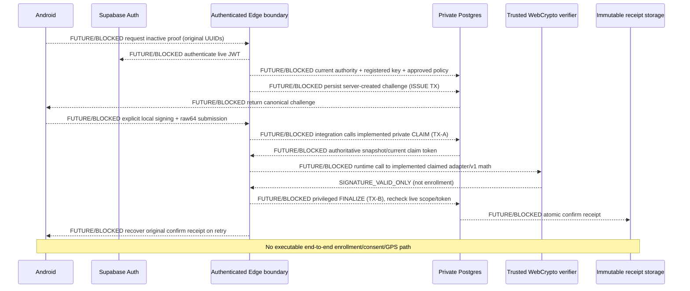

# M15A.3 — Trusted challenge & credential lifecycle (inactive only)

2026-11-03 · **GPS DISABLED · P01–P14/A01 UNAPPROVED · SOURCE ONLY**
No SQL, crypto execution, runtime validation, test, build, CI or deployment performed.
Source inspection is not evidence of runtime safety or operational readiness.

## 1. Decisions and actual delivery

| Component | Decision | Exact boundary / missing prerequisite |
|---|---|---|
| Private credential schema | IMPLEMENT_NOW | Empty, inaccessible INACTIVE/REVOKED metadata registry; NOT possession-validated enrollment |
| Private challenge schema | IMPLEMENT_NOW | Empty, inaccessible frozen challenge metadata and guarded lifecycle; no seeded policy/epoch |
| Server key registration | BLOCKED_BY_INFRASTRUCTURE | No authenticated possession-gated registration transaction, trusted verifier identity or approved metadata lifecycle |
| Authenticated challenge issuance | BLOCKED_BY_POLICY | Policy version/document/audience/recovery-epoch authority and retention approval absent; no callable ISSUE |
| Atomic challenge claim | IMPLEMENT_NOW | Private owner-only TX-A primitive, not a client RPC; useful only with legitimately provisioned future records |
| WebCrypto verification integration | IMPLEMENT_NOW | Internal constructor + claimed-snapshot adapter import unchanged v1 verifier; no deployed runtime caller |
| Privileged finalization | BLOCKED_BY_INFRASTRUCTURE | No server-only verifier identity/grant/transaction bridge; no FINALIZE; VERIFIED_INACTIVE update rejected |
| Immutable receipt recovery | IMPLEMENT_NOW | Own inactive credential REVOKE uses existing incident_operation_receipts; confirmation/ISSUE receipts remain DESIGN_ONLY |
| Credential revocation | IMPLEMENT_NOW | Private exact-owner transaction; invalidates all outstanding claims; no public/client dispatch |
| Rotation/generation changes | DESIGN_ONLY | Schema enforces immutable generation, next generation only after older candidates revoked; no rotation writer |
| Metadata physical cleanup | BLOCKED_BY_POLICY | No approved credential/challenge/receipt/backups retention or owner-approved independent erasure job |
| Public Android enrollment | BLOCKED_BY_INFRASTRUCTURE | No HTTP/JWT/registration/ISSUE/FINALIZE path or client integration |
| Vehicle pairing | BLOCKED_BY_POLICY | P01–P14/A01 all UNAPPROVED, no operational binding record |
| GPS producer | BLOCKED_BY_POLICY | Six OFF flags unchanged; no producer/permissions/services/telemetry |
| GPS viewer | BLOCKED_BY_POLICY | No approved precise-reader audience/source/retention; C3 stays unavailable |

This is the explicitly permitted smaller inert implementation. The database
provides real constraints, locking and revocation primitives, not a verifier
stub or a success flag. No table is populated by the migration and no application
role can invoke these primitives. An INACTIVE row is a scoped **candidate public
key record**, not proof that a human/phone owns the key, consented, or is bound.

### Baseline and source review

Base main: **3137311066a1122ba1ec7b226e3294dbf120fa68**.
#95 merged with merge commit b3f7fb7f14d6430e2784a1d70bbc59609932218f;
reviewed head 3a958735e9907e0775f4d6c5d45c9432a7670d60 is an ancestor
(compare head→main ahead2/behind0). Open-PR inventory was empty before work.
No local project files were written; source/changes prepared via GitHub.

Read AGENTS, primary/M14 SPEC, M15A/A1/A2, C2/C3, B1/B2, C1, D1/D2,
unit-leadership and M10/NAV contracts and corresponding source. Root M15A.3.txt
is the current assignment; SPECS/prompts/08 and automation/queue.json (snapshot
2026-10-28) are historical context, not policy/deployment approval. Owner's
explicit no-test/no-execution restriction overrides ordinary AGENTS validation
instructions for this task; all execution/release gates remain open.

## 2. As-found contract matrix (pinned main, not installed database claims)

| Contract | Actual source file/line | Exact existing schema/signature | Trusted authority/current guarantee | Missing requirement | M15A.3 action |
|---|---|---|---|---|---|
| Vehicle | [supabase/migrations/20261007100000_operational_inventory_schema.sql:9](https://github.com/ficlus/Gasilko/blob/3137311066a1122ba1ec7b226e3294dbf120fa68/supabase/migrations/20261007100000_operational_inventory_schema.sql#L9) | public.operational_vehicles(id PK,organization_id,active,availability,version); UNIQUE(id,organization_id) | Owned asset; exact org FK | No key/possession identity | Reference existing composite FK; no inventory change |
| Inventory unit | [supabase/migrations/20261007100000_operational_inventory_schema.sql:12](https://github.com/ficlus/Gasilko/blob/3137311066a1122ba1ec7b226e3294dbf120fa68/supabase/migrations/20261007100000_operational_inventory_schema.sql#L12) | public.operational_units(id,organization_id,vehicle_id,active,version); same-org vehicle FK | Canonical current vehicle | Inventory UUID is NOT deployment UUID | Join through incident_units.unit_id |
| Deployment | [supabase/migrations/20261007100000_operational_inventory_schema.sql:25](https://github.com/ficlus/Gasilko/blob/3137311066a1122ba1ec7b226e3294dbf120fa68/supabase/migrations/20261007100000_operational_inventory_schema.sql#L25) | public.incident_units(id,incident_id,participation_id,organization_id,unit_id,status,version,changed_revision); UNIQUE(id,incident_id,organization_id) | Current participant, immutable episode identity | No GPS authority | Use actual deployment composite FK/current version |
| Driver episode | [supabase/migrations/20261007100000_operational_inventory_schema.sql:36](https://github.com/ficlus/Gasilko/blob/3137311066a1122ba1ec7b226e3294dbf120fa68/supabase/migrations/20261007100000_operational_inventory_schema.sql#L36) | public.incident_crew_members(id,incident_id,unit_assignment_id,user_id,membership_organization_id,crew_role,status,version); UNIQUE(id,incident_id) | ACTIVE DRIVER row.id; guard_operational_episode:113 forbids repurposing/reactivating LEFT | Not consent/key possession | Use this real UUID as authority_episode_id; no synthetic episode |
| Inventory changes | [supabase/migrations/20261007101000_operational_inventory_api.sql:40](https://github.com/ficlus/Gasilko/blob/3137311066a1122ba1ec7b226e3294dbf120fa68/supabase/migrations/20261007101000_operational_inventory_api.sql#L40) | private inventory command forbids live deployment vehicle/kind reassignment | UNIT_ALREADY_DEPLOYED, same-org mutex | No proof credential | Preserve; current vehicle joined again |
| Active membership | [supabase/migrations/20260917140000_memberships_roles_rls.sql:23](https://github.com/ficlus/Gasilko/blob/3137311066a1122ba1ec7b226e3294dbf120fa68/supabase/migrations/20260917140000_memberships_roles_rls.sql#L23) | private.is_active_user()→boolean; private.is_organization_member(uuid)→boolean | auth.uid(), profiles.account_status='ACTIVE', exact user_organizations | Membership alone is not DRIVER | Reuse through existing locks |
| Acting org | [supabase/migrations/20261006120000_incident_core.sql:35](https://github.com/ficlus/Gasilko/blob/3137311066a1122ba1ec7b226e3294dbf120fa68/supabase/migrations/20261006120000_incident_core.sql#L35) | private.incident_acting_member(p_org uuid)→boolean | Active org + current membership | Does not grant GPS | Reuse, no role widening |
| Incident read | [supabase/migrations/20261006100000_incident_operations_foundation.sql:165](https://github.com/ficlus/Gasilko/blob/3137311066a1122ba1ec7b226e3294dbf120fa68/supabase/migrations/20261006100000_incident_operations_foundation.sql#L165) | private.can_read_incident(p_incident_id uuid)→boolean | Current member/participant or limited draft/terminal read | May authorize another participating org; not precise access | Additional exact-org ACTIVE participant + DRIVER required |
| Field roles | [supabase/migrations/20261027100000_incident_android_field_pilot.sql:2](https://github.com/ficlus/Gasilko/blob/3137311066a1122ba1ec7b226e3294dbf120fa68/supabase/migrations/20261027100000_incident_android_field_pilot.sql#L2) | private.field_unit_leader(p_person uuid,p_org uuid,p_unit uuid)→boolean; field_unit_visible(same args)→boolean | Effective UNIT_LEADER or exact active crew scope | Leader/ADMIN is NOT automatic driver/position authority | No leader fallback; unchanged |
| B1 lock/scope/head | [supabase/migrations/20261030100000_incident_snapshot_protocol.sql:86](https://github.com/ficlus/Gasilko/blob/3137311066a1122ba1ec7b226e3294dbf120fa68/supabase/migrations/20261030100000_incident_snapshot_protocol.sql#L86) | private.incident_sync_lock(uuid,uuid)→void; incident_field_scope(uuid,uuid)→text:103; public.incident_sync_head(uuid,uuid)→jsonb:400 | Org mutex, org/profile/incident locks, salted live field scope | Field fingerprint != approved GPS audience/recovery epoch | Reuse lock only; do not repurpose fingerprint |
| Immutable receipts | [supabase/migrations/20261006120000_incident_core.sql:2](https://github.com/ficlus/Gasilko/blob/3137311066a1122ba1ec7b226e3294dbf120fa68/supabase/migrations/20261006120000_incident_core.sql#L2) | private.incident_operation_receipts(operation_id PK,actor_user_id,acting_organization_id,incident_id,command_code,request≤64KiB,result,created_at) | UPDATE/DELETE/TRUNCATE blocked; operation advisory seed141 in resource_commands:105 | No device enrollment command/finalizer | Reuse for private terminal DEVICE_CREDENTIAL_REVOKE only |
| Notification devices | [supabase/migrations/20261005140000_notifications.sql:10](https://github.com/ficlus/Gasilko/blob/3137311066a1122ba1ec7b226e3294dbf120fa68/supabase/migrations/20261005140000_notifications.sql#L10) | private.notification_devices; public.register_notification_device(installation uuid,token text,enabled boolean=true)→void:69 | Authenticated caller supplies UUID/token; NOT possession | Not a signing credential | No reuse or changes |
| C2 OFF RPC | [supabase/migrations/20261102140000_incident_vehicle_location_capability.sql:4](https://github.com/ficlus/Gasilko/blob/3137311066a1122ba1ec7b226e3294dbf120fa68/supabase/migrations/20261102140000_incident_vehicle_location_capability.sql#L4) | public.incident_vehicle_location_capabilities(p_acting_organization_id uuid,p_incident_id uuid)→jsonb | B1 authorized; DISABLED + six literal false fields:22–24 | No enable/producer/reader path | Unchanged |
| REAL/SIM and NAV | [supabase/migrations/20261009140000_incident_simulation_foundation.sql:17](https://github.com/ficlus/Gasilko/blob/3137311066a1122ba1ec7b226e3294dbf120fa68/supabase/migrations/20261009140000_incident_simulation_foundation.sql#L17) | public.simulation_scenarios incident association; simulated positions source='SIMULATED':39; navigation_input ACTUAL_POSITION rejects | Scenario association authoritative even if simulation disabled | NAV origin/SIM are not REAL observations | Deny any scenario-associated incident; no NAV/SIM edits |
| Session encryption | [android/app/src/main/java/si/gasilko/app/core/auth/KeystoreSessionManager.kt:22](https://github.com/ficlus/Gasilko/blob/3137311066a1122ba1ec7b226e3294dbf120fa68/android/app/src/main/java/si/gasilko/app/core/auth/KeystoreSessionManager.kt#L22) | AndroidKeyStore AES/GCM session/PKCE/lease storage | Local auth secrets | Not device proof | Unchanged |
| Local device keys | [android/app/src/main/java/si/gasilko/app/core/security/deviceproof/LocalDeviceProofKeys.kt:59](https://github.com/ficlus/Gasilko/blob/3137311066a1122ba1ec7b226e3294dbf120fa68/android/app/src/main/java/si/gasilko/app/core/security/deviceproof/LocalDeviceProofKeys.kt#L59) | createNew/openExisting:85/prepareProof:91; scoped nonexportable P-256 SHA256withECDSA | Explicit local ceremony, identity episode cancellation | No server enrollment/consent | No caller added |
| Android byte contract | [android/app/src/main/java/si/gasilko/app/core/security/deviceproof/DeviceProofProtocol.kt:53](https://github.com/ficlus/Gasilko/blob/3137311066a1122ba1ec7b226e3294dbf120fa68/android/app/src/main/java/si/gasilko/app/core/security/deviceproof/DeviceProofProtocol.kt#L53) | DeviceProofChallengeV1.bytes() exact27LF; DeviceProofEncoding.kt canonical91byte SPKI/DER↔raw64 | Immutable typed local transcript | Not server authorization | Unchanged v1 |
| Pure server verifier | [supabase/functions/_shared/deviceProofV1.ts:210](https://github.com/ficlus/Gasilko/blob/3137311066a1122ba1ec7b226e3294dbf120fa68/supabase/functions/_shared/deviceProofV1.ts#L210) | verifyDeviceProofV1(unknown)→Promise<DeviceSignatureEvidenceV1>; encodeDeviceProofTranscriptV1 | Strict copies, raw64/point/keyhash/transcript/scope/math; SIGNATURE_VALID_ONLY | No JWT/SQL/origin/one-use guarantee | Import/reuse unchanged |
| Existing Edge boundary | [supabase/functions/incident-evidence/index.ts:53](https://github.com/ficlus/Gasilko/blob/3137311066a1122ba1ec7b226e3294dbf120fa68/supabase/functions/incident-evidence/index.ts#L53) | POST, auth/v1/user, caller RPC, separate private service verification | Evidence-specific live authorization | Not a device-proof finalizer; deployment unconfirmed | No reuse of evidence grants/handler |
| Exposed API | [supabase/config.toml:7](https://github.com/ficlus/Gasilko/blob/3137311066a1122ba1ec7b226e3294dbf120fa68/supabase/config.toml#L7) | schemas public/graphql_public; db.major_version=17; no device-proof handler | private not PostgREST exposed | No registered device verifier identity | Keep private unexposed, no config/dependency changes |
| Android clients/cache | [android/app/src/main/java/si/gasilko/app/feature/incidents/IncidentRepository.kt:115](https://github.com/ficlus/Gasilko/blob/3137311066a1122ba1ec7b226e3294dbf120fa68/android/app/src/main/java/si/gasilko/app/feature/incidents/IncidentRepository.kt#L115) | vehicleLocationCapability(org,incident); ViewModel:45; RegistryDatabase.kt:130 version16 | Lease/current account/org checks before+after optional read | No device enrollment dispatch | No Room/queue/worker modifications |
| Web clients | [web/app/api/incidents/route.ts:16](https://github.com/ficlus/Gasilko/blob/3137311066a1122ba1ec7b226e3294dbf120fa68/web/app/api/incidents/route.ts#L16) | ACTIVE account/same-origin allowlist; VehicleLocationCapability.tsx keyed identity+abort; RealUnitPosition.tsx unavailable | Manual OFF read, no new polling | No proof endpoint or REAL marker | No client changes |
| Platform | [android/app/build.gradle.kts:9](https://github.com/ficlus/Gasilko/blob/3137311066a1122ba1ec7b226e3294dbf120fa68/android/app/build.gradle.kts#L9) | compileSdk36,minSdk26,targetSdk36; AndroidManifest.xml:2–7 existing foreground map location/network/notification permissions | No background-location/FGS permission | No new GPS producer | No platform changes |

No proposed M15A SQL object was mistaken for a previously deployed credential
registry. This migration creates new private objects. No production introspection
was performed. Existing incident field/command/read authority is preserved.

## 3. Migration, objects and privileges

New, forward-only:
`supabase/migrations/20261103100000_vehicle_device_proof_lifecycle.sql`.
It follows `20261102140000_incident_vehicle_location_capability.sql`.
No earlier migration is edited.

Two RLS-enabled tables, owned by postgres, no RLS policies, all table privileges
revoked from PUBLIC/anon/authenticated/service_role:
- private.vehicle_device_credentials: UUID identity; exact actor/org/incident/
  deployment/vehicle/DRIVER episode; protocol1; public SPKI/hash; positive immutable
  generation; INACTIVE/REVOKED; creation/revocation metadata.
- private.vehicle_device_challenges: corresponding frozen scope/credential;
  distinct immutable issue/confirm UUIDs; unique32byte nonce; whole-second issue
  timestamp + exactly120second expiry; transcript hash; bounded original normalized
  JSON request + PostgreSQL SHA256; signed versions/generation/policy/audience/epoch;
  state/token/lease/signature hash/consumed timestamp.

Actual FK targets exist: deployment(id,incident_id,organization_id),
vehicle(id,organization_id), crew(id,incident_id). Credential/challenge guards
add canonical live joins and exact candidate identity; FKs alone are not authority.
Credential actor/org/key/scope/generation cannot be repurposed. A LEFT crew episode
cannot be reactivated by existing canonical guard. The inventory command already
forbids changing vehicle association while deployed.

Global public-key fingerprint uniqueness deliberately prevents key reuse across
candidate scopes. Generation lineage is actor/org/incident/deployment/DRIVER episode:
first1, then exactly previous maximum+1, with every predecessor REVOKED. At most8
historical candidates per lineage and32 challenges per credential, counting terminal
rows. These are conservative internal storage caps, not approved competing-phone
or operational rotation policy. No rotation/registration command is implemented.

DDL validates SPKI91byte length, canonical27byte P-256 prefix and SHA256 fingerprint;
it does **not** implement on-curve/possession verification in SQL. The existing v1
verifier performs full point/scalar/math validation. No client writer can insert a
malformed key or claim it was verified. No private key/token/signature bytes stored.
The signature hash binds retry bytes, not an idempotency UUID.

Private routines (all postgres-owned SECURITY DEFINER, search_path='', qualified
relations, EXECUTE revoked from PUBLIC/anon/authenticated/service_role):
- vehicle_device_driver_scope(p_org uuid,p_incident uuid,p_deployment uuid,p_vehicle uuid) RETURNS jsonb.
- guard_vehicle_device_credential() RETURNS trigger.
- guard_vehicle_device_challenge() RETURNS trigger.
- claim_vehicle_device_proof(p_org uuid,p_incident uuid,p_challenge uuid,p_confirm_operation uuid,p_signature_sha256 text) RETURNS jsonb.
- invalidate_vehicle_device_claims() RETURNS trigger.
- revoke_vehicle_device_credential(p_operation uuid,p_org uuid,p_incident uuid,p_credential uuid,p_reason text) RETURNS jsonb.

No public RPC, table grants, private schema exposure, HTTP endpoint, service-role
exception or new role is added. Only the database owner can deliberately arrange
an authenticated SQL context and call the internals in a separately approved
environment. This is not an instruction to seed dummy policy hashes or fabricate
approval. A database owner able to disable triggers is outside this privilege
model; these constraints do not defend against a malicious superuser.

## 4. Authentication and current authority

The internal actor is **auth.uid()**, never a JSON actor parameter. Existing
incident_sync_lock uses org mutex + org/profile/incident SHARE locks and rechecks
active account/membership. The new driver query also requires can_read_incident,
exact ACTIVE participating org, live same-org deployment, active inventory unit,
its current active AVAILABLE vehicle, and actor's ACTIVE DRIVER crew row. Any
simulation_scenarios association excludes the incident even if SIM is disabled.
UNIT_LEADER/ADMIN is not a substitute for DRIVER.

For this inaccessible candidate primitive, only ACTIVE incidents are accepted
(not STABILIZED/CLOSED/CANCELLED). This conservative restriction is **not approval**
of P03 operational eligibility. Public issuance still has no approved policy gate.

Operation advisory lock namespace141 precedes existing org/profile/incident locks,
then credential FOR UPDATE, then challenge FOR UPDATE. Org mutex and incident SHARE
lock serialize canonical membership/resource/crew/incident mutations; revocation
uses the same credential-before-challenge order. CLAIM/REVOKE have1500ms lock timeout.
No new canonical locks, worker or queue are added. Lock timeout/deadlock/serialization/
transport ambiguity never becomes a definitive rejection or a new operation UUID.

The DRIVER episode is the actual immutable crew row.id. Leaving and rejoining
creates a new episode. Current incident/deployment/vehicle versions and episode are
checked at CLAIM. A future FINALIZE must repeat ALL checks after crypto, including
policy/recovery epoch and current generation. There is **no source-authoritative
approved recovery-epoch/policy provider yet**. The snapshot's policy/epoch fields
are frozen challenge data for mathematical verification, not live approval.

## 5. Internal construction, transcript and verifier reuse

`supabase/functions/_shared/deviceProofLifecycle.ts` exports:
- constructDeviceChallengeV1(trustedContext): generates crypto.randomUUID(),
  crypto.getRandomValues32bytes, server whole epoch seconds and expiry+120.
  Caller cannot pass nonce/id/timestamps; context has exact keys and no defaults
  for policy/audience/recovery epoch. No storage or authorization is performed.
- verifyClaimedDeviceProofV1(snapshot,proof): accepts the private CLAIM JSON shape,
  copies SPKI hex into bytes, checks the current claim/lease snapshot and invokes
  the unchanged verifyDeviceProofV1. Returned transcript/signature hashes must
  equal stored hashes. Returns claim identity plus **SIGNATURE_VALID_ONLY**.
- bounded DeviceProofLifecycleFailure codes, no logs or network/DB calls.

The constructor is NOT ISSUE. Future issuance must authenticate/authorize, resolve
approved trusted fields, reserve IDs, persist material+original request atomically
and recover that same material on retry. Calling the constructor again for a retry
would produce a different nonce and is forbidden. No runtime imports/callers are
added outside this internal module.

No v1 parser/cryptography/byte contract is duplicated. Existing encoder and verifier
retain the27 ordered LF-terminated UTF-8 lines:
domain, audience, recoveryEpoch, BIND_INACTIVE, account, org, incident, REAL,
deployment, vehicle, authorityEpisode, DRIVER, credentialId, keySha256,
policyVersion, policyDocumentSha256, preciseAudienceSha256, issueOperationId,
confirmOperationId, challengeId, nonceBase64Url, issuedSeconds, expiresSeconds,
incidentVersion, deploymentVersion, vehicleVersion, generation.
Nonce is unpadded43char base64url. Versions/epoch seconds are canonical decimal
strings, never lossy JSON bigint numbers. Public key is canonical SPKI DER91bytes;
wire signature is P1363 raw64, not DER R||S confusion. Android's existing
DER↔raw64 conversion is unchanged.

The SQL normalized-request hash is SHA256(UTF8(jsonb::text)), computed/checked
inside PostgreSQL, for request storage integrity. It is NOT the signed transcript,
a cross-runtime JSON canonicalization promise, or a replacement for full request
equality. Revocation receipts compare the original full normalized JSON request.

Types and names cannot authenticate snapshot provenance. A future Edge adapter must
obtain key/challenge from locked private rows, never substitute a client key/context,
and keep the returned claim token private. The pure adapter checks the supplied
server-time snapshot; it cannot keep a lease alive during await. FINALIZE must
check real current time/token again. Successful math is not a DB receipt.

## 6. TX-A, recovery and the deliberately absent TX-B

CLAIM freezes confirm operation identity (already stored), transcript hash and the
first raw-signature hash. Under row/org/operation locks:
1. Check actual actor/exact current DRIVER/scope/version/generation.
2. Check fixed confirm UUID, unchanged signature hash and no conflicting canonical receipt.
3. Reject revoked/terminal/expired/future-issued challenge.
4. ISSUED→CLAIMED allocates unpredictable UUID token and lease up to30seconds,
   bounded by challenge expiry. No success receipt is written.
5. Exact retry while lease is valid returns the SAME token. After lease expiry,
   same original request may replace the token, only while challenge is live.
   Different confirm UUID or signature bytes hash fails OPERATION_REUSED.

There is at most one current claim token per row, not an exactly-once verifier
execution promise. Two identical concurrent retries can recover that same token
and both calculate math; no authoritative finalization can result in this milestone.
A future TX-B must consume a still-current token at most once. A verifier crash
cannot write success; expiry does not create a new nonce/operation.

Challenge state/identity is guarded. Original fields and terminal history cannot
be rewritten; valid claim lease cannot be replaced/extended early. No delete or
truncate is allowed through ordinary writes. VERIFIED_INACTIVE is representable
for future compatibility but **the guard rejects entering it with
VERIFIER_UNAVAILABLE**. There is no FINALIZE function or privileged success RPC.

Remaining future transaction bridge:
- Authenticated Edge validates live user/session and exact-org authority for TX-A.
- Off-DB verifier uses locked authoritative snapshots, returns math evidence only.
- Separate server-only TX-B authenticates actual verifier authority, locks credential/
  challenge, rechecks current actor/driver/episode/versions/policy/epoch/generation/
  expiry/token/original request, consumes once and writes immutable original receipt.
- Lost FINALIZE response recovers that receipt under current scope; unknown outcome
  does not mean rejection and never causes a new operation UUID.

No client-supplied verified=true, shared-secret-in-client or service-role bypass-as-
authorization is acceptable. No such implementation is shipped. A future public
handler needs reviewed methods/size limits (candidate POST≤8KiB), JWT audience/issuer
and live Auth validation, rate/replay limits, safe errors and redacted logging.
Currently there is **no function path/allowed method/public RPC signature** to call;
JWT/gateway configuration is unchanged. Existing incident-evidence POST/Auth-user/
separate-service verifier is evidence-specific and is not silently repurposed.

Official source references (review only):
[Supabase Edge authentication](https://supabase.com/docs/guides/functions/auth)
requires an authenticated boundary and cautions against disabling platform checks;
current source uses explicit Auth-user validation in incident-evidence, not the
new documentation's SDK wrapper. No SDK dependency is added.
[PostgreSQL binary functions](https://www.postgresql.org/docs/17/functions-binarystring.html)
documents native SHA256(bytea)/encode; no invented pgcrypto ECDSA API is used.

## 7. Revocation, generation and immutable operation receipts

Private revoke authorizes only the credential's own auth.uid + exact org/incident,
with active account/current org membership under existing locks. It needs no
current DRIVER role or incident-read permission to withdraw one's own candidate.
Loss of org membership/account access blocks this private self-service primitive;
future administrative security revocation after such loss remains unimplemented.

INACTIVE→REVOKED sets server timestamp/reason; the same transaction sets every
ISSUED/CLAIMED child to REVOKED/consumed, retaining original identity/hash/token
evidence. REVOKED cannot become INACTIVE. Later generations require a new
credential UUID/key and previous generations revoked. No successful proof path
can race past revocation because TX-B is absent; future TX-B MUST lock/recheck.

DEVICE_CREDENTIAL_REVOKE uses existing private.incident_operation_receipts
(operation PK, current actor/org/incident, full normalized request, original result).
Exact same operation/request recovers original result even after credential revoked;
changed request/actor/scope/code rejects OPERATION_REUSED. A distinct revoke UUID
may record an already-revoked result without rewriting original revocation metadata.
Existing receipt immutability triggers preserve every confirmed result. No separate
proof receipt table/queue is needed for this implemented terminal operation.

Issue/confirm IDs are unique, distinct and cross-column checked under sorted
namespace141 advisory locks; challenge insertion rejects an existing canonical
receipt UUID. Canonical older commands do not know these new reservations.
If an unrelated canonical command later uses a reserved UUID, CLAIM fails closed
when it finds that receipt. This is NOT a global cross-engine operation reservation
guarantee. Future ISSUE/FINALIZE must handle canonical receipt collision atomically
and never overwrite a receipt. Confirmation replay/receipt API is NOT implemented;
existing D1 receipt allowlists are unchanged.

UNKNOWN_OUTCOME remains a transport/recovery concern. No SQL error or timeout
rewrites original UUIDs or existing pending evidence; no Android dispatch is added.

## 8. State and interaction diagrams

```mermaid
stateDiagram-v2
 UNREGISTERED --> INACTIVE: FUTURE registration; private candidate schema only
 INACTIVE --> REVOKED: implemented private owner revoke + immutable receipt
 REVOKED --> REVOKED: exact receipt replay; no reactivation
```





```mermaid
stateDiagram-v2
 [*] --> ISSUED: FUTURE trusted ISSUE; empty private schema
 ISSUED --> CLAIMED: implemented private TX-A
 CLAIMED --> CLAIMED: same request replay / expired lease new token
 ISSUED --> REVOKED: implemented credential revocation
 CLAIMED --> REVOKED: implemented credential revocation
 CLAIMED --> VERIFIED_INACTIVE: FUTURE/BLOCKED; currently rejected
 ISSUED --> EXPIRED: logical time expiry; no state-maintenance writer
 CLAIMED --> EXPIRED: logical time expiry; no state-maintenance writer
 CLAIMED --> REJECTED: FUTURE trusted definitive rejection writer
```

REJECTED/EXPIRED/REVOKED are supported terminal schema states; no automatic
expiry-state maintenance is shipped. A row can still say ISSUED/CLAIMED after
its time expires, but CLAIM/verifier deny it. No state implies SHARING.

## 9. Threat model and privacy boundaries

- Stolen bearer/FCM installation ID is not device possession; no registration route
  accepts it. Future JWT, actual current DRIVER, proof possession and human consent
  remain four separate requirements. Auth AES encryption is not EC possession.
- Caller-supplied replacement SPKI cannot enter claimed proof shape. Stored key
  hash/point/math and scope must match. A forged authoritative snapshot supplied
  directly to a pure library is still not authenticated; no DB success accepts it.
- Key loss/restore/uninstall/rotation does not regenerate server identity. No
  automatic enrollment/local key call or backup restore recovery is wired.
- Wrong org/vehicle/incident/DRIVER episode/version and SIM candidates fail at
  current SQL scope or existing verifier. Current user role loss is checked again
  on retry; no signature overrides authorization. Clock supplied by a client is
  never a live DB authority clock; constructor relies on future trusted server host.
- Replay with changed proof metadata/UUID is denied. Parallel lease claims serialize;
  shared current token can repeat math but cannot finalize here. Revocation wins at
  stored lifecycle; future TX-B must reject old token/generation even after key revoke.
- No automatic competing-driver/device takeover or one-device-per-vehicle policy.
  Historical recovery epoch/session invalidation requires future trusted configuration,
  not a generated dummy UUID. No local consent-approved flag.
- No JWT/private key/raw signature/nonce dump/context logging; no GPS data in
  URL/receipt/timeline/FCM/Broadcast/map source. New code has no logger or transport.
- Expiry checks are authorization/time validity, NOT physical deletion. There is
  no coordinate store, erasure worker or approved security-metadata retention job.
  Challenge/key/receipt lifetime, WAL/backups/PITR restoration after revocation,
  logs/caches and independent no-traffic cleanup/failure alerts need owner decisions.
  Immutable receipt/no-delete guards mean future approved erasure needs a separate
  reviewed privilege/retention migration, not a hidden bypass in this PR.
- Offline STOP/LEAVE VEHICLE cannot revoke immediately on a disconnected server;
  finite sharing leases/revocation are future-only. No sharing lease exists now.
- P01–P14 and A01 remain UNAPPROVED. No code/merge/row state can approve them.

## 10. Owner-only rollout, rollback and compatibility

Owner reports #82–#85 SQL applied. Full-file #86
`20261030160000_incident_private_attachments.sql` failed SQLSTATE42601,
syntax error at end of input near109. Owner confirmed complete correct paste;
this is NOT attributed to truncation/clipboard. It is a separate unresolved blocker.
Do not apply this migration out of order or silently retry/fix #86.

After separate #86 resolution/review, owner must reconcile chronological #87–#90,
#92 (`20261102140000_incident_vehicle_location_capability.sql`) and any subsequent
unconfirmed migrations, then independently review/apply
`20261103100000_vehicle_device_proof_lifecycle.sql` last if approved.
Incident-evidence Edge deployment is also unconfirmed. GitHub merge is NOT rollout.
No device-proof Edge deployment exists or is requested by this PR.

Migration is transactional/forward-only. Failure rolls back its new objects.
No seed data, mutation of canonical incident/receipt rows or runtime client call.
Rollback of the feature means leave private routines inaccessible and do not deploy
a caller; old clients continue using unchanged OFF capability. Do not drop populated
security records/receipts to roll back; future corrective migration preserves history.
Do not use rollback to resurrect revoked generations. Backup restore needs reconciliation
before any future enrollment endpoint is permitted.

Room16, B1 projection/cursor/lease, B2 hint payload, C1/NAV task coordinates,
C3 unavailable positions, D1/D2 original receipts/pending operations, M10 FCM,
registry/hydrants/inspections/photos, SI/DE/default strings remain unchanged.
No new client flow needs translation or UI notices; existing localized OFF card is reused.
No dependencies/config/permissions/services/workers/channels/pollers added.

## 11. Exactly40 owner-run acceptance scenarios — ALL UNEXECUTED

No scenario below was executed by the agent. Source-implemented does not mean
runtime-verified. Any populated private fixture environment requires separate owner
approval; do not seed synthetic approved policies into production to exercise it.

| ID | Precondition | Action | Expected outcome | Implementation status | Execution |
|---|---|---|---|---|---|
| A01 | GitHub main and #95 accessible | Inspect ancestry from reviewed head to base | 3a958735… is an ancestor of 31373110…; no cherry-pick/competing PR | IMPLEMENT_NOW: repository evidence | UNEXECUTED |
| A02 | C2 RPC source/owner-approved environment | Inspect/read disabled capability | DISABLED; enabled,producer_available,reader_available,policy_approved,retention_ready,device_binding_ready all false | IMPLEMENT_NOW: unchanged OFF source; RPC execution owner-only | UNEXECUTED |
| A03 | New migration source | Inspect columns and allowed states | Only security metadata; no coordinates, location history, consent approval or ACTIVE/SHARING state | IMPLEMENT_NOW: DDL | UNEXECUTED |
| A04 | Owner-reviewed isolated migrated database | Attempt anon/authenticated/service_role private table/function access | No table CRUD/EXECUTE; no exposed private schema/public wrapper | IMPLEMENT_NOW: grant definitions; runtime unverified | UNEXECUTED |
| B05 | Future approved registration boundary | Register an authorized inactive key | No current registration path; future SPKI/fingerprint must be bound without private key retention | BLOCKED_BY_INFRASTRUCTURE + BLOCKED_BY_POLICY | UNEXECUTED |
| B06 | Isolated owner-prepared inactive candidate | Attempt actor/org/incident/deployment/vehicle/key/generation replacement | Credential guard rejects immutable identity mutation; no retarget | IMPLEMENT_NOW: private guard | UNEXECUTED |
| B07 | Revoked candidate, matching mathematical signature | Attempt CLAIM/verification | CLAIM rejects CREDENTIAL_REVOKED; pure verifier also refuses REVOKED snapshot | IMPLEMENT_NOW: internal checks; no public invocation | UNEXECUTED |
| B08 | Future rotation command; current old generation exists | Rotate and retry old proof | Rotation writer absent; schema requires prior generations REVOKED and next positive generation; no reactivation | BLOCKED_BY_INFRASTRUCTURE: rotation API; guards implemented | UNEXECUTED |
| B09 | Malformed SPKI candidate | Attempt registration/verify | Registration unavailable; DDL checks91byte prefix/hash only; existing verifier rejects off-curve/wrong SPKI. DDL is not full crypto verification | BLOCKED_BY_INFRASTRUCTURE: registration; pure validation implemented | UNEXECUTED |
| B10 | Another user's key available to attacker | Try enroll it under attacker context | No enrollment endpoint; global fingerprint uniqueness prevents duplicate stored key but does NOT prove possession | BLOCKED_BY_INFRASTRUCTURE: possession-gated registration | UNEXECUTED |
| C11 | Actual approved policy/audience/recovery-epoch provider and registration | Issue exact-scope challenge | Public ISSUE remains unavailable now; future persisted server nonce/id/time and exact120s window required | BLOCKED_BY_POLICY + BLOCKED_BY_INFRASTRUCTURE | UNEXECUTED |
| C12 | Internal constructor and malicious caller-supplied nonce/time | Pass nonce/challenge/time fields through context | Exact context keys reject supplied generated fields; constructor uses crypto randomness and server clock; no public ISSUE | IMPLEMENT_NOW: pure constructor | UNEXECUTED |
| C13 | Future persisted issuance and original issue UUID | Repeat exact ISSUE | Must recover original row/nonce, never rerun constructor; public replay API not implemented | BLOCKED_BY_INFRASTRUCTURE | UNEXECUTED |
| C14 | Persisted original issue identity in isolated review environment | Insert another challenge reusing issue/confirm UUID with changed vehicle/request | Same/cross-column operation collision rejected; existing canonical receipt collisions rejected too | IMPLEMENT_NOW: private insertion guard; public ISSUE blocked | UNEXECUTED |
| C15 | Expired stored challenge | Attempt CLAIM and signature check | CHALLENGE_EXPIRED/EXPIRED; no new challenge/acceptance on retry; row may remain physically present | IMPLEMENT_NOW: clock checks | UNEXECUTED |
| C16 | Changed DRIVER episode or authoritative recovery context | Retry original proof after episode/epoch change | SQL current episode mismatch denied; verifier context epoch mismatch rejected. Live configured epoch provider does not yet exist | IMPLEMENT_NOW: episode/byte checks; BLOCKED_BY_INFRASTRUCTURE: live recovery epoch | UNEXECUTED |
| D17 | Android/server v1 source and owner-held nonoperational vectors | Compare encoded transcript bytes | 27 ordered UTF-8 LF lines with one final LF; no JSON or CRLF canonicalization | IMPLEMENT_NOW: unchanged encoder reuse | UNEXECUTED |
| D18 | Matching nonoperational v1 P-256 vector | Verify through existing pure verifier/claimed adapter | Only SIGNATURE_VALID_ONLY; no enrollment/receipt/consent/GPS state change | IMPLEMENT_NOW: mathematical verifier + adapter | UNEXECUTED |
| D19 | Malformed raw64/DER-as-raw signature | Invoke pure verification | INVALID_ENCODING; no DER fallback; malformed signature never finalizes | IMPLEMENT_NOW: existing strict verifier | UNEXECUTED |
| D20 | SPKI fingerprint differs from registered snapshot | Verify matching-looking signature | CREDENTIAL_MISMATCH/invalid input, no signature-valid evidence or finalization | IMPLEMENT_NOW: existing verifier | UNEXECUTED |
| D21 | Changed vehicle version in trusted context | Verify original signed challenge | SCOPE_MISMATCH; SQL CLAIM also rejects current version change as STALE_VERSION | IMPLEMENT_NOW: existing verifier/private CLAIM | UNEXECUTED |
| D22 | Revoked lifecycle after signature was created | Verify/claim stale proof | Current revoked state rejected; no privileged FINALIZE exists; future TX-B must recheck after crypto await | IMPLEMENT_NOW: revoke/claim; BLOCKED_BY_INFRASTRUCTURE: TX-B | UNEXECUTED |
| E23 | Isolated owner-prepared valid issued challenge; no public caller | Send parallel identical private CLAIM requests | One current row token; exact retries may share that token and repeat math, not duplicate successful finalization; changed signature hash rejected | IMPLEMENT_NOW: row/advisory locks; runtime unverified | UNEXECUTED |
| E24 | Future privileged finalizer | Race two FINALIZE requests | No current FINALIZE access or positive state transition; future locked conditional consumption must allow at most one result | BLOCKED_BY_INFRASTRUCTURE | UNEXECUTED |
| E25 | CLAIM committed, verifier terminates before return | Retry exact original proof after30s lease but before120s challenge expiry | Same immutable operation/signature hash, new claim token only after lease expires; old token unusable for future TX-B; no success receipt | IMPLEMENT_NOW: internal recovery; endpoint absent | UNEXECUTED |
| E26 | Future FINALIZE committed, HTTP response lost | Retry original confirm UUID and exact normalized request | Future immutable confirmation receipt recovery required; only revocation receipts implemented now | BLOCKED_BY_INFRASTRUCTURE | UNEXECUTED |
| E27 | CLAIM in flight and own inactive credential revoked | Race private revoke against claim/late verification | Credential row/org locks serialize; open rows become REVOKED, original metadata retained; late math cannot finalize | IMPLEMENT_NOW: revoke invalidation; future TX-B blocked | UNEXECUTED |
| E28 | Stored challenge has fixed confirm operation UUID | Use different confirm UUID or changed signature hash | OPERATION_REUSED; no new identity/acceptance; consumed or revoked rows remain terminal | IMPLEMENT_NOW: fixed request binding | UNEXECUTED |
| F29 | DRIVER removed/LEFT before retry or future confirm | Claim original challenge | NOT_AUTHORIZED; immutable crew episode cannot be revived; future FINALIZE also must repeat check | IMPLEMENT_NOW: live CLAIM guard; finalizer absent | UNEXECUTED |
| F30 | Canonical vehicle/deployment changed or released | Claim original challenge | Current join/version mismatch rejects; live inventory vehicle change already blocked by UNIT_ALREADY_DEPLOYED | IMPLEMENT_NOW: scope/version guards | UNEXECUTED |
| F31 | Actor from another org or forged actor field | Attempt private claim/store foreign scope | auth.uid sourced actor + exact membership/participant/crew/vehicle joins deny; no existence detail | IMPLEMENT_NOW: private boundary; public access denied | UNEXECUTED |
| F32 | Incident has simulation_scenarios association, even when SIM disabled | Attempt private credential/claim ceremony | NOT_AUTHORIZED; REAL eligibility never inferred from simulation switch/NAV | IMPLEMENT_NOW: scenario exclusion | UNEXECUTED |
| F33 | Effective UNIT_LEADER/ADMIN but no ACTIVE DRIVER row | Attempt private candidate/claim | Denied; no leader fallback or implied precise-position rights | IMPLEMENT_NOW: DRIVER-only candidate guard | UNEXECUTED |
| F34 | Incident closed or stabilized before CLAIM/future FINALIZE | Retry proof | Private candidate path permits only ACTIVE; closed/stabilized denied; no proof success transition | IMPLEMENT_NOW: conservative private guard; public eligibility policy unapproved | UNEXECUTED |
| G35 | Untrusted client sends verified=true or forged signature-valid result | Call any supposed device-proof endpoint/finalizer | No handler/RPC exists; existing verifier exact-record parser rejects extra success flag; no success state | IMPLEMENT_NOW: closed surface; finalizer NOT_IMPLEMENTED | UNEXECUTED |
| G36 | Ordinary anon/authenticated/service_role caller | Invoke FINALIZE or set VERIFIED_INACTIVE directly | No FINALIZE function/grant; table CRUD denied; trigger rejects VERIFIED_INACTIVE even ordinary owner update | IMPLEMENT_NOW: privilege/state barrier | UNEXECUTED |
| G37 | Owner source/log/timeline review | Inspect helper calls and payloads | No logging, fetch, JWT/signature/nonce dumps, timeline/FCM/B2 additions or coordinates; future infrastructure must preserve redaction | IMPLEMENT_NOW: no logging/output integration; operational log review owner-only | UNEXECUTED |
| G38 | Expired row, no future traffic/maintenance | Wait beyond expiry then inspect metadata | Unusable by time predicates, not physically deleted; no erasure/backups claim or cleanup job | IMPLEMENT_NOW: expiry denial; BLOCKED_BY_POLICY: retention/cleanup | UNEXECUTED |
| H39 | Old Android/Web app and unapplied new migration | Use existing OFF/field/NAV flows, switch account/org | No new client call, Room16/worker/receipts/permissions unchanged, no REAL positions/new permission or poller; no new local consent | IMPLEMENT_NOW: compatibility by untouched call sites; runtime unverified | UNEXECUTED |
| H40 | Owner rollout records and this acceptance table | Review chronological deployment without executing here | Resolve full-file #86 SQL42601 separately; later SQL/Edge not assumed installed; new migration unapplied; all40 cases UNEXECUTED | IMPLEMENT_NOW: documentation; rollout owner-only | UNEXECUTED |

## 12. Remaining gates and implementation limits

Public registration/ISSUE, live approved policy/precise audience/recovery-epoch
provider, authenticated Edge adapter, privileged verifier identity/FINALIZE,
confirmation receipts/API, rotation/admin revoke and approved independent retention
remain BLOCKED/DESIGN_ONLY. M15B/M15C must resolve those explicitly before active
pairing/consent/producer/viewer work; none is inferred from this schema.

No tests added/modified/run, build, lint/typecheck, CI/monitoring, Gradle sync,
SQL/migration execution, production Supabase inspection, crypto/runtime checking,
emulator/browser/app install, deployment, secret/Cron change or merge performed.
No prior migration/#86 fix, Gradle/KAPT/KSP/dependency/generated Room change,
or unrelated local file modification. Owner alone reviews, validates, applies,
deploys, releases and merges.
