# M15B — End-to-end REAL vehicle GPS, source only / default OFF

2026-11-04. **IMPLEMENTED_BUT_DISABLED · NOT RUNTIME-VERIFIED · NOT PILOT-READY.**
All P01–P16/A01 remain **UNAPPROVED**. No source merge approves surveillance.
See [owner decisions](M15B-owner-privacy-activation-decisions.md).
This document describes checked-in source, not an installed database or accepted deployment.

## 1. Dependency ledger and as-found contracts

- Fresh base main: `78c892c54f48079c04604d9257ad5a5e236e788b`.
- PR #96 was confirmed merged, merge `deeeb9547037226720ced0c667400358c4e00337`;
  reviewed head `efe9a173e07eb57bcf9d476679f4582fba70901f` is an ancestor of main
  (compare ahead2/behind0). Main's parent is that merge. Subsequent change is the
  assignment M15B.txt, not a different implementation. Open PR collection was empty
  at initial inspection and final source handoff check.
- No local files/checkout were changed; source prepared via GitHub. No deployment
  state inferred from merge. Owner reported #82–#85 SQL applied, #86 full correctly
  pasted file failed42601 near109; later SQL/Edge is unconfirmed.
- Existing SDK/source signatures below were inspected; old contracts remain the
  authority. Room stays16. No Gradle/dependency/toolchain/generated-schema change.

| Object | Current source/line | Exact signature/FKs | Existing authority/grants | Confirmed gap | M15B change |
|---|---|---|---|---|---|
| Vehicle | [supabase/migrations/20261007100000_operational_inventory_schema.sql:9](https://github.com/ficlus/Gasilko/blob/78c892c54f48079c04604d9257ad5a5e236e788b/supabase/migrations/20261007100000_operational_inventory_schema.sql#L9) | public.operational_vehicles(id PK,organization_id,active,availability,version); UNIQUE(id,organization_id) | Owned asset; exact org FK | No key/possession identity | Join canonical vehicle; no inventory mutation |
| Inventory unit | [supabase/migrations/20261007100000_operational_inventory_schema.sql:12](https://github.com/ficlus/Gasilko/blob/78c892c54f48079c04604d9257ad5a5e236e788b/supabase/migrations/20261007100000_operational_inventory_schema.sql#L12) | public.operational_units(id,organization_id,vehicle_id,active,version); same-org vehicle FK | Canonical current vehicle | Inventory UUID is NOT deployment UUID | Preserve inventory/deployment distinction |
| Deployment | [supabase/migrations/20261007100000_operational_inventory_schema.sql:25](https://github.com/ficlus/Gasilko/blob/78c892c54f48079c04604d9257ad5a5e236e788b/supabase/migrations/20261007100000_operational_inventory_schema.sql#L25) | public.incident_units(id,incident_id,participation_id,organization_id,unit_id,status,version,changed_revision); UNIQUE(id,incident_id,organization_id) | Current participant, immutable episode identity | No GPS authority | Use verified composite FKs and live assignment |
| Driver episode | [supabase/migrations/20261007100000_operational_inventory_schema.sql:36](https://github.com/ficlus/Gasilko/blob/78c892c54f48079c04604d9257ad5a5e236e788b/supabase/migrations/20261007100000_operational_inventory_schema.sql#L36) | public.incident_crew_members(id,incident_id,unit_assignment_id,user_id,membership_organization_id,crew_role,status,version); UNIQUE(id,incident_id) | ACTIVE DRIVER row.id; guard_operational_episode:113 forbids repurposing/reactivating LEFT | Not consent/key possession | Reuse actual immutable DRIVER episode, no synthetic identity |
| Inventory changes | [supabase/migrations/20261007101000_operational_inventory_api.sql:40](https://github.com/ficlus/Gasilko/blob/78c892c54f48079c04604d9257ad5a5e236e788b/supabase/migrations/20261007101000_operational_inventory_api.sql#L40) | private inventory command forbids live deployment vehicle/kind reassignment | UNIT_ALREADY_DEPLOYED, same-org mutex | No proof credential | Preserve inventory's live-deployment protection |
| Active membership | [supabase/migrations/20260917140000_memberships_roles_rls.sql:23](https://github.com/ficlus/Gasilko/blob/78c892c54f48079c04604d9257ad5a5e236e788b/supabase/migrations/20260917140000_memberships_roles_rls.sql#L23) | private.is_active_user()→boolean; private.is_organization_member(uuid)→boolean | auth.uid(), profiles.account_status='ACTIVE', exact user_organizations | Membership alone is not DRIVER | Reuse active actor/exact membership |
| Acting org | [supabase/migrations/20261006120000_incident_core.sql:35](https://github.com/ficlus/Gasilko/blob/78c892c54f48079c04604d9257ad5a5e236e788b/supabase/migrations/20261006120000_incident_core.sql#L35) | private.incident_acting_member(p_org uuid)→boolean | Active org + current membership | Does not grant GPS | Reuse org mutex; self-withdrawal is narrower authority reduction |
| Incident read | [supabase/migrations/20261006100000_incident_operations_foundation.sql:165](https://github.com/ficlus/Gasilko/blob/78c892c54f48079c04604d9257ad5a5e236e788b/supabase/migrations/20261006100000_incident_operations_foundation.sql#L165) | private.can_read_incident(p_incident_id uuid)→boolean | Current member/participant or limited draft/terminal read | May authorize another participating org; not precise access | Reuse incident read PLUS independent precise grants |
| Field roles | [supabase/migrations/20261027100000_incident_android_field_pilot.sql:2](https://github.com/ficlus/Gasilko/blob/78c892c54f48079c04604d9257ad5a5e236e788b/supabase/migrations/20261027100000_incident_android_field_pilot.sql#L2) | private.field_unit_leader(p_person uuid,p_org uuid,p_unit uuid)→boolean; field_unit_visible(same args)→boolean | Effective UNIT_LEADER or exact active crew scope | Leader/ADMIN is NOT automatic driver/position authority | No leader fallback for producer; explicit reader grant/current role |
| B1 lock/scope/head | [supabase/migrations/20261030100000_incident_snapshot_protocol.sql:86](https://github.com/ficlus/Gasilko/blob/78c892c54f48079c04604d9257ad5a5e236e788b/supabase/migrations/20261030100000_incident_snapshot_protocol.sql#L86) | private.incident_sync_lock(uuid,uuid)→void; incident_field_scope(uuid,uuid)→text:103; public.incident_sync_head(uuid,uuid)→jsonb:400 | Org mutex, org/profile/incident locks, salted live field scope | Field fingerprint != approved GPS audience/recovery epoch | Head for Web, nullable B1 field fingerprint for Android; no GPS in snapshots |
| Immutable receipts | [supabase/migrations/20261006120000_incident_core.sql:2](https://github.com/ficlus/Gasilko/blob/78c892c54f48079c04604d9257ad5a5e236e788b/supabase/migrations/20261006120000_incident_core.sql#L2) | private.incident_operation_receipts(operation_id PK,actor_user_id,acting_organization_id,incident_id,command_code,request≤64KiB,result,created_at) | UPDATE/DELETE/TRUNCATE blocked; operation advisory seed141 in resource_commands:105 | No device enrollment command/finalizer | Reuse command receipts without locations; bounded separate sample ACK hashes |
| Notification devices | [supabase/migrations/20261005140000_notifications.sql:10](https://github.com/ficlus/Gasilko/blob/78c892c54f48079c04604d9257ad5a5e236e788b/supabase/migrations/20261005140000_notifications.sql#L10) | private.notification_devices; public.register_notification_device(installation uuid,token text,enabled boolean=true)→void:69 | Authenticated caller supplies UUID/token; NOT possession | Not a signing credential | Unchanged; NOT device identity |
| C2 OFF RPC | [supabase/migrations/20261102140000_incident_vehicle_location_capability.sql:4](https://github.com/ficlus/Gasilko/blob/78c892c54f48079c04604d9257ad5a5e236e788b/supabase/migrations/20261102140000_incident_vehicle_location_capability.sql#L4) | public.incident_vehicle_location_capabilities(p_acting_organization_id uuid,p_incident_id uuid)→jsonb | B1 authorized; DISABLED + six literal false fields:22–24 | No enable/producer/reader path | Forward-only compatible readiness implementation; no seed approval |
| REAL/SIM and NAV | [supabase/migrations/20261009140000_incident_simulation_foundation.sql:17](https://github.com/ficlus/Gasilko/blob/78c892c54f48079c04604d9257ad5a5e236e788b/supabase/migrations/20261009140000_incident_simulation_foundation.sql#L17) | public.simulation_scenarios incident association; simulated positions source='SIMULATED':39; navigation_input ACTUAL_POSITION rejects | Scenario association authoritative even if simulation disabled | NAV origin/SIM are not REAL observations | Reject any scenario-associated incident; no NAV/SIM change |
| Session encryption | [android/app/src/main/java/si/gasilko/app/core/auth/KeystoreSessionManager.kt:22](https://github.com/ficlus/Gasilko/blob/78c892c54f48079c04604d9257ad5a5e236e788b/android/app/src/main/java/si/gasilko/app/core/auth/KeystoreSessionManager.kt#L22) | AndroidKeyStore AES/GCM session/PKCE/lease storage | Local auth secrets | Not device proof | Add separately encrypted immutable-command/STOP journal, no positions |
| Local device keys | [android/app/src/main/java/si/gasilko/app/core/security/deviceproof/LocalDeviceProofKeys.kt:59](https://github.com/ficlus/Gasilko/blob/78c892c54f48079c04604d9257ad5a5e236e788b/android/app/src/main/java/si/gasilko/app/core/security/deviceproof/LocalDeviceProofKeys.kt#L59) | createNew/openExisting:85/prepareProof:91; scoped nonexportable P-256 SHA256withECDSA | Explicit local ceremony, identity episode cancellation | No server enrollment/consent | Wire explicit driver ceremony + separate GPS sample signer |
| Android byte contract | [android/app/src/main/java/si/gasilko/app/core/security/deviceproof/DeviceProofProtocol.kt:53](https://github.com/ficlus/Gasilko/blob/78c892c54f48079c04604d9257ad5a5e236e788b/android/app/src/main/java/si/gasilko/app/core/security/deviceproof/DeviceProofProtocol.kt#L53) | DeviceProofChallengeV1.bytes() exact27LF; DeviceProofEncoding.kt canonical91byte SPKI/DER↔raw64 | Immutable typed local transcript | Not server authorization | Enrollment27 lines unchanged; new sample20-line domain |
| Pure server verifier | [supabase/functions/_shared/deviceProofV1.ts:210](https://github.com/ficlus/Gasilko/blob/78c892c54f48079c04604d9257ad5a5e236e788b/supabase/functions/_shared/deviceProofV1.ts#L210) | verifyDeviceProofV1(unknown)→Promise<DeviceSignatureEvidenceV1>; encodeDeviceProofTranscriptV1 | Strict copies, raw64/point/keyhash/transcript/scope/math; SIGNATURE_VALID_ONLY | No JWT/SQL/origin/one-use guarantee | Extract shared math; no second crypto implementation |
| Existing Edge boundary | [supabase/functions/incident-evidence/index.ts:53](https://github.com/ficlus/Gasilko/blob/78c892c54f48079c04604d9257ad5a5e236e788b/supabase/functions/incident-evidence/index.ts#L53) | POST, auth/v1/user, caller RPC, separate private service verification | Evidence-specific live authorization | Not a device-proof finalizer; deployment unconfirmed | Reuse verified Auth/user + service-only writer pattern in new handler |
| Exposed API | [supabase/config.toml:7](https://github.com/ficlus/Gasilko/blob/78c892c54f48079c04604d9257ad5a5e236e788b/supabase/config.toml#L7) | schemas public/graphql_public; db.major_version=17; no device-proof handler | private not PostgREST exposed | No registered device verifier identity | Keep private schema unexposed; vehicle-location gateway JWT true |
| Android clients/cache | [android/app/src/main/java/si/gasilko/app/feature/incidents/IncidentRepository.kt:115](https://github.com/ficlus/Gasilko/blob/78c892c54f48079c04604d9257ad5a5e236e788b/android/app/src/main/java/si/gasilko/app/feature/incidents/IncidentRepository.kt#L115) | vehicleLocationCapability(org,incident); ViewModel:45; RegistryDatabase.kt:130 version16 | Lease/current account/org checks before+after optional read | No device enrollment dispatch | Add online ephemeral GPS repo via existing VM; Room stays16 |
| Web clients | [web/app/api/incidents/route.ts:16](https://github.com/ficlus/Gasilko/blob/78c892c54f48079c04604d9257ad5a5e236e788b/web/app/api/incidents/route.ts#L16) | ACTIVE account/same-origin allowlist; VehicleLocationCapability.tsx keyed identity+abort; RealUnitPosition.tsx unavailable | Manual OFF read, no new polling | No proof endpoint or REAL marker | Use existing authenticated same-origin route + existing COP map |
| Platform | [android/app/build.gradle.kts:9](https://github.com/ficlus/Gasilko/blob/78c892c54f48079c04604d9257ad5a5e236e788b/android/app/build.gradle.kts#L9) | compileSdk36,minSdk26,targetSdk36; AndroidManifest.xml:2–7 existing foreground map location/network/notification permissions | No background-location/FGS permission | No new GPS producer | Same SDK/deps; only location FGS declarations added |
| #96 credentials/challenges | [20261103100000...:5](../supabase/migrations/20261103100000_vehicle_device_proof_lifecycle.sql#L5) / :33 | private.vehicle_device_credentials / vehicle_device_challenges; real deployment/vehicle/crew FKs; INACTIVE/REVOKED; fixed issue/confirm UUIDs | RLS; no app/service table CRUD or private EXECUTE | No registration/ISSUE/FINALIZE/client caller | New service-only bridge; forward-only guard replacements preserve immutable history |
| #96 CLAIM | [same source:201](../supabase/migrations/20261103100000_vehicle_device_proof_lifecycle.sql#L201) | private.claim_vehicle_device_proof(uuid,uuid,uuid,uuid,text)→jsonb | auth.uid, live DRIVER, org/key/challenge locks,30s claim | No privileged finalizer | Invoke under delegated live actor; real WebCrypto then guarded TX-B |
| #96 internal library | [deviceProofLifecycle.ts:47](../supabase/functions/_shared/deviceProofLifecycle.ts#L47) | constructDeviceChallengeV1 / verifyClaimedDeviceProofV1 | pure, no endpoint/DB/consent grant | No authenticated invoker | New Edge is actual invoker; no v1 wire change |


### Implemented versus gated/absent

| Component | Actual status | Guard / remaining owner work |
|---|---|---|
| Local P-256 primitive, exact V1 proof reuse and new sample domain | IMPLEMENTED_SAFE source | No automatic key creation; called only explicit gated enroll |
| JWT gateway, real crypto, CLAIM/FINALIZE and private binding/consent/session/ingest/read | IMPLEMENTED_BUT_DISABLED, wired source | SQL/Edge not installed; all independent policy/trust/readiness gates required |
| Android explicit Units UI → repository → proof/START → visible GPS FGS → signed POST | IMPLEMENTED_BUT_DISABLED, wired source | Owner-approved controlled REAL pilot, permissions and affirmative actions |
| Web/Android independent reader → existing MapLibre source/layer | IMPLEMENTED_BUT_DISABLED, wired source | Narrow precise grants; foreground visibility; finite in-memory validity |
| Executable physical deletion + aggregate health | IMPLEMENTED_BUT_DISABLED maintenance source | No Cron/alerts installed, no deletion acceptance run |
| Privacy, legal basis, device approval process, audience, backup/log retention | BLOCKED_BY_POLICY | P01–P16/A01, including independent physical key fingerprint verification |
| Hardware attestation, managed-device provisioning/MFA enrollment, automatic DB-restore detection | NOT_IMPLEMENTED | Must be decided before acceptance; do not infer hardware/driver authenticity from EC |
| Real-world verification, scheduler/alerts, SQL rollout, app releases | BLOCKED_BY_INFRASTRUCTURE | Owner only; all64 cases UNEXECUTED |

No GPS sample uses Room or the durable field queue. This narrow volatile
telemetry path is deliberately online-only/latest-only; existing offline
incidents, hydrants, inspection/photo queues and immutable evidence are preserved.

## 2. Architecture and trust boundaries

```mermaid
sequenceDiagram
 actor D as Current DRIVER
 participant U as Android Units UI/VM
 participant R as VehicleLocationRepository
 participant K as AndroidKeyStore
 participant E as vehicle-location Edge
 participant A as Supabase Auth /user
 participant P as PostgreSQL private authority
 participant F as Location FGS
 participant M as Scoped Web/Android MapLibre
 participant C as Owner-installed cleaner (NOT INSTALLED)
 D->>U: Review notice, enroll explicitly
 U->>R: Frozen account/org/incident/deployment/vehicle
 R->>K: Existing M15A local EC key / public SPKI
 R->>E: REGISTER / ISSUE, original UUIDs
 E->>A: Actual current bearer account + expected account
 E->>P: Committed budget, live DRIVER and policy, ISSUE
 P-->>R: Original issued challenge / receipt
 R->>K: Sign exact unchanged 27-line V1
 R->>E: CONFIRM original signature/UUID
 E->>P: CLAIM TX-A (no verified state)
 E->>E: Actual P-256 WebCrypto math
 E->>P: FINALIZE TX-B live locks + conditional consume + receipt/binding
 Note over D,P: ALL positive arrows OFF until owner policy/readiness; key proof is INACTIVE
 D->>U: Read approved version, unchecked opt-in, START
 R->>P: Via Edge CONSENT and START
 P-->>R: Finite confirmed session, sequence, server clock
 U->>F: Root permission host, RESUMED Activity, visible notification
 F->>K: Sign fresh GPS_PROVIDER sample, no backlog
 F->>E: SAMPLE distinct domain + raw64
 E->>P: Preparation → actual math → commit recheck / latest upsert / ACK
 M->>E: Via repository / same-origin Next route, independent precise reader
 E->>P: Current exact grant+role+lease+key+consent+freshness
 P-->>M: ≤100 finite-lived positions, no device identity
 D->>F: STOP / LEAVE
 F->>F: Release callbacks immediately
 F->>P: Via Edge original STOP; offline stays pending, lease expires
 C->>P: Independent cleanup and health (owner installation required)
```

Service-role is a trusted server transport, not evidence that a caller is a
driver. Edge validates live Auth then delegates only that UID into private
functions; no HTTP actor/role/verification boolean is accepted. Browser/Android
never receive a service key. Policy, precise audience, device approval, human
consent, possession and a finite lease are separate conditions.

```mermaid
stateDiagram-v2
 [*] --> DISABLED
 DISABLED --> POLICY_UNAPPROVED: missing approved gates
 DISABLED --> DEVICE_UNBOUND: all owner gates separately approved
 DEVICE_UNBOUND --> PROOF_PENDING: explicit enroll / original UUIDs
 PROOF_PENDING --> PROOF_VALIDATED_INACTIVE: real math + atomic consume
 PROOF_PENDING --> OUTCOME_UNKNOWN: interrupted dispatch
 PROOF_VALIDATED_INACTIVE --> CONSENT_PENDING: out-of-band key approval + current DRIVER
 CONSENT_PENDING --> STARTING: explicit checked notice / confirmed consent
 STARTING --> SHARING: authoritative ACK + visible OS launch
 STARTING --> OUTCOME_UNKNOWN: no ACK; NO collection
 SHARING --> STOP_PENDING_SERVER: immediate local STOP / logout / permission loss
 SHARING --> EXPIRED: lease/max deadline
 STOP_PENDING_SERVER --> STOPPED: original server receipt
 STOP_PENDING_SERVER --> EXPIRED: no network, trusted server deadline
 SHARING --> REVOKED: role/key/policy/vehicle revocation
 STOPPED --> CONSENT_PENDING: fresh explicit ceremony, never old session
 REVOKED --> DEVICE_UNBOUND: new approved key/ceremony only
```



These are connected runtime source transitions behind OFF gates, not approval
states. The older pure DeviceProofPhase helper remains a non-operational enum.

## 3. Schema reference, constraints and privileges

Only new forward migration:
[`supabase/migrations/20261104120000_vehicle_location_end_to_end.sql`](../supabase/migrations/20261104120000_vehicle_location_end_to_end.sql). No old migration is edited.
Every new table is private, owner postgres, RLS enabled with **no client policies**
and all table privileges revoked from PUBLIC/anon/authenticated/service_role.
Only protected SECURITY DEFINER routines execute as postgres; no direct public
Storage/table grants. Primary-store position erasure intentionally differs from
append-only non-coordinate authorization evidence.

The following DDL is copied from the migration: types/nullability/defaults,
primary/candidate/composite foreign keys and CHECKs are the actual source, not
proposed installed objects.

### private.vehicle_location_policies

Versioned legal/operational parameters; DRAFT by default; only owner can approve; immutable approved content and one-way revocation.
Source: [supabase/migrations/20261104120000_vehicle_location_end_to_end.sql:3](../supabase/migrations/20261104120000_vehicle_location_end_to_end.sql#L3).

```sql
create table private.vehicle_location_policies (
 id uuid primary key, organization_id uuid not null references public.organizations(id),
 version text not null check(version ~ '^[A-Za-z0-9._-]{1,64}$'),
 status text not null default 'DRAFT' check(status in ('DRAFT','APPROVED','REVOKED')),
 notice jsonb, document_sha256 text, audience_sha256 text, audience text, recovery_epoch uuid,
 approved_by uuid references public.profiles(id), approved_at timestamptz, expires_at timestamptz,
 revoked_by uuid references public.profiles(id),revoked_at timestamptz,
 lease_seconds integer, maximum_seconds integer, interval_seconds integer, accuracy_cm integer,
 observed_lag_seconds integer, future_skew_seconds integer, position_seconds integer,
 allow_stale boolean, cleanup_sla_seconds integer,maximum_speed_mps integer,movement_metres integer,
 unique(organization_id,version),unique(id,organization_id),
 check((status='REVOKED' and revoked_by is not null and revoked_at is not null) or (status<>'REVOKED' and revoked_by is null and revoked_at is null)),
 check(status<>'APPROVED' or (
  notice is not null and jsonb_typeof(notice)='object' and octet_length(notice::text)<=16384
  and jsonb_typeof(notice->'sl')='string' and jsonb_typeof(notice->'de')='string' and jsonb_typeof(notice->'default')='string'
  and length(btrim(notice->>'sl')) between 1 and 5000 and length(btrim(notice->>'de')) between 1 and 5000 and length(btrim(notice->>'default')) between 1 and 5000
  and document_sha256 ~ '^[0-9a-f]{64}$' and document_sha256=encode(sha256(convert_to(notice::text,'UTF8')),'hex')
  and audience_sha256 ~ '^[0-9a-f]{64}$' and audience ~ '^[A-Za-z0-9._:/-]{1,128}$'
  and recovery_epoch is not null and recovery_epoch<>'00000000-0000-0000-0000-000000000000'::uuid
  and approved_by is not null and approved_at is not null and expires_at>approved_at
  and lease_seconds between 30 and 90 and maximum_seconds between lease_seconds and 3600
  and interval_seconds between 20 and 120 and interval_seconds*2<=lease_seconds and accuracy_cm between 1 and 10000
  and observed_lag_seconds between 1 and 30 and future_skew_seconds between 0 and 5
  and movement_metres between 0 and 100 and maximum_speed_mps between 1 and 100 and position_seconds between 120 and 900 and allow_stale is not null and cleanup_sla_seconds between 15 and 120
 ) is true)
);
```

### private.vehicle_location_readiness

Independent OFF flags and owner sign-off; cleaner evidence and short-lived Edge reachability are health, never approval.
Source: [supabase/migrations/20261104120000_vehicle_location_end_to_end.sql:30](../supabase/migrations/20261104120000_vehicle_location_end_to_end.sql#L30).

```sql
create table private.vehicle_location_readiness (
 organization_id uuid primary key references public.organizations(id),
 manual_enabled boolean not null default false,legal_approved boolean not null default false,
 readers_approved boolean not null default false,verifier_approved boolean not null default false,
 android_approved boolean not null default false,web_approved boolean not null default false,
 retention_schedule_approved boolean not null default false,
 cleanup_at timestamptz,cleanup_rows integer,cleanup_backlog boolean not null default true,
 signed_off_by uuid references public.profiles(id),signed_off_at timestamptz,edge_epoch uuid,edge_seen_at timestamptz
);
```

### private.vehicle_location_bindings

Exact original proof receipt, account/org/incident/deployment/vehicle/crew/key generation; INACTIVE is not consent or sharing.
Source: [supabase/migrations/20261104120000_vehicle_location_end_to_end.sql:41](../supabase/migrations/20261104120000_vehicle_location_end_to_end.sql#L41).

```sql
create table private.vehicle_location_bindings (
 id uuid primary key,credential_id uuid not null unique references private.vehicle_device_credentials(credential_id),
 actor_user_id uuid not null references public.profiles(id),organization_id uuid not null,
 incident_id uuid not null,deployment_id uuid not null,vehicle_id uuid not null,authority_episode_id uuid not null,
 credential_generation bigint not null check(credential_generation>0),generation bigint not null default 1 check(generation>0),
 policy_id uuid not null,proof_operation_id uuid not null unique references private.incident_operation_receipts(operation_id),
 state text not null check(state in ('INACTIVE','REVOKED')),created_at timestamptz not null default clock_timestamp(),revoked_at timestamptz,
 foreign key(policy_id,organization_id) references private.vehicle_location_policies(id,organization_id),
 foreign key(deployment_id,incident_id,organization_id) references public.incident_units(id,incident_id,organization_id),
 foreign key(vehicle_id,organization_id) references public.operational_vehicles(id,organization_id),
 foreign key(authority_episode_id,incident_id) references public.incident_crew_members(id,incident_id),
 unique(id,organization_id,incident_id,deployment_id,vehicle_id),
 unique(id,actor_user_id,policy_id),
 unique(id,credential_id,credential_generation,authority_episode_id),
 foreign key(credential_id,actor_user_id,organization_id,incident_id,deployment_id,vehicle_id,authority_episode_id,credential_generation)
  references private.vehicle_device_credentials(credential_id,actor_user_id,acting_organization_id,incident_id,deployment_id,vehicle_id,authority_episode_id,generation),
 check((state='REVOKED')=(revoked_at is not null))
);
```

### private.vehicle_location_consents

Immutable affirmative policy/notice evidence; only withdrawal can change.
Source: [supabase/migrations/20261104120000_vehicle_location_end_to_end.sql:59](../supabase/migrations/20261104120000_vehicle_location_end_to_end.sql#L59).

```sql
create table private.vehicle_location_consents (
 id uuid primary key, binding_id uuid not null references private.vehicle_location_bindings(id),
 policy_id uuid not null references private.vehicle_location_policies(id),actor_user_id uuid not null references public.profiles(id),
 operation_id uuid not null unique references private.incident_operation_receipts(operation_id),
 notice_sha256 text not null check(notice_sha256 ~ '^[0-9a-f]{64}$'),
 granted_at timestamptz not null default clock_timestamp(),withdrawn_at timestamptz,
 unique(id,binding_id,policy_id,actor_user_id),
 foreign key(binding_id,actor_user_id,policy_id) references private.vehicle_location_bindings(id,actor_user_id,policy_id)
);
```

### private.vehicle_location_sessions

Finite authoritative lease and sequence; no coordinate fields; terminal states cannot revive.
Source: [supabase/migrations/20261104120000_vehicle_location_end_to_end.sql:68](../supabase/migrations/20261104120000_vehicle_location_end_to_end.sql#L68).

```sql
create table private.vehicle_location_sessions (
 id uuid primary key,binding_id uuid not null,actor_user_id uuid not null references public.profiles(id),
 organization_id uuid not null,incident_id uuid not null,deployment_id uuid not null,vehicle_id uuid not null,
 consent_id uuid not null,policy_id uuid not null,credential_id uuid not null references private.vehicle_device_credentials(credential_id),
 credential_generation bigint not null check(credential_generation>0),binding_generation bigint not null check(binding_generation>0),
 authority_episode_id uuid not null,session_context text not null check(session_context ~ '^[A-Za-z0-9_-]{43}$'),
 start_operation_id uuid not null unique,stop_operation_id uuid unique,
 state text not null check(state in ('SHARING','STOPPED','REVOKED','LEASE_EXPIRED')),
 started_at timestamptz not null,lease_expires_at timestamptz not null,maximum_expires_at timestamptz not null,
 stopped_at timestamptz,accepted_sequence bigint not null default 0 check(accepted_sequence>=0),
 last_renewed_at timestamptz not null default clock_timestamp(),last_observed_at timestamptz,last_sample_at timestamptz,last_sample_id uuid,last_sample_hash text,last_sample_ack jsonb,
 foreign key(binding_id,organization_id,incident_id,deployment_id,vehicle_id)
  references private.vehicle_location_bindings(id,organization_id,incident_id,deployment_id,vehicle_id),
 foreign key(binding_id,credential_id,credential_generation,authority_episode_id)
  references private.vehicle_location_bindings(id,credential_id,credential_generation,authority_episode_id),
 foreign key(consent_id,binding_id,policy_id,actor_user_id) references private.vehicle_location_consents(id,binding_id,policy_id,actor_user_id),
 foreign key(policy_id,organization_id) references private.vehicle_location_policies(id,organization_id),
 foreign key(authority_episode_id,incident_id) references public.incident_crew_members(id,incident_id),
 unique(id,organization_id,incident_id,deployment_id,vehicle_id),
 check(lease_expires_at>started_at and maximum_expires_at>=lease_expires_at),
 check((state='SHARING' and stopped_at is null) or (state<>'SHARING' and stopped_at is not null))
);
```

### private.vehicle_latest_positions

Only raw coordinate table, one current row per canonical vehicle; raw hard deletion is intentional privacy maintenance.
Source: [supabase/migrations/20261104120000_vehicle_location_end_to_end.sql:92](../supabase/migrations/20261104120000_vehicle_location_end_to_end.sql#L92).

```sql
create table private.vehicle_latest_positions (
 vehicle_id uuid primary key,session_id uuid not null unique,organization_id uuid not null,incident_id uuid not null,deployment_id uuid not null,
 sample_id uuid not null,sample_sequence bigint not null check(sample_sequence>0),
 observed_at timestamptz not null,received_at timestamptz not null,expires_at timestamptz not null,
 latitude_e7 integer not null check(latitude_e7 between -900000000 and 900000000),
 longitude_e7 integer not null check(longitude_e7 between -1800000000 and 1800000000),
 accuracy_cm integer not null check(accuracy_cm between 1 and 10000),
 source text not null check(source='ANDROID_REAL_GNSS'),
 foreign key(session_id,organization_id,incident_id,deployment_id,vehicle_id)
  references private.vehicle_location_sessions(id,organization_id,incident_id,deployment_id,vehicle_id),
 check(expires_at>received_at and expires_at<=observed_at+interval '900 seconds')
);
```

### private.vehicle_location_readers

Owner-defined exact-deployment precise grants plus still-current required role, separately from COP read.
Source: [supabase/migrations/20261104120000_vehicle_location_end_to_end.sql:105](../supabase/migrations/20261104120000_vehicle_location_end_to_end.sql#L105).

```sql
create table private.vehicle_location_readers (
 actor_user_id uuid not null references public.profiles(id),organization_id uuid not null,incident_id uuid not null,
 deployment_id uuid not null,policy_id uuid not null,active boolean not null default false,
 approved_by uuid references public.profiles(id),approved_at timestamptz,
 primary key(actor_user_id,organization_id,incident_id,deployment_id,policy_id),
 foreign key(deployment_id,incident_id,organization_id) references public.incident_units(id,incident_id,organization_id),
 foreign key(policy_id,organization_id) references private.vehicle_location_policies(id,organization_id),
 check(not active or (approved_by is not null and approved_at is not null))
);
```

### private.vehicle_location_rate_org

One current-minute aggregate counter; no coordinates or timeline.
Source: [supabase/migrations/20261104120000_vehicle_location_end_to_end.sql:117](../supabase/migrations/20261104120000_vehicle_location_end_to_end.sql#L117).

```sql
create table private.vehicle_location_rate_org(organization_id uuid primary key references public.organizations(id),minute bigint not null,n integer not null);
```

### private.vehicle_location_rate_actor

One actor/org current-minute counter; no request log.
Source: [supabase/migrations/20261104120000_vehicle_location_end_to_end.sql:118](../supabase/migrations/20261104120000_vehicle_location_end_to_end.sql#L118).

```sql
create table private.vehicle_location_rate_actor(actor_user_id uuid not null references public.profiles(id),organization_id uuid not null references public.organizations(id),minute bigint not null,n integer not null,primary key(actor_user_id,organization_id));
```

### private.vehicle_location_device_trust

Out-of-band per-key fingerprint approval, expiry and revocation; inactive on registration.
Source: [supabase/migrations/20261104120000_vehicle_location_end_to_end.sql:193](../supabase/migrations/20261104120000_vehicle_location_end_to_end.sql#L193).

```sql
create table private.vehicle_location_device_trust (
 credential_id uuid primary key references private.vehicle_device_credentials(credential_id),
 public_key_sha256 text not null check(public_key_sha256 ~ '^[0-9a-f]{64}$'),
 active boolean not null default false,approved_by uuid references public.profiles(id),approved_at timestamptz,expires_at timestamptz,
 check(not active or ((approved_by is not null and approved_at is not null and expires_at>approved_at) is true))
);
```

### private.vehicle_location_sample_receipts

Temporary non-coordinate ACK hash/sequence; expire after bounded session lifetime; not trajectory history.
Source: [supabase/migrations/20261104120000_vehicle_location_end_to_end.sql:213](../supabase/migrations/20261104120000_vehicle_location_end_to_end.sql#L213).

```sql
create table private.vehicle_location_sample_receipts (
 operation_id uuid primary key,session_id uuid not null references private.vehicle_location_sessions(id),
 sequence bigint not null check(sequence>0),request_sha256 text not null check(request_sha256 ~ '^[0-9a-f]{64}$'),
 result jsonb not null check(octet_length(result::text)<=1024),expires_at timestamptz not null,
 unique(session_id,sequence)
);
```


### Additional indexes, constraints and guards

- Existing private.vehicle_device_credentials gains
  UNIQUE(credential_id,actor_user_id,acting_organization_id,incident_id,
  deployment_id,vehicle_id,authority_episode_id,generation); binding FK uses
  that exact tuple. Existing incident_units(id,incident_id,organization_id),
  operational_vehicles(id,organization_id), crew(id,incident_id) targets were
  source verified, not guessed.
- policies: one APPROVED per org partial unique; UNIQUE(org,version).
  Approved content is immutable, only one-way revoke; no physical delete/truncate.
  `CHECK(... IS TRUE)` prevents SQL NULL from masquerading as approved parameters.
- sessions: one static `state='SHARING'` slot per vehicle, no time-dependent
  index predicate; START retires expired slot while vehicle lock is held.
  (org,incident,state) lookup index.
- latest positions: (expires_at,vehicle_id) index for bounded cleanup.
- sample receipts: (expires_at,operation_id); UNIQUE(session,sequence).
- bindings/consents/sessions: immutable scope trigger, one-way revoke/withdraw/
  terminal state, no DELETE/TRUNCATE. sample receipts reject UPDATE/TRUNCATE but
  private cleanup may DELETE expired hashes. policy/readiness/trust/readers are
  owner-maintained; no runtime approval RPC.
- readers additionally requires required_role in DRIVER, UNIT_LEADER,
  INCIDENT_COMMANDER, AGENCY_COMMANDER, SECTOR_COMMANDER; active rows require it.
  Active row approver/time and current canonical role are independently checked.
- Policy/trust/consent/history have no raw GPS. Command UUIDs and request hashes
  are privacy metadata with P12 retention still UNAPPROVED; they are not a claim
  of anonymous data. Session accepted-sequence/last-observed timestamps also
  need P12 review. No sample coords in immutable command receipts.

### Exact function signatures and execution

The source declarations (linked at the actual line) are:
- [private.vehicle_location_rate(p_actor uuid,p_org uuid) returns void](../supabase/migrations/20261104120000_vehicle_location_end_to_end.sql#L124)
- [private.guard_vehicle_location_identity() returns trigger](../supabase/migrations/20261104120000_vehicle_location_end_to_end.sql#L140)
- [private.guard_vehicle_location_policy() returns trigger](../supabase/migrations/20261104120000_vehicle_location_end_to_end.sql#L169)
- [private.vehicle_location_health() returns jsonb](../supabase/migrations/20261104120000_vehicle_location_end_to_end.sql#L182)
- [private.vehicle_location_key_trust(p_credential uuid,p_hash text) returns void](../supabase/migrations/20261104120000_vehicle_location_end_to_end.sql#L202)
- [private.vehicle_location_actor(p_actor uuid,p_epoch uuid) returns void](../supabase/migrations/20261104120000_vehicle_location_end_to_end.sql#L247)
- [private.vehicle_location_policy(p_org uuid) returns private.vehicle_location_policies](../supabase/migrations/20261104120000_vehicle_location_end_to_end.sql#L255)
- [private.vehicle_location_live(p_actor uuid,p_org uuid,p_incident uuid,p_binding uuid) returns private.vehicle_location_bindings](../supabase/migrations/20261104120000_vehicle_location_end_to_end.sql#L274)
- [private.vehicle_location_cleanup() returns jsonb](../supabase/migrations/20261104120000_vehicle_location_end_to_end.sql#L294)
- [private.guard_vehicle_device_credential() returns trigger](../supabase/migrations/20261104120000_vehicle_location_end_to_end.sql#L315)
- [private.guard_vehicle_device_challenge() returns trigger](../supabase/migrations/20261104120000_vehicle_location_end_to_end.sql#L348)
- [public.vehicle_location_control(p_actor uuid,p_epoch uuid,p_action text,p_org uuid,p_incident uuid,p_operation uuid,p_payload jsonb)](../supabase/migrations/20261104120000_vehicle_location_end_to_end.sql#L407)
- [private.vehicle_location_field_fingerprint(p_org uuid,p_incident uuid) returns text](../supabase/migrations/20261104120000_vehicle_location_end_to_end.sql#L637)
- [public.vehicle_location_context(p_actor uuid,p_epoch uuid,p_org uuid,p_incident uuid) returns jsonb](../supabase/migrations/20261104120000_vehicle_location_end_to_end.sql#L650)
- [public.vehicle_location_sample(p_actor uuid,p_epoch uuid,p_org uuid,p_incident uuid,p_sample jsonb,p_hash text,p_commit boolean)](../supabase/migrations/20261104120000_vehicle_location_end_to_end.sql#L676)
- [public.vehicle_location_positions(p_actor uuid,p_epoch uuid,p_org uuid,p_incident uuid) returns jsonb](../supabase/migrations/20261104120000_vehicle_location_end_to_end.sql#L756)
- [public.incident_vehicle_location_capabilities(p_acting_organization_id uuid,p_incident_id uuid) returns jsonb](../supabase/migrations/20261104120000_vehicle_location_end_to_end.sql#L818)
- [public.vehicle_location_budget(p_actor uuid,p_epoch uuid,p_org uuid,p_incident uuid) returns void](../supabase/migrations/20261104120000_vehicle_location_end_to_end.sql#L851)

All new functions have `search_path=''`, qualified application objects, owner
postgres and no PUBLIC/anon/authenticated EXECUTE. Only these public bridges
receive service_role EXECUTE:
`vehicle_location_control(uuid,uuid,text,uuid,uuid,uuid,jsonb)`,
`vehicle_location_context(uuid,uuid,uuid,uuid)`,
`vehicle_location_sample(uuid,uuid,uuid,uuid,jsonb,text,boolean)`,
`vehicle_location_positions(uuid,uuid,uuid,uuid)`,
`vehicle_location_budget(uuid,uuid,uuid,uuid)`.
Cleaner/health/trust/actor/policy/live/fingerprint and guard helpers remain
owner/internal only. The same existing authenticated-only C2 capability signature
`incident_vehicle_location_capabilities(uuid,uuid)` is forward-replaced;
authenticated may inspect only their authorized incident, never write approval.
No client may execute a finalizer or set its protected transaction marker.

## 4. HTTP endpoints and frozen identities

One new source endpoint: `POST /functions/v1/vehicle-location`.
Gateway verify_jwt stays true in checked-in config. Edge also calls current
`/auth/v1/user`; expected `X-Gasilko-Account` must match that actual user.
Authorization bearer is never accepted as device possession. No public GET,
URL coordinates, arbitrary RPC names, caller actor or service-role material.

Exact envelope:
```json
{"action":"context","organization":"<canonical nonzero UUID>","incident":"<canonical nonzero UUID>","operation":"<original UUID>","args":{}}
```
UUID placeholders are illustrative schema labels, not sample approved identities.
No actual coordinates/tokens/challenges are logged in this document.

| action / args (exact keys) | Client/caller | Authoritative DB transaction / result |
|---|---|---|
| context / {} | Android review + scoped map probe | context: current head/policy; actual own DRIVER vehicles, notice, Web and optional field fingerprints |
| positions / {} | Android reader / Web Next proxy | positions: independently authorized exact audience, limited current records; no phone identity |
| register / credential,deployment,vehicle,spki | explicit Android enroll | control REGISTER: canonical SPKI and live DRIVER; one INACTIVE credential + inactive trust + receipt |
| issue / credential,confirmOperation | same original enrollment | ISSUE_CONTEXT snapshot then trusted construction then ISSUE under locks; original receipt on retry |
| confirm / challenge,signature | Android exact original proof | CLAIM TX-A; actual crypto; protected FINALIZE TX-B consumes+binding+receipt atomically |
| consent / binding,policy,noticeHash,accepted=true | explicit unchecked notice confirmed | CONSENT exact current notice and approved key; immutable consent+receipt |
| start / binding,consent | explicit Android foreground action | START locks vehicle/session, finite lease/random context+receipt; no GPS before ACK |
| renew / session | active visible FGS heartbeat | RENEW current lease/consent/driver, absolute maximum, never revive terminal lease |
| stop / session,reason | local/notification STOP, lease recovery | exact owner withdrawal; bypass availability/policy/driver loss, raw row deleted; immutable receipt |
| revoke / credential,reason=OWNER_REQUEST | explicit own device reset | exact owner credential/bindings/session revoke, latest delete; no data grant |
| sample / sample,signature | visible real GPS FGS | prepare key/live snapshot; actual P-256; commit repeats every gate and atomically upserts/ACKs |

Allowed stop reasons USER_STOP, LEFT_VEHICLE, LOGOUT, PERMISSION_REVOKED, ERROR.
LEFT additionally revokes own credential/binding/consent, with explicit new
enrollment for handover. Ordinary STOP ends session and requires new consent/
START UUIDs without pretending credential revocation.

Success: `{ok:true,schemaVersion:1,result:<object>,serverTime:<ISO>}`.
Failure: `{ok:false,schemaVersion:1,code:<safe code>,retryable:<boolean>}`.
Client request numeric transcript fields are canonical decimal **strings**, never
IEEE754 bigint. Only boolean accepted is actual true for affirmative consent.
Strict parser rejects duplicate decoded JSON keys/arrays/depth>8, extra keys,
malformed UTF8/UUIDs, >16KiB bodies; raw64 signature is128 lowercase hex chars,
canonical91-byte SPKI is182 lowercase hex chars. Sample object18 fields≤4096
serialized bytes. Native response bound128KiB; reader≤100. Redacted failures
never echo raw server messages, requests, coords, token or stack.

Safe categories: INVALID_INPUT/INVALID_ENCODING/PROOF_INVALID; NOT_AUTHORIZED/
SCOPE_CHANGED; POLICY_UNAPPROVED/CAPABILITY_DISABLED/RETENTION_NOT_READY/
DEVICE_APPROVAL_REQUIRED; expired/revoked/challenge/claim/stale-version/session
conflicts; OPERATION_REUSED; INVALID_LOCATION; RATE_LIMITED/RESOURCE_LIMIT_REACHED;
BACKEND_UNAVAILABLE/OUTCOME_UNKNOWN. 403 means denial,422 bounded rejection,
503 retryable unknown; neither HTTP status nor a later rejection proves a
previous ambiguous operation never committed.

Before positive calls Edge commits `vehicle_location_budget` separately:
120/actor/org/min,1000/org/min, counters fixed size. Rejecting an action cannot
roll back consumed budget; overflow transaction itself rejects while counter
stays at ceiling. Actor must be current ACTIVE exact member before counter FK
work. STOP/REVOKE bypass this positive budget to keep withdrawal possible;
network/gateway abuse protection still requires owner review. Endpoint timeout12s;
native connect/read8s; Web/native readers have no GPS history retry queue.

Web uses existing same-origin `POST /api/incidents`, rpc name
`vehicle_location_positions`, exact org/incident args and expected-account check.
That branch invokes new Edge using current user's JWT and header, not service key.
Other incident commands/RPC signatures remain unchanged.

## 5. Device proof and sample byte contracts

Original enrollment V1 is unchanged: UTF8 ASCII-compatible,27 LF-terminated
lines, exactly one final LF, no BOM/CR/JSON signing:
1 domain GASILKO-VEHICLE-PHONE-BINDING-V1;2 audience;3 recoveryEpoch;
4 BIND_INACTIVE;5 account;6 organization;7 incident;8 REAL;
9 deployment;10 vehicle;11 authorityEpisode;12 DRIVER;
13 credentialId;14 publicKeySha256;15 policyVersion;16 policyDocumentSha256;
17 preciseAudienceSha256;18 issueOperationId;19 confirmOperationId;
20 challengeId;21 nonceBase64Url;22 issuedAtSeconds;23 expiresAtSeconds;
24 incidentVersion;25 deploymentVersion;26 vehicleVersion;27 reservedGeneration.
Nonce32 cryptographic random bytes, unpadded base64url43 chars,120s proposed
hard contract. Existing original ISSUE and CONFIRM UUIDs remain fixed.

New sample V1 is exactly20 LF-terminated lines:
1 GASILKO-REAL-VEHICLE-LOCATION-SAMPLE-V1;2 literal1;
3 sampleId;4 sessionId;5 account;6 organization;7 incident;8 deployment;
9 vehicle;10 credentialId;11 generation;12 policyVersion;
13 bindingGeneration;14 sequence;15 observedAtMillis;16 latitudeE7;
17 longitudeE7;18 accuracyCm;19 ANDROID_REAL_GNSS;20 sessionContext.
No missing/extra fields, negative-zero coordinates, exponent/leading zeros or
fractional timestamps. Integer coordinate precision E7 is NOT accuracy.
Positive bigint≤9223372036854775807, accuracy1–10000cm; latitude±900000000,
longitude±1800000000. Client rounds E7 HALF_UP and rounds accuracy upward.

sampleId is UUIDv8: SHA256 UTF8
`GASILKO-REAL-VEHICLE-SAMPLE-ID-V1\n<session>\n<sequence>\n`,
first16 bytes; byte6=(byte6&15)|128, byte8=(byte8&63)|128, canonical UUID.
Android/TS/SQL use the same derivation. Original sample cannot be relabeled into
another session/sequence after temporary ACK expiry; changed request hash fails.
No security relies on collision-free random integers or JSON property order.

JCA SHA256withECDSA produces strict DER ECDSA, converted by existing
DeviceProofEncoding to P1363 raw R||S64; Edge WebCrypto ECDSA P-256 SHA-256
expects raw64, not DER. Public key is exact canonical91-byte SPKI DER P-256;
point/length/scalars/hash are validated before import. Generic helper extraction
preserves old V1 validation and shares actual `crypto.subtle.verify`, not a fake
pgcrypto ECDSA function. Private key stays nonexportable AndroidKeyStore;
SPKI/fingerprint/signature are not consent or hardware attestation.

REGISTER creates untrusted inactive candidate; actual accepted key must separately
match private owner-approved fingerprint with finite trust expiry before CONSENT/
START/RENEW/ingest/read. A stolen JWT registering a replacement key is insufficient.
Owner out-of-band device/driver verification is mandatory; automated hardware
attestation/MFA managed enrollment is **NOT_IMPLEMENTED**.

## 6. Transactions, receipts, consent, leases and failures

- Command lock order: original operation UUID advisory namespace141 → canonical
  org mutex/incident lock → policy/readiness shared locks → credential/trust →
  canonical vehicle/session → latest/receipt. Existing org mutex is row-based;
  it is NOT a guessed GPS advisory lock. Cleaner locks readiness BEFORE latest.
  Policy/trust revocation serializes with checks; server retryable locks/deadlocks
  are uncertainty, not definitive success.
- ISSUE_CONTEXT and ISSUE share normalized original command/request, excluding
  trusted generated document/hash. ISSUE rechecks current versions and key before
  persisting server-constructed nonce/transcript. CLAIM/FINALIZE similarly share
  signature-hash identity, excluding trusted claim/hash additions. Client cannot
  provide these privileged additions.
- Existing private CLAIM reserves fixed confirm/signature hash in TX-A. Actual
  verifier runs outside DB; TX-B rechecks current key generation/DRIVER episode,
  exact expected versions/policy/epoch, challenge+claim TTL/id/transcript/hash;
  protected challenge update + INACTIVE binding + canonical receipt commit together.
  Rollback cannot leave success; nonce cannot create two bindings. Interruptions
  are UNKNOWN and original immutable retry, never invented success.
- Replays compare actor/org/incident/normalized payload and original UUID.
  START replay additionally checks current live binding/session and returns
  original lease (with current clock/accepted sequence), not renewed authority.
  Revoked/expired session cannot become SHARING by receipt replay.
- START uses current actual DRIVER scope, trusted key, exact policy notice consent,
  owner operational/retention/audience gates and canonical vehicle lock. One static
  SHARING slot, expired rows retired first. Max100 live/org and3/actor; absolute
  maximum≤3600s and lease30–90s. Session context32 random bytes from trusted Edge,
  not supplied by HTTP caller.
- RENEW is explicit heartbeat only while active FGS, same current conditions,
  approved interval, capped absolute expiry. An unknown renew response does not
  justify extending client deadline. Further heartbeat uses another operation;
  old receipt cannot revive or extend. No indefinite session.
- Samples prepare+commit both recheck current session/key/trust/consent/DRIVER/
  policy/lease and exact bound fields. Strict increasing seq AND observed time,
  stale/future bounds, accuracy and haversine speed sanity with reported
  uncertainty. Actual signature before commit. Atomic latest+sequence+thin ACK.
  Exact ACK retry returns original when still authorized; unknown samples are
  dropped by this client, never accumulated. At most one native in-flight sample.
- STOP local release precedes disk/network. One immutable encrypted withdrawal per
  account plus armed original UUID before service launch; no coordinate in it.
  Lost response retries original payload. USER_STOP finishes session; LEAVE also
  revokes own key/binding/consent. Policy/driver loss does not block own withdrawal.
  No foreign session lookup/existence leak before ownership check.
- Account/org/logout/revocation invalidates local epoch, clears active callbacks;
  suspended old requests cannot retarget state. Separate per-account pending STOP
  map and compare-on-write secure journal prevent account B overwriting A.
  Local stop/restore also masks retired session UUID in Android's in-memory
  reader. Original field DRAFT/PENDING/UNKNOWN/receipts are untouched.
- STOP unknown is displayed honestly as stopped-on-device / server pending.
  Remote server cannot be instantaneously revoked offline; finite server lease
  bounds remaining authority. No offline STOP claim of immediate global erasure.

## 7. Android integration and lifecycle

Actual minSdk26,targetSdk36/compileSdk36 unchanged. Manifest adds only
FOREGROUND_SERVICE and FOREGROUND_SERVICE_LOCATION plus unexported
VehicleLocationService foregroundServiceType=location. Existing COARSE/FINE and
POST_NOTIFICATIONS are reused; **no ACCESS_BACKGROUND_LOCATION**, boot receiver,
worker or new dependency. Default/SI/DE labels and errors are added.

Incident Units panel → existing VM repository → notice/review → enroll/proof
→ independent key approval → unchecked consent → START. Canonical vehicle must
be the sole current DRIVER choice; ambiguous assignments require correction,
not a guessed vehicle. No map/login/FCM path generates a key or launches GPS.

Root-owned permission launcher survives normal auth-loading recomposition;
immutable ticket/account/org/incident and epoch survive only in current process.
Only RESUMED foreground Activity, current confirmed SHARING ticket, precise
permission and visible notification permission/channel may start FGS. No Activity
origin after process recreation means fail closed. Approximate-only is safely
unavailable. Pending permission disposal stops the session; active service can
survive ordinary navigation/lockscreen within OS and lease limits.

FGS START_NOT_STICKY, no automatic boot/login/restart. Notification is PRIVATE,
ongoing, exact vehicle, STOP PendingIntent available without Activity. GPS_PROVIDER
callback only; no lastKnownLocation fallback, no fabricated location. Monotonic
fix age0–20s, nonmock/provider/finite/range/accuracy validation. Device clock is
not freshness authority; server independently limits timestamp skew.
If no fresh fix, UI says acquiring/poor accuracy, never green fabricated point.

Renewal and watchdog run while service active; permission/notification visibility/provider/lease/identity
failure removes callbacks and cancels jobs. At most one sample in flight; offline
sample bytes discarded. No location Room row, file log, SharedPreferences history,
WorkManager payload, FCM or timeline. Encrypted separate command journal uses
existing AES/GCM security approach, survives auth logout only to preserve own
original STOP/proof intent; actual account still checked before reads/send.
Key loss/restore cannot silently create replacement: missing original key/hash
fails; explicit revoke/reset/new owner approval required.

## 8. Precise readers, maps and scope cleanup

Existing incident read and current membership remain necessary, never sufficient.
Private reader grant exact actor/org/incident/deployment/policy must be active,
approved and match current required DRIVER or effective scoped command role.
Sender also needs current ACTIVE REAL incident, active org participation,
canonical deployment/unit/vehicle/current DRIVER episode, active profile/member,
unrevoked key+trust+binding+consent/session and current policy/health.
Cross-org inheritance denied. Generic ADMIN, callsign visibility, SIM or NAV
route-origin is not a precise-reader grant.

Positions response includes session UUID (for local STOP masking), Web scope fingerprint and optional Android B1
fieldFingerprint. Optional helper returns null when Web commander has no field
crew projection; does NOT make precise Web access depend on unrelated simulation/
field size privileges. Android requires its current field fingerprint before
render; Web requires current head fingerprint. Identity generation nonce prevents
A→B→A old-request resurrection. Scoped timeout/abort/lease/failure clears maps;
known field-lock/scope loss hides immediately. No unauthorized cached fallback.

Each frame carries current serverTime, validUntil=min(now+15s,point expiry,
lease expiry,cleaner deadline), source/observed/received/accuracy/vehicle/deployment.
No phone/key/driver identifiers exposed. Client adds full measured roundtrip
conservatively to server clock then uses monotonic elapsed time; no client wall
clock extension. CURRENT<120s, LAST_KNOWN120–899 only if policy permits, none≥900;
lease/positionTTL may hide earlier. Tick expires without next request.

Web uses existing IncidentCop/CopMap/OperationalMapCanvas plus new child source;
Android extends existing IncidentMapLayers source. Central green/amber marker
with ●/▧ non-color indication and accessible text callsign/source/age/accuracy.
No coordinate-only navigation action is created from observed GPS, no automatic
camera move, no unit location inferred from task/NAV/SIM. Existing unavailable
C3 display remains truthful when no approved real record.

One bounded OFF-compatible probe per visible identity; no GPS position polling
when OFF. When approved, single reader loop10s only while visible/STARTED, with
≤100 rows. No B2 transport, worker or background poller added.
Server excludes/deletes STOP/revoked rows immediately on next authorized read.
Native own STOP masks that retired session synchronously. Other viewers have
bounded ≤15s cached display until revalidation/expiry, **not instantaneous push**.
This latency is a remaining owner acceptance requirement, not a claim that B2
carries private coordinates.

## 9. Retention, maintenance, backups and budget

Only vehicle_latest_positions stores raw coords, latest-only PK(vehicle).
Executable `private.vehicle_location_cleanup()→jsonb` works independent of
reads/traffic: try-advisory single run,≤10 oldest-cleaned orgs,≤1000 expired rows
each using SKIP LOCKED, then≤1000 expired thin ACKs. Health writes cleanup_at/rows/
backlog. No background schedule is installed by this PR; lack/lag/backlog fails
positive readiness closed. Health returns aggregate expired count/age/oldest
cleanup/backlogged org count, not coordinates. Read suppression is not erasure.

Owner must install independent schedule, choose cadence compatible with approved
SLA/org budget, configure external failure/lag alerts and test no-traffic deletion.
If cleanup fails, expired raw rows can physically remain even though reads/ingest
deny. Do not claim deletion before successful owner verification. At>10 orgs
capacity/cadence needs explicit evaluation; do not activate beyond tested budget.

Primary raw lifetime is position TTL plus actual cleaner delay; positionTTL≤900
does NOT promise physical deletion exactly900s. If legal maximum900, approve
shorter TTL+testedSLA or require revised reviewed maintenance; do not select
inconsistent policy. WAL/PITR/backups/logs/provider logs have separate retention;
deleting live row does not erase them. Owner P11/P12 must cover them.

External VEHICLE_LOCATION_RELEASE_EPOCH is required in Edge, not persisted solely
in DB; policy must match it. Before any restore, owner DISABLES/ROTATES epoch and
manual gate, drains/cleans/restores with new approval/version before activation.
This prevents accidental reuse when that procedure is followed, **not automatic
restore detection**. An operator restoring old DB without rotating the external
epoch remains a residual risk. No secret/epoch value is configured here.

Hypothetical unapproved budget:10 cars/30s =20 sample requests/min =28800/day,
PLUS renewal/context/proof/reader/budget RPC overhead. Latest rows≤100live/org;
samples are not a raw history table. ACK metadata bounded by maxsessionexpiry+
positionTTL; rate rows fixed one/minute bucket per scope. Canonical immutable
renew/command receipts still grow with operations and need P12 retention/capacity
approval. No performance/load/price claim or actual external billing action.

## 10. Threat model and residual limits

| Attack/failure | Implemented source mitigation | Remaining owner/release limit |
|---|---|---|
| Stolen JWT/token/notification installation UUID | live /user, expected actor, key possession, per-key out-of-band trust; no FCM-as-key | Trusted physical approval process mandatory |
| Stolen unlocked phone/private key use | exact current DRIVER/consent/finite lease/revoke | Hardware/user-auth key attestation not implemented; A01 open |
| Replacement key/public-key injection | canonical SPKI + pinned hash + inactive trust | Operator must not approve over same compromised channel |
| Lost/restored/uninstalled key | open original alias/hash, no automatic regeneration | Explicit recovery/revoke, no recovered private key claim |
| Wrong actor/org/vehicle/deployment | all signed and live canonical composite scopes | Owner must verify actual role lifecycle integrations |
| Role/vehicle/incident change | current DRIVER episode + vehicle assignment + ACTIVE REAL recheck | Local collection bounded by short lease/network awareness |
| Duplicate/concurrent nonce | operation locks, claim TTL/hash, TX-B conditional state+receipt | Transport may remain UNKNOWN; no exactly-once network promise |
| Replay after STOP/revoke | terminal state/key/trust/lease checks before acceptance/replay | Old backup requires external epoch rotation procedure |
| Reuse UUID changed payload | canonical request/hash/receipt and sample v8 binding | No redesign of global original command UUID namespace |
| Forged DER/raw/SPKI/curve | strict existing parser/math reuse and dedicated sample domain | Real-device interoperability unexecuted |
| Sample reordered/delayed/future | strict seq+observation, DBclock/skew/interval | Deviceclock error may safely reject all samples |
| Mock/rooted/spoofed GNSS | platform mock rejection, fresh GPS provider, bounds/speed check | No hardware GNSS authenticity/root detection |
| Simultaneous phones/handover | static unique live vehicle slot + lock, explicit LEFT/new ceremony | No force takeover/admin tracking override |
| Offline STOP | release first, encrypted immutable withdrawal, lease deadline | Not immediate server revocation offline |
| OS kills/no callbacks | nonsticky service, no bootstart, server expiry | Owner background/notification acceptance on real OS |
| Hidden/background launch | root current ticket + RESUMED/fine/visible notification | No background permission; OS may deny safely |
| Old account/org promise ABA | frozen expected UID + epoch/generation nonce/cancellation/CAS | SDK/platform behavior needs manual review |
| Broad COP/ADMIN reader | explicit narrow approved grant + current role | Policy audience/legal basis not approved |
| Shared timeline/FCM/Broadcast/log leakage | no telemetry payload path added; redacted errors | Infrastructure request/body logging must be reviewed |
| Browser/device coordinate retention | volatile current DTO only, no persistence/offline GPS queue | Managed OS screenshots/compromised clients not prevented |
| Cleaner crash/no traffic | independent executable cleaner + health fails closed | Owner schedule/alerts not deployed |
| SQL rollback/lost HTTP | atomic latest/ACK and fixed command receipts | No runtime concurrency checks executed |
| Old clients/incomplete migrations | initial OFF; bounded unavailable branch; no Room change | #86 blocks owner rollout, source merge≠install |
| DB restore/backup/history privacy | epoch gate and latest-only primary table; no history | Automatic restore hook/PITR erasure not implemented, owner gates open |

## 11. Owner-only rollout and rollback — NOT EXECUTED

No commands below were run. The owner must separately approve all policy and
infrastructure, resolve SQL source blocker and accept the code before deployment.

1. Separately correct #86 `20261030160000_incident_private_attachments.sql`
   42601 near109. The full correct file was pasted; no truncation assumption.
   Do not blindly rerun or repair as part of M15B.
2. Confirm owner-controlled chronological dependencies, reviewing each applied
   version and exact function signature rather than inferring from Git:
   #87 `20261030180000_android_unit_leadership.sql`;
   #88 `20261030200000_incident_field_map.sql`;
   #89 `20261102100000_incident_field_receipt_recovery.sql`;
   #90 `20261102120000_incident_field_reliability.sql`;
   #92 `20261102140000_incident_vehicle_location_capability.sql`;
   #96 `20261103100000_vehicle_device_proof_lifecycle.sql`;
   then M15B `20261104120000_vehicle_location_end_to_end.sql`.
   No later SQL/incident-evidence/new Edge is confirmed installed.
3. In authorized isolated nonproduction environment, owner reviews and applies
   this forward migration, NO seed activation; inspect grants/RLS/function owner/
   exact signatures and constraints. Expected initial capability sixfalse.
4. Owner installs reviewed trusted Edge source with JWT validation and existing
   server credentials, with independent non-secret release epoch. No value or
   deployment supplied by agent. Check missing epoch/backend safely unavailable.
5. Complete P01–P16/A01, approved notices/hash/audience, finite policy and recovery
   epoch, read grants, key out-of-band trust process. Do NOT copy dummy approvals.
   Keep manual_enabled=false throughout installation and OFF acceptance.
6. Owner installs independently approved maintenance and monitoring. Illustrative
   SQL below is only a future owner action, extension/cadence not presumed:
   `select cron.schedule('gasilko-vehicle-location-purge','* * * * *',
   $$select private.vehicle_location_cleanup();$$);`
   One minute is only an example; approved SLA may require different safe cadence
   and bounded capacity. Owner monitors cron job failure/lag plus
   `select private.vehicle_location_health();`; evaluate empty/no-traffic and
   >10-org behavior before setting retention_schedule_approved.
7. Owner read-only checks before any activation: pg_proc exact signatures/owners/
   proconfig ACL; pg_class relrowsecurity; pg_indexes static live slot; no public
   private-table grants; policy/readiness/reader/trust status; aggregate health;
   no actual coordinate telemetry in logs/receipts/notifications/timeline. Owner
   verifies capability remains OFF until all required gates, not only manual flag.
8. Owner builds/installs Web+Android and runs64 manual cases in approved controlled
   REAL nonproduction scope. No field GPS on TRAINING or production as a shortcut.
   Review app-target OS/notification/permission/driver/key/consent/scheduler behavior.
9. Explicit separately recorded staged operational activation only after all
   gates and acceptance; compare driver key fingerprint out-of-band; exact narrow
   reader grants, expiry/health/watchdog and owner rollback rehearsal.

Kill/rollback: owner sets manual_enabled=false and disables/rotates external
release epoch; readers/renew/ingest fail closed and own STOP/REVOKE remain
available. Keep cleaner RUNNING and remove existing latest rows through reviewed
maintenance; do not drop immutable proof/consent/receipts or rollback old SQL.
Revoke policy/key/trust/grants as appropriate, release installed app explicitly.
No automatic reenable; new approved version/epoch/ceremony after incident review.
Record backup/PITR separate handling; old DB restore without epoch rotation is
not covered by source alone. No owner approval was requested or assumed here.

## 12. OFF-by-default evidence (actual code guards)

1. No policy/readiness/reader/trusted-key approval rows are seeded.
2. Policy DRAFT default; APPROVED requires explicit values and approver/expiry/
   exactnotice hash with NULL-rejecting CHECK, immutable version.
3. manual/legal/readers/verifier/android/web/retention_schedule flags defaultfalse,
   cleaner backlog defaulttrue; signed-off evidence required.
4. Missing/expired cleaner heartbeat/backlog denies ingestion and reads.
5. Edge release epoch missing/malformed/mismatch denies positive routes.
6. Edge reachability evidence is finite and never sets any owner approval field.
7. Key REGISTER creates trust activefalse; only owner approval of exact SPKI/
   expiry permits consent/start/renew/ingest/read.
8. Current live DRIVER/proof/notice/consent/vehicle/REAL/session independently
   required; valid signature or admin role alone does not enable collection.
9. C2 six flags all derive from full owner readiness conjunction, initiallyfalse;
   it never substitutes for per-operation actor/key/consent checks.
10. UI has no START until explicit notice/proof/consent and positive server ACK;
    permission launcher/FGS cannot run from passive map/login/FCM.
11. Reader grant defaultinactive; map has no SIM/manual/NAV fallback marker.
12. Own STOP remains possible when positive gates are OFF; expired/terminal
    sessions cannot be reactivated by old receipts.

## 13. Manual acceptance — 40 core +24 integration =64

**All64 UNEXECUTED.** No test code was added, changed or executed.
Blocking status identifies missing approval/installation, not a failed test.
The source paths are reviewable, but no case is claimed passed.

### A01 — Inactive first migration

- **PRECONDITION:** Authorized isolated DB; no policy/trust/readiness approvals.
- **ACTION:** Owner installs forward migration, then reads capability and attempts START/positions.
- **EXPECTED (server/user):** Six flags false; no SHARING or coordinates; no Android prompt.
- **STATUS:** UNEXECUTED · BLOCKED_BY_INFRASTRUCTURE

### A02 — New Android / old backend

- **PRECONDITION:** Backend lacks M15B; existing C2 stays OFF.
- **ACTION:** Open map/Units and review unavailable capability.
- **EXPECTED (server/user):** One bounded failure/OFF state; no collector, marker or crash; field remains usable.
- **STATUS:** UNEXECUTED · BLOCKED_BY_INFRASTRUCTURE

### A03 — Old Android / new backend

- **PRECONDITION:** Unmodified old Android and new inactive SQL.
- **ACTION:** Use existing registry, inspections, incident and Room16 cache.
- **EXPECTED (server/user):** Old C2 unknown/disabled behavior cannot start GPS; existing operations unchanged.
- **STATUS:** UNEXECUTED · BLOCKED_BY_INFRASTRUCTURE

### A04 — One enable flag is insufficient

- **PRECONDITION:** Only manual_enabled is true; no approved audience/cleanup/policy.
- **ACTION:** Attempt each positive route.
- **EXPECTED (server/user):** Safe denial, no lease/sample/read; flags never inferred from one switch.
- **STATUS:** UNEXECUTED · BLOCKED_BY_INFRASTRUCTURE

### A05 — REAL versus TRAINING

- **PRECONDITION:** TRAINING/SIM incident and otherwise valid identities.
- **ACTION:** Attempt proof, START and source substitution.
- **EXPECTED (server/user):** REAL driver scope denies; no SIM/NAV/task-derived GPS.
- **STATUS:** UNEXECUTED · BLOCKED_BY_INFRASTRUCTURE

### B06 — Explicit local enrollment

- **PRECONDITION:** Approved isolated review context and current DRIVER.
- **ACTION:** Press enroll and inspect public output/Keystore owner-side.
- **EXPECTED (server/user):** One scoped P-256 key; only public SPKI leaves device; no login-created key.
- **STATUS:** UNEXECUTED · BLOCKED_BY_POLICY

### B07 — Challenge target substitution

- **PRECONDITION:** Valid issued challenge in org/incident/vehicle A.
- **ACTION:** Change incident or vehicle while keeping signature.
- **EXPECTED (server/user):** No FINALIZE/binding; source transcript and live scope reject mismatch.
- **STATUS:** UNEXECUTED · BLOCKED_BY_POLICY

### B08 — DER/raw64 interoperability

- **PRECONDITION:** Exact V1 Android bytes and real issued nonce.
- **ACTION:** Owner submits Android JCA DER→raw64 proof through trusted Edge.
- **EXPECTED (server/user):** Actual P-256 math passes only exact bytes; result INACTIVE, not consent.
- **STATUS:** UNEXECUTED · BLOCKED_BY_POLICY

### B09 — Malformed public key/signature

- **PRECONDITION:** Bounded proof route with authenticated actor.
- **ACTION:** Submit wrong curve/SPKI/point/scalar/hash/DER shape.
- **EXPECTED (server/user):** Stable redacted failure; no accepted credential proof or sample.
- **STATUS:** UNEXECUTED · BLOCKED_BY_INFRASTRUCTURE

### B10 — Concurrent nonce confirmations

- **PRECONDITION:** One issued nonce/confirm UUID and original signature.
- **ACTION:** Confirm concurrently with identical and changed requests.
- **EXPECTED (server/user):** At most one authoritative proof receipt/binding; changed request rejected.
- **STATUS:** UNEXECUTED · BLOCKED_BY_POLICY

### B11 — Crash after CLAIM

- **PRECONDITION:** CLAIM commits, verifier/finalizer response does not.
- **ACTION:** Retry original confirm UUID/signature after interruption.
- **EXPECTED (server/user):** UNKNOWN is not success; original claim can recover within lifecycle; no duplicate binding.
- **STATUS:** UNEXECUTED · BLOCKED_BY_POLICY

### B12 — Revocation between phases

- **PRECONDITION:** Valid CLAIM, not finalized.
- **ACTION:** Owner revokes credential before FINALIZE.
- **EXPECTED (server/user):** Current key/live guard denies; no late accepted binding/session.
- **STATUS:** UNEXECUTED · BLOCKED_BY_POLICY

### B13 — Changed payload / original UUID

- **PRECONDITION:** An immutable command receipt already exists.
- **ACTION:** Reuse UUID with altered target, key or notice.
- **EXPECTED (server/user):** OPERATION_REUSED; original receipt/request unchanged.
- **STATUS:** UNEXECUTED · BLOCKED_BY_POLICY

### B14 — Caller-supplied verifier flag

- **PRECONDITION:** Authenticated public HTTP client.
- **ACTION:** Add verified=true, claim data or commit=true to request.
- **EXPECTED (server/user):** Exact schema rejects; direct authenticated EXECUTE denied; no fake verification.
- **STATUS:** UNEXECUTED · BLOCKED_BY_INFRASTRUCTURE

### C15 — Eligible consenting driver

- **PRECONDITION:** Current exact ACTIVE DRIVER, REAL deployment/vehicle, approved isolated policy/trust/readers/cleaner.
- **ACTION:** Enroll, compare key out-of-band, check consent and press START.
- **EXPECTED (server/user):** Only complete current proof/trust/consent allows bounded session; visible FGS after ACK.
- **STATUS:** UNEXECUTED · BLOCKED_BY_POLICY

### C16 — Role alone insufficient

- **PRECONDITION:** ADMIN/UNIT_LEADER with no current designated DRIVER episode.
- **ACTION:** Attempt enrollment or START.
- **EXPECTED (server/user):** Denied; command power does not imply driver or precise GPS right.
- **STATUS:** UNEXECUTED · BLOCKED_BY_POLICY

### C17 — Cross-scope requests

- **PRECONDITION:** Actor A and foreign org/incident/deployment/vehicle.
- **ACTION:** Attempt all positive methods and foreign STOP.
- **EXPECTED (server/user):** Safe NOT_AUTHORIZED; no FK/existence/private coordinate detail.
- **STATUS:** UNEXECUTED · BLOCKED_BY_INFRASTRUCTURE

### C18 — Crew role loss

- **PRECONDITION:** Proof exists; driver removed before START.
- **ACTION:** Attempt consent/START and late sample.
- **EXPECTED (server/user):** Current episode rechecked; no session/ingest/position authority.
- **STATUS:** UNEXECUTED · BLOCKED_BY_POLICY

### C19 — Vehicle reassignment during sharing

- **PRECONDITION:** Valid live session in approved isolated environment.
- **ACTION:** Change canonical unit vehicle or release deployment.
- **EXPECTED (server/user):** New ingest/renew denied; precise reader suppresses old record; local lease bounds outage.
- **STATUS:** UNEXECUTED · BLOCKED_BY_POLICY

### C20 — Policy version turnover

- **PRECONDITION:** Consent for old approved version; revoke/replace policy.
- **ACTION:** Retry consent/START/renew under old binding.
- **EXPECTED (server/user):** No automatic renewal of consent; policy mismatch/disabled; no mutation of old evidence.
- **STATUS:** UNEXECUTED · BLOCKED_BY_POLICY

### C21 — Competing phones

- **PRECONDITION:** Two separately approved keys/consents for one vehicle.
- **ACTION:** Concurrent distinct START operations.
- **EXPECTED (server/user):** Vehicle lock + unique SHARING slot gives one session; other SESSION_CONFLICT.
- **STATUS:** UNEXECUTED · BLOCKED_BY_POLICY

### C22 — Account/org change in flight

- **PRECONDITION:** Native request or permission prompt under A/X.
- **ACTION:** Switch to B/Y, then deliver old response.
- **EXPECTED (server/user):** Generation/SDK/account header rejects retarget; release callbacks; original STOP remains A's.
- **STATUS:** UNEXECUTED · BLOCKED_BY_POLICY

### D23 — Passive map opening

- **PRECONDITION:** No explicit driver enrollment/START.
- **ACTION:** Open signed-in incident map/Units; do not press START.
- **EXPECTED (server/user):** No automatic key creation, location prompt, GPS_PROVIDER callback or FGS.
- **STATUS:** UNEXECUTED · BLOCKED_BY_INFRASTRUCTURE

### D24 — Visible foreground sharing

- **PRECONDITION:** All owner gates approved; precise and notification permission granted.
- **ACTION:** Explicit START from RESUMED Activity.
- **EXPECTED (server/user):** ACK precedes GPS; location FGS shows exact vehicle and STOP; no background permission.
- **STATUS:** UNEXECUTED · BLOCKED_BY_POLICY

### D25 — Lock-screen operation

- **PRECONDITION:** Approved live FGS and finite lease.
- **ACTION:** Lock screen, inspect notification and server lease.
- **EXPECTED (server/user):** Only OS-permitted bounded operation; visible notification; no hidden/unlimited collection.
- **STATUS:** UNEXECUTED · BLOCKED_BY_POLICY

### D26 — Permission revoked

- **PRECONDITION:** Approved active service.
- **ACTION:** Remove fine location or disable GPS provider.
- **EXPECTED (server/user):** Callbacks released/local stop; frozen withdrawal or expiry; unavailable, no fabricated point.
- **STATUS:** UNEXECUTED · BLOCKED_BY_POLICY

### D27 — Network outage on drive

- **PRECONDITION:** Approved collector then network lost.
- **ACTION:** Travel offline, reconnect before or after lease expiry.
- **EXPECTED (server/user):** No sample backlog persisted; only fresh observations; expired lease cannot resume automatically.
- **STATUS:** UNEXECUTED · BLOCKED_BY_POLICY

### D28 — Notification STOP

- **PRECONDITION:** Active service, screen may be locked.
- **ACTION:** Tap STOP notification.
- **EXPECTED (server/user):** Immediate unregister/cancel; original STOP operation idempotent; no Activity required.
- **STATUS:** UNEXECUTED · BLOCKED_BY_POLICY

### D29 — Offline LEAVE

- **PRECONDITION:** Active collector, network unavailable.
- **ACTION:** Press I left vehicle and later retry withdrawal.
- **EXPECTED (server/user):** Local stop immediately, SERVER_CONFIRMATION_PENDING honest; same UUID/reason; no trip upload.
- **STATUS:** UNEXECUTED · BLOCKED_BY_POLICY

### D30 — Process/service death

- **PRECONDITION:** Live lease and encrypted armed STOP.
- **ACTION:** Kill process without onDestroy, reopen later.
- **EXPECTED (server/user):** No sticky/boot/login restart; lease expires; original armed withdrawal recovered, never GPS auto-resume.
- **STATUS:** UNEXECUTED · BLOCKED_BY_POLICY

### E31 — Valid monotonic sample

- **PRECONDITION:** Approved current session and eligible precise reader.
- **ACTION:** Submit fresh real GNSS signed sample.
- **EXPECTED (server/user):** Real math + TX-B validation; one latest upsert/ACK/sequence atomic; no second raw row.
- **STATUS:** UNEXECUTED · BLOCKED_BY_POLICY

### E32 — Old, duplicate, forged sample

- **PRECONDITION:** At least one sample ACK and original session.
- **ACTION:** Replay exact/changed sample; send old seq, wrong generation or signature.
- **EXPECTED (server/user):** Exact current ACK may recover; no version regression or new history; stale/forged fails.
- **STATUS:** UNEXECUTED · BLOCKED_BY_POLICY

### E33 — Quality/source anomaly

- **PRECONDITION:** Approved service/owner-controlled synthetic provider conditions.
- **ACTION:** Present mock, ancient, poor accuracy, nonfinite or implausible jump.
- **EXPECTED (server/user):** Client filters; server bounds independently; no REAL authenticity claim from string alone.
- **STATUS:** UNEXECUTED · BLOCKED_BY_POLICY

### E34 — Freshness boundaries

- **PRECONDITION:** Still-current lease/role/policy, stale allowed; controlled isolated timestamps.
- **ACTION:** Observe 119/120/899/900s classifications and TTL.
- **EXPECTED (server/user):** Current/stale/none by age; lease/TTL may suppress earlier; local timer expires without new request.
- **STATUS:** UNEXECUTED · BLOCKED_BY_POLICY

### E35 — Unit visibility ≠ precise access

- **PRECONDITION:** Ordinary incident reader sees callsign but no precise grant.
- **ACTION:** Read positions from Web/native.
- **EXPECTED (server/user):** Denied/empty protected projection; unit remains POSITION UNAVAILABLE; no coordinates.
- **STATUS:** UNEXECUTED · BLOCKED_BY_POLICY

### E36 — Fresh point after STOP

- **PRECONDITION:** Recent coordinate and current viewer.
- **ACTION:** Commit STOP/revoke, then revalidate readers.
- **EXPECTED (server/user):** Server immediately excludes/deletes raw row; own Android hides retired session immediately; remote frames ≤15s.
- **STATUS:** UNEXECUTED · BLOCKED_BY_POLICY

### E37 — Slow old reader response

- **PRECONDITION:** In-flight positions for account/org/incident A.
- **ACTION:** Switch context including A→B→A before completion.
- **EXPECTED (server/user):** Nonce generation + cancellation prevents old render; no persistent coordinate cache.
- **STATUS:** UNEXECUTED · BLOCKED_BY_POLICY

### F38 — No-traffic physical erasure

- **PRECONDITION:** Owner-installed independent cleaner with synthetic expired raw rows.
- **ACTION:** Wait with NO reads/ingest.
- **EXPECTED (server/user):** Physical latest rows removed within approved tested SLA; separate non-coordinate evidence retained.
- **STATUS:** UNEXECUTED · BLOCKED_BY_POLICY

### F39 — Cleaner outage

- **PRECONDITION:** Approved isolated scheduler then disabled/failing job.
- **ACTION:** Wait beyond heartbeat SLA without traffic.
- **EXPECTED (server/user):** Ingest/reader readiness fails; owner alert required; expired bytes not falsely claimed erased.
- **STATUS:** UNEXECUTED · BLOCKED_BY_POLICY

### F40 — Release/source compatibility

- **PRECONDITION:** Owner source review plus controlled nonproduction releases.
- **ACTION:** Review Room16/B1/B2/C1/C3/D1/D2/M10/NAV, rollout and all cases.
- **EXPECTED (server/user):** Unrelated queues/receipts/SIM unchanged; #86 remains separate; all this report's cases UNEXECUTED.
- **STATUS:** UNEXECUTED · BLOCKED_BY_INFRASTRUCTURE

### I01 — START refused when policy draft exists, with otherwise valid driver

- **PRECONDITION:** server has a DRAFT policy record and a real driver/device credential candidate.
- **ACTION:** explicit START request.
- **EXPECTED (server/user):** `POLICY_UNAPPROVED`, no session in SHARING, no GPS callback started, capability OFF. No fabricated approved policy row.
- **STATUS:** UNEXECUTED · BLOCKED_BY_INFRASTRUCTURE

### I02 — Retention health absent after owner marks policy approved

- **PRECONDITION:** source supports approval but independent purge health is missing/unverified.
- **ACTION:** START.
- **EXPECTED (server/user):** `RETENTION_NOT_READY`, no coordinate ingestion, no automatic `retention_ready=true` merely because cleanup SQL exists.
- **STATUS:** UNEXECUTED · BLOCKED_BY_POLICY

### I03 — Device proof mathematically valid but driver lost active crew membership

- **PRECONDITION:** previously accepted `SIGNATURE_VALID_ONLY` evidence, crew status now revoked.
- **ACTION:** FINALIZE or START.
- **EXPECTED (server/user):** trusted DB denies before writing an accepted binding/session. Android shows role-loss reason, not GPS-ready.
- **STATUS:** UNEXECUTED · BLOCKED_BY_POLICY

### I04 — Two active driver phones race for one vehicle

- **PRECONDITION:** same canonical deployed vehicle, simultaneous distinct START UUIDs, approved pilot policy in an isolated owner-run environment.
- **ACTION:** both START calls.
- **EXPECTED (server/user):** at most one live session via DB lock and unique slot; other gets stable conflict. No dual collector.
- **STATUS:** UNEXECUTED · BLOCKED_BY_POLICY

### I05 — START response lost after DB commits

- **PRECONDITION:** valid frozen START UUID; transport disconnect between commit and HTTP response.
- **ACTION:** retry original UUID/payload, not regenerated.
- **EXPECTED (server/user):** same session receipt; Android starts FGS only after authoritative positive outcome, not on timeout.
- **STATUS:** UNEXECUTED · BLOCKED_BY_POLICY

### I06 — No location permission after server START accepted

- **PRECONDITION:** server START receipt exists but Android runtime location access is denied.
- **ACTION:** service launch attempt.
- **EXPECTED (server/user):** no GPS acquisition, immediate STOP best-effort and/or bounded server lease expiry, explicit human-readable error; no fake position.
- **STATUS:** UNEXECUTED · BLOCKED_BY_POLICY

### I07 — Android user grants approximate rather than precise location

- **PRECONDITION:** permission dialog grants COARSE only, accuracy violates configured precise map threshold.
- **ACTION:** real provider observation.
- **EXPECTED (server/user):** no false green marker; reject/degrade according to quality contract, preserve user's permission choice, no forced background permission.
- **STATUS:** UNEXECUTED · BLOCKED_BY_POLICY

### I08 — Start attempted while app Activity not visible

- **PRECONDITION:** Android 14+ background state with while-in-use permission only.
- **ACTION:** late network START callback attempts to launch FGS.
- **EXPECTED (server/user):** code does not rely on unauthorized background launch; fails safely, stops server lease/requests explicit foreground action, no hidden tracking.
- **STATUS:** UNEXECUTED · BLOCKED_BY_POLICY

### I09 — User STOP from persistent notification while screen locked

- **PRECONDITION:** confirmed active session with visible FGS.
- **ACTION:** notification STOP PendingIntent.
- **EXPECTED (server/user):** unregister location updates immediately, notification cleared appropriately, original STOP UUID sent; no Activity required, no auto restart.
- **STATUS:** UNEXECUTED · BLOCKED_BY_POLICY

### I10 — Foreground service killed by OS without callback

- **PRECONDITION:** confirmed SHARING lease, then process death.
- **ACTION:** no further contact.
- **EXPECTED (server/user):** server lease expires by trusted clock even without STOP, reader suppresses disallowed old point; no app boot receiver relaunches GPS.
- **STATUS:** UNEXECUTED · BLOCKED_BY_POLICY

### I11 — Offline STOP followed by reconnection after lease expiry

- **PRECONDITION:** Android offline with active local collector.
- **ACTION:** driver taps "I left vehicle", then reconnects later.
- **EXPECTED (server/user):** collection stops on tap; same frozen STOP request can be sent later; no stored route backlog uploaded; server authoritative state not falsely shown as confirmed during outage.
- **STATUS:** UNEXECUTED · BLOCKED_BY_POLICY

### I12 — START again after a confirmed STOP using old session

- **PRECONDITION:** STOP receipt authoritative, previous session generation revoked.
- **ACTION:** old sample/signature or renew.
- **EXPECTED (server/user):** rejected; new sharing requires fresh explicit policy/consent/start ceremony as applicable, never automatic resurrection.
- **STATUS:** UNEXECUTED · BLOCKED_BY_POLICY

### I13 — Old sample arrives after STOP commit

- **PRECONDITION:** sample signed before STOP; STOP transaction commits first.
- **ACTION:** submit delayed packet.
- **EXPECTED (server/user):** reject even with cryptographically valid signature and in-range timestamps; latest row not restored.
- **STATUS:** UNEXECUTED · BLOCKED_BY_POLICY

### I14 — Out-of-order observations with increasing network arrival time

- **PRECONDITION:** sample sequence 22 received before sequence 21.
- **ACTION:** send 21 later.
- **EXPECTED (server/user):** strict monotonic sequence rejects 21; latest observation never moves backwards in observed time.
- **STATUS:** UNEXECUTED · BLOCKED_BY_POLICY

### I15 — Android observation timestamp in future

- **PRECONDITION:** phone clock is significantly ahead of server clock.
- **ACTION:** sign submitted real observation.
- **EXPECTED (server/user):** server rejects or classifies unavailable per bounded skew; freshness age never negative and marker not falsely current.
- **STATUS:** UNEXECUTED · BLOCKED_BY_POLICY

### I16 — Provider returns cached ancient OS location

- **PRECONDITION:** GPS provider `lastKnownLocation` with old elapsed-realtime fix.
- **ACTION:** client tries to send.
- **EXPECTED (server/user):** client rejects; server independently rejects stale observed timestamp; no artificially refreshed last-known dot.
- **STATUS:** UNEXECUTED · BLOCKED_BY_POLICY

### I17 — GPS source marked mock or suspect

- **PRECONDITION:** platform indicates mock provider or quality anomaly.
- **ACTION:** sample submission.
- **EXPECTED (server/user):** source-specific policy applies; never label as trusted REAL vehicle GNSS based solely on a client string; no fake coordinates substituted.
- **STATUS:** UNEXECUTED · BLOCKED_BY_POLICY

### I18 — Last-known age boundary at 119/120/899/900 seconds

- **PRECONDITION:** authorized viewer, current nonrevoked session and real observation with controlled server timestamps in test environment.
- **ACTION:** advance controlled clock through thresholds.
- **EXPECTED (server/user):** 119 CURRENT, 120 LAST_KNOWN, 899 LAST_KNOWN, 900 UNAVAILABLE/no coordinate, with permitted stale policy. UI expiry updates without requiring a new request.
- **STATUS:** UNEXECUTED · BLOCKED_BY_POLICY

### I19 — Explicit STOP while last-known marker is orange

- **PRECONDITION:** stale observation at age 200s, then STOP is confirmed.
- **ACTION:** refresh viewer.
- **EXPECTED (server/user):** marker disappears immediately regardless of 900-second TTL; "last known" does not override revoke.
- **STATUS:** UNEXECUTED · BLOCKED_BY_POLICY

### I20 — Web actor switches organization during slow position fetch

- **PRECONDITION:** two authorized organizations, in-flight response for org A, viewer now org B.
- **ACTION:** delayed A result arrives.
- **EXPECTED (server/user):** AbortController/identity fingerprint rejects it; no coordinates from A flash in B's map, no cross-org persistent cache.
- **STATUS:** UNEXECUTED · BLOCKED_BY_POLICY

### I21 — General incident reader lacks precise GPS audience

- **PRECONDITION:** user may see unit names under B1/C3 but lacks approved precise-reader role.
- **ACTION:** query `/positions`.
- **EXPECTED (server/user):** denied/redacted, never a coordinate or a distinction revealing another organization's movements; unit badge still truthfully says unavailable.
- **STATUS:** UNEXECUTED · BLOCKED_BY_POLICY

### I22 — Purge job fails while no traffic exists

- **PRECONDITION:** synthetic expired latest-location rows, scheduled worker intentionally unavailable in owner test environment.
- **ACTION:** wait beyond cleanup SLA without queries/ingest.
- **EXPECTED (server/user):** metrics alert operator, `retention_ready` cannot be treated healthy, reader rejects expired rows, documented physical-delete failure is not hidden.
- **STATUS:** UNEXECUTED · BLOCKED_BY_POLICY

### I23 — Database restore includes past revoked data

- **PRECONDITION:** owner-controlled isolated restore snapshot predating STOP.
- **ACTION:** restore + run readiness check.
- **EXPECTED (server/user):** no accidental sharing activation, no previously revoked session automatically granted a new lease, cleanup/reconciliation required before enabling.
- **STATUS:** UNEXECUTED · BLOCKED_BY_POLICY

### I24 — Old Web/Android client and incomplete SQL rollout

- **PRECONDITION:** old production DB lacks new M15B migration and `incident_vehicle_location_capabilities` remains C2 DISABLED.
- **ACTION:** load existing Web/Android incident maps and Units dialog.
- **EXPECTED (server/user):** no crash, no location permission prompt, no active markers, no dead polling, existing NAV/B1/offline receipts and Room16 work unaffected.
- **STATUS:** UNEXECUTED · BLOCKED_BY_INFRASTRUCTURE

**Implementation-specific qualifications:** I12 stops the session permanently; USER_STOP need not revoke the credential generation, while LEAVE does. I17 rejects platform-indicated mock input and quality anomalies, but hardware GNSS attestation/root-compromise detection is NOT_IMPLEMENTED. I18 can only show stale data while the lease is renewed and the policy permits it; position TTL/lease may expire earlier. I19 remote maps clear on next online revalidation or ≤15s display deadline, not an implemented instantaneous push. I22 alert delivery requires owner-installed monitoring, NOT_IMPLEMENTED as a deployed service. I23 requires owner disabling/rotating the external release epoch BEFORE restore; automatic restore detection is NOT_IMPLEMENTED. No scenario is represented as passed.


## 14. Changed source files and line reference

Ranges cover whole changed files for reproducibility; use the exact function
links in section3 for SQL entrypoints. Most existing integration files have only
a few narrow additions, not full rewrites.

| File | Current source range |
|---|---|
| [supabase/functions/_shared/vehicleLocationSample.ts](../supabase/functions/_shared/vehicleLocationSample.ts) | 1–44 |
| [supabase/functions/_shared/deviceProofV1.ts](../supabase/functions/_shared/deviceProofV1.ts) | 1–261 |
| [supabase/functions/vehicle-location/index.ts](../supabase/functions/vehicle-location/index.ts) | 1–137 |
| [android/app/src/main/java/si/gasilko/app/core/security/deviceproof/DeviceLocationSampleV1.kt](../android/app/src/main/java/si/gasilko/app/core/security/deviceproof/DeviceLocationSampleV1.kt) | 1–38 |
| [android/app/src/main/java/si/gasilko/app/core/security/deviceproof/LocalDeviceProofKeys.kt](../android/app/src/main/java/si/gasilko/app/core/security/deviceproof/LocalDeviceProofKeys.kt) | 1–167 |
| [android/app/src/main/java/si/gasilko/app/core/auth/KeystoreSessionManager.kt](../android/app/src/main/java/si/gasilko/app/core/auth/KeystoreSessionManager.kt) | 1–102 |
| [android/app/src/main/java/si/gasilko/app/feature/incidents/VehicleLocationRepository.kt](../android/app/src/main/java/si/gasilko/app/feature/incidents/VehicleLocationRepository.kt) | 1–221 |
| [android/app/src/main/java/si/gasilko/app/feature/incidents/VehicleLocationService.kt](../android/app/src/main/java/si/gasilko/app/feature/incidents/VehicleLocationService.kt) | 1–211 |
| [android/app/src/main/java/si/gasilko/app/core/auth/SupabaseAuthGateway.kt](../android/app/src/main/java/si/gasilko/app/core/auth/SupabaseAuthGateway.kt) | 1–203 |
| [android/app/src/main/AndroidManifest.xml](../android/app/src/main/AndroidManifest.xml) | 1–34 |
| [supabase/config.toml](../supabase/config.toml) | 1–52 |
| [android/app/src/main/java/si/gasilko/app/feature/incidents/VehicleLocationUi.kt](../android/app/src/main/java/si/gasilko/app/feature/incidents/VehicleLocationUi.kt) | 1–187 |
| [android/app/src/main/java/si/gasilko/app/feature/incidents/IncidentRepository.kt](../android/app/src/main/java/si/gasilko/app/feature/incidents/IncidentRepository.kt) | 1–1157 |
| [android/app/src/main/java/si/gasilko/app/feature/incidents/IncidentViewModel.kt](../android/app/src/main/java/si/gasilko/app/feature/incidents/IncidentViewModel.kt) | 1–85 |
| [android/app/src/main/java/si/gasilko/app/feature/auth/AuthScreen.kt](../android/app/src/main/java/si/gasilko/app/feature/auth/AuthScreen.kt) | 1–187 |
| [web/features/incidents/VehicleLocationLayer.tsx](../web/features/incidents/VehicleLocationLayer.tsx) | 1–83 |
| [web/app/api/incidents/route.ts](../web/app/api/incidents/route.ts) | 1–87 |
| [web/features/incidents/IncidentCop.tsx](../web/features/incidents/IncidentCop.tsx) | 1–265 |
| [web/features/incidents/CopMap.tsx](../web/features/incidents/CopMap.tsx) | 1–221 |
| [android/app/src/main/java/si/gasilko/app/feature/incidents/IncidentMapScreen.kt](../android/app/src/main/java/si/gasilko/app/feature/incidents/IncidentMapScreen.kt) | 1–264 |
| [android/app/src/main/java/si/gasilko/app/feature/map/IncidentMapLayers.kt](../android/app/src/main/java/si/gasilko/app/feature/map/IncidentMapLayers.kt) | 1–169 |
| [android/app/src/main/res/values/strings.xml](../android/app/src/main/res/values/strings.xml) | 1–808 |
| [android/app/src/main/res/values-sl/strings.xml](../android/app/src/main/res/values-sl/strings.xml) | 1–735 |
| [android/app/src/main/res/values-de/strings.xml](../android/app/src/main/res/values-de/strings.xml) | 1–808 |
| [supabase/migrations/20261104120000_vehicle_location_end_to_end.sql](../supabase/migrations/20261104120000_vehicle_location_end_to_end.sql) | 1–866 |
| [docs/M15B-owner-privacy-activation-decisions.md](../docs/M15B-owner-privacy-activation-decisions.md) | 1–97 |
| [docs/SPEC-M14-INCIDENT-OPERATIONS.md](../docs/SPEC-M14-INCIDENT-OPERATIONS.md) | 1–3292 |
This milestone document is also changed. Source ranges above include the factual SPEC appendix.
No generated Room JSON, tests, lockfile, Gradle/dependency, existing migration or
developer-local configuration is modified.

### Changed spans in production sources

Spans are the first-to-last changed line per file (unchanged lines can occur between
multiple narrow insertions); new files are complete. No claim of line execution.

| Path | Changed span |
|---|---|
| `supabase/functions/_shared/vehicleLocationSample.ts` | 1–44 (new) |
| `supabase/functions/_shared/deviceProofV1.ts` | 233–259 (changed span) |
| `supabase/functions/vehicle-location/index.ts` | 1–137 (new) |
| `android/app/src/main/java/si/gasilko/app/core/security/deviceproof/DeviceLocationSampleV1.kt` | 1–38 (new) |
| `android/app/src/main/java/si/gasilko/app/core/security/deviceproof/LocalDeviceProofKeys.kt` | 115–129 (changed span) |
| `android/app/src/main/java/si/gasilko/app/core/auth/KeystoreSessionManager.kt` | 24–81 (changed span) |
| `android/app/src/main/java/si/gasilko/app/feature/incidents/VehicleLocationRepository.kt` | 1–221 (new) |
| `android/app/src/main/java/si/gasilko/app/feature/incidents/VehicleLocationService.kt` | 1–211 (new) |
| `android/app/src/main/java/si/gasilko/app/core/auth/SupabaseAuthGateway.kt` | 42–72 (changed span) |
| `android/app/src/main/AndroidManifest.xml` | 4–11 (changed span) |
| `supabase/config.toml` | 50–52 (changed span) |
| `android/app/src/main/java/si/gasilko/app/feature/incidents/VehicleLocationUi.kt` | 1–187 (new) |
| `android/app/src/main/java/si/gasilko/app/feature/incidents/IncidentRepository.kt` | 99–102 (changed span) |
| `android/app/src/main/java/si/gasilko/app/feature/incidents/IncidentViewModel.kt` | 10–10 (changed span) |
| `android/app/src/main/java/si/gasilko/app/feature/auth/AuthScreen.kt` | 29–39 (changed span) |
| `web/features/incidents/VehicleLocationLayer.tsx` | 1–83 (new) |
| `web/app/api/incidents/route.ts` | 16–41 (changed span) |
| `web/features/incidents/IncidentCop.tsx` | 17–182 (changed span) |
| `web/features/incidents/CopMap.tsx` | 2–110 (changed span) |
| `android/app/src/main/java/si/gasilko/app/feature/incidents/IncidentMapScreen.kt` | 29–230 (changed span) |
| `android/app/src/main/java/si/gasilko/app/feature/map/IncidentMapLayers.kt` | 58–130 (changed span) |
| `android/app/src/main/res/values/strings.xml` | 773–806 (changed span) |
| `android/app/src/main/res/values-sl/strings.xml` | 700–733 (changed span) |
| `android/app/src/main/res/values-de/strings.xml` | 773–806 (changed span) |
| `supabase/migrations/20261104120000_vehicle_location_end_to_end.sql` | 1–866 (new) |

## 15. Source references, verification limits and completion statement

Official sources inspected for APIs:
- [Android location FGS types/permissions](https://developer.android.com/develop/background-work/services/fgs/service-types#location).
- [Foreground-service launch restrictions](https://developer.android.com/develop/background-work/services/fgs/launch).
- [Platform Location observation/mock/elapsed time](https://developer.android.com/reference/android/location/Location).
- [Supabase Edge authentication](https://supabase.com/docs/guides/functions/auth).
- [Checked-in SDK3.6 UserSession contract](https://raw.githubusercontent.com/supabase-community/supabase-kt/3.6.0/Auth/src/commonMain/kotlin/io/github/jan/supabase/auth/user/UserSession.kt).

**Actual completion statement:** producer, verifier/finalizer, consent/session,
signed latest-only ingest, independently authorized readers/maps, withdrawal,
and executable cleanup are connected in source. They are **IMPLEMENTED_BUT_DISABLED
and UNVERIFIED**, not operationally end-to-end accepted or pilot-ready.
Production cannot be enabled by merge, signature proof or a single feature flag.
Security-critical release dependencies still absent: approved P01–P16/A01,
physical key-approval process/assurance decision, installed trusted SQL/Edge,
independent scheduler+alerts, external epoch restore procedure and owner manual
acceptance. Hardware attestation/automatic restore detection remain NOT_IMPLEMENTED.
Remote UI revocation has explicit finite15s maximum display lease rather than
instantaneous private GPS push. Approval may require additional reviewed work.

No tests/build/lint/typecheck/CI/Gradle sync/emulator/browser runtime/SQL/Supabase
production inspection/deployment/installation/monitoring/GPS exercise was performed.
No merge. Owner alone reviews, merges, executes, deploys, approves and activates.
